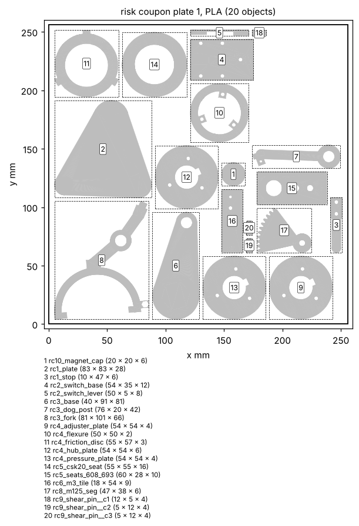
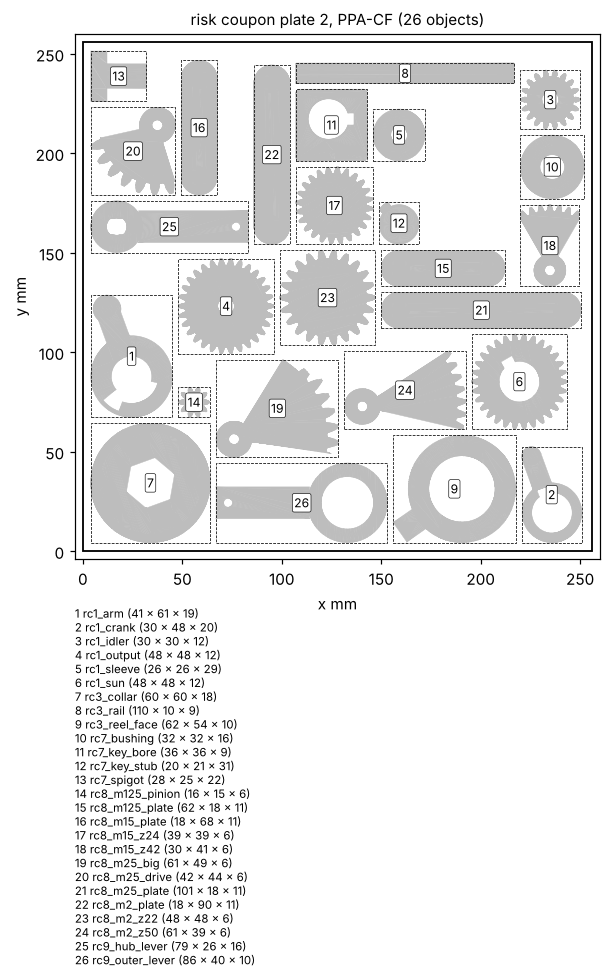
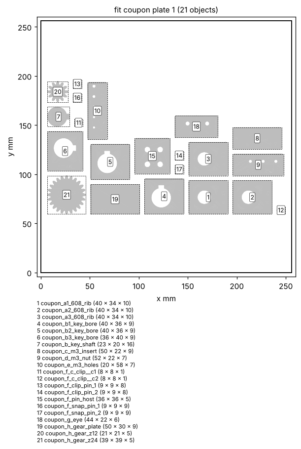
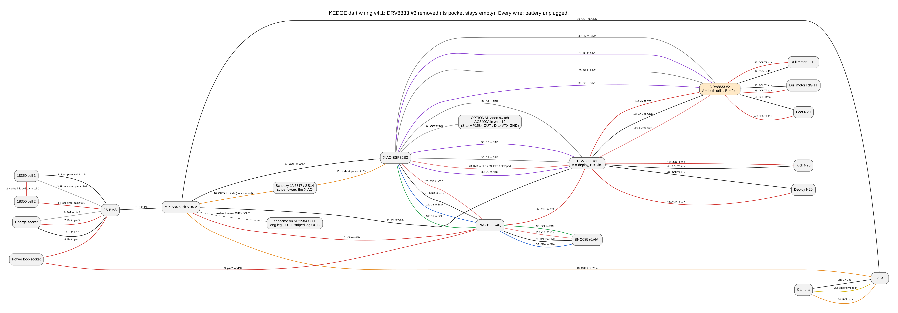
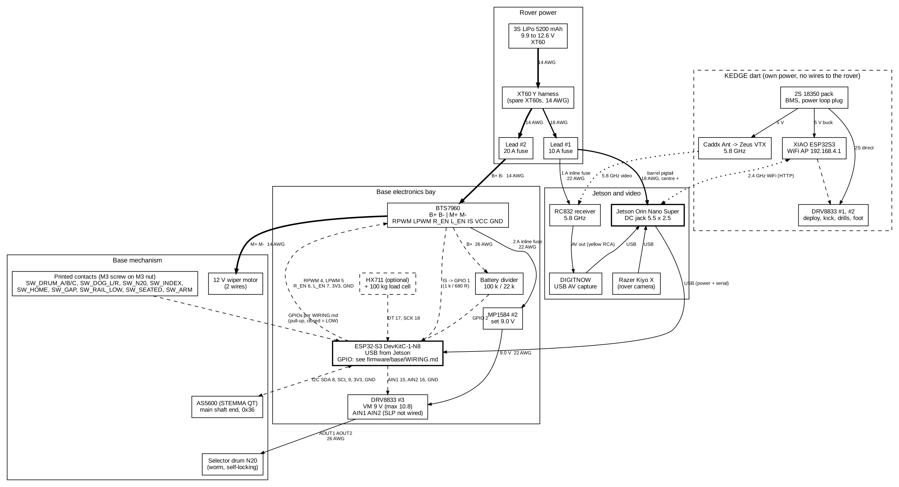

# GrappStar build guide

One guide from parts to first mission: print, wire, flash, calibrate, test. Every hands-on step is in order. Every
wiring step starts with the battery unplugged.


Built 2026-11-03 13:56 Sydney time from commit `043ed77`.


How to use it: read section 1 and 2 first, then work through the "Order of work" list in section 1. Where a section
says "From `some/file.md`", that text comes straight from the repo, so it is always the latest version. Re-build the
guide after any change: `python3 docs/build/make_guide.py`.


*From `docs/build/FIRST_DAY.md`:*

## First session back: what to do, in order

Everything else waits until these are done. The measuring takes an afternoon; the coupons wait for the 608s to arrive.

### 1. Read (15 minutes)

- Build guide sections 1 (what the system is) and 2 (safety).
- The rule for every wiring step: battery unplugged first.

### 2. Measure (1 to 2 hours; caliper, kitchen scale, water bottles, phone camera)

Take a photo of every caliper reading and put them in a new folder `originals/measure_2026-11/` (create it).
Write each number into `docs/build/MEASURE_RESULTS.md` (a fill-in sheet; print it).

1. Wiper motor (MEASURE_LIST A1 to A5, A8): output shaft diameter and flats, end thread and length, the mount hole
   pattern (press the motor face onto paper), the housing size, the boss and hub.
2. Launch springs (B1 to B3), safety glasses on while a loaded spring hangs: free length with a steel rule or
   tape (the spring is longer than a caliper), then hang about 1, 2 and 3 kg of water bottles (weigh each load:
   W1, W2, W3 in kg) from ONE spring and measure hook to hook each time (L1, L2, L3 in mm). Both springs.
   `python3 base/physics/calib.py spring L0 W1:L1 W2:L2 W3:L3` gives the rate and initial tension. Enter the
   weaker spring's numbers.
3. Small parts (H1, H3, H4): drum N20 shaft, CSK20PP keyway depths, BTS7960 heatsink height and hole spacing.
4. Count the parts box (group C): worm N20s (4 needed), the spare MP1584, 8 mm rod or M8 bolts, 693ZZ / F693ZZ left
   after the dart, resistors (2 x 10 k, 1 k, 680 R, 100 k, 22 k), a small magnet for the AS5600, spare XT60s, and
   the coupon extras (MEASURE_LIST C21).
5. Update the design with the numbers (build guide section 14, "After you measure"): the easy way is to open
   Claude Code in the repo, give it MEASURE_RESULTS.md and ask it to enter the numbers in params.py and re-run the
   base pipeline. By hand: the commands are in that section.

### 3. Buy

- 608 bearings, 10 (search "608ZZ bearing 8x22x7").
- Only if not in the box: a small neodymium disc magnet for the AS5600 (6 to 10 mm across, 2 to 3 mm thick, or
  a 6 x 2.5 mm diametric disc).

### 4. Print first (test pieces only)

1. The dart fit coupon (`kedge/pack_v30/fit_coupon.stl`, 20 minutes). Check it against run sheet section 4.
2. The base fit coupon (`base/pack/fit_coupon/coupon_plate_1.3mf`, PLA; checks in its COUPON.md; tile A uses three
   608s) and the two base risk coupon plates (`base/pack/coupons/risk_plate_1_PLA.3mf` PLA, `risk_plate_2_PPA-CF.3mf` PPA-CF: hardened
   nozzle, dry spool) and the test sheet `COUPON_TEST.pdf` (test stage 0). Every check must pass before the big
   base parts. The coupons need a few bought parts (C21) and one each of 608, F693ZZ, 693ZZ and a CSK20PP.
3. The dart plates A and B do not wait for the base coupon or the measurements: start them once the dart fit
   coupon passes.

### 5. Do NOT do yet

- Do not print the big base parts until the coupons pass AND the measurements are in params.py and the pipeline
  has been re-run (the motor adapter, saddle and couplers depend on them).
- Do not connect the LiPo to anything new. No wiring with a battery plugged in, ever.
- Do not fit the launch springs (they go on at test stage 5).
- Do not fire anything. When the time comes: never without the tether tied on.
- Do not plug the dart into the Mac with its power loop plug in.


# 1. What the system is

GrappStar is a rover that can pull itself out of trouble. A launcher on the rover fires a small dart (KEDGE) on a
Dyneema tether. The dart lands, screws itself into the soil, and the rover winches against it. Then the dart lets go
and is reeled home.

Three parts:

- **Rover.** Jetson Orin Nano Super on the rover's 3S LiPo. It runs the mission, the operator web page, and the
  vision (rover camera Razer Kiyo X, and the dart's video through an RC832 receiver and a DIGITNOW USB capture).
- **Base station** (on the rover). ONE 12 V wiper motor drives everything. A sliding dog collar on the main shaft
  couples the wiper to the LAUNCH train, to nothing (NEUTRAL), or to the REEL train. A small N20 motor turns a
  selector drum (like a motorcycle gear drum) through four zones in a fixed order: LAUNCH, NEUTRAL, WRAP, REEL.
  - LAUNCH, wiper forward: draws the spring carriage back (241 mm), fires at the end of the stroke, resets.
  - LAUNCH, wiper backward: tilts the rail between 6 and 47 degrees to aim. A self-locking worm holds the angle.
  - WRAP zone: the collar stays in NEUTRAL while the drum turns a wrap cup 7 times round the capstan.
  - REEL, wiper forward: the capstan (REEL gear 50T to capstan gear 22T, 2.27 times wiper speed) winds in and tows. A one-way bearing stops it ever
    turning out. Tow limit 50 N by default.
  - Take-up: every forward wiper turn also winds the storage reel through a slip clutch, so slack never builds up.
  - Payout at launch: the line skips the capstan and pulls off the free-spinning storage reel against a light
    payout brake (0.5 N; over 1 N costs range).
  - Range: a few metres with the two springs (6 to 47 degrees of pitch). Two springs only in v1 (decision D38).
  - Protection: current trips in the firmware and a printed torque limiter (about 5 N m) in the wiper coupler. Any
    fault: wiper off, drum to NEUTRAL (except when the wraps are on, the spring is drawn or the
    drum itself faulted: then the drum holds, decision D27). A hand lever on the
    drum is the fallback.
  - Brain: an ESP32-S3 DevKitC on USB from the Jetson, with an AS5600 angle sensor on the main shaft and printed
    contact switches (an M3 screw head touching an M3 nut).
- **Dart (KEDGE v30).** 42 mm x 152 mm, its own XIAO ESP32S3, 2S 18350 pack, WiFi access point. After landing a kick
  leg swings over the nose and plants a foot auger, then two drill pods swing down and screw in. A nose camera
  sends analog video at 5.8 GHz.

How they talk: the Jetson talks to the base over USB serial (JSON lines, `firmware/base/PROTOCOL.md`) and to the dart
over WiFi (HTTP at 192.168.4.1, `firmware/dart/API.md`). Video is analog 5.8 GHz into the USB capture.

A mission (the fixed sequence in BASE_SPEC section 10.1): pick a target on the rover camera view; the Jetson looks
up the pitch; the base aims, cocks and fires on your confirmation; the dart video is checked for the landing zone;
the base wraps the capstan at once while the line is still slack (the drum parks at WRAPPED); the dart anchors; the
base tidies the slack, shifts into REEL and tows; the dart releases; the base reels in to about 1.5 m, unwraps, and
brings the dart home on the take-up until it seats; back to LAUNCH.

Range today (from `base/out/ballistics.json`, 0.5 N payout brake, measured from the ground point under the rail pivot): best about 4.3 m at 38.5 degrees, shortest about 2.6 m at 6 degrees, leaving the rail at about 6.9 m/s. These numbers change after the spring and wiper measurements; rebuild the guide.

## Order of work

0. Get the repo onto the Mac (Terminal; if macOS asks to install the command line developer tools for `git`,
   say Install and run the command again): `cd ~ && GIT_LFS_SKIP_SMUDGE=1 git clone https://github.com/HarryHYu/GrappStar.git`
   (skips the 145 MB photo PDF). If `~/GrappStar` then has no `docs/build` folder, run `cd ~/GrappStar && git checkout
   base-v1`. `git pull` updates it later.
1. Measure the wiper motor shaft, mount and housing (section 14, A1 to A5 and A8), the springs (group B), and the
   parts in H1, H3, H4. Put the
   numbers in `base/spec/params.py` and re-run the base pipeline. The base parts that touch the motor depend on
   them. A6 (speed, current) needs the base electronics: do it at step 7. A7 is optional. They change no
   printed part.
2. Confirm the parts box (section 14, group C). The only purchase is 608 bearings (and an AS5600 magnet if none
   is in the box).
3. Print the dart fit coupon, the base fit coupon and the two base risk coupon plates, and test them (section 4, test stage 0). The dart
   plates (section 4) do not wait for the base coupons or the measurements: start them any time after the dart
   fit coupon passes.
4. Flash the dart and build it (sections 6 and 8, and the dart run sheet in the appendix).
5. Set up the Jetson on its own wall supply (section 9, steps 0 to 3 only; its step 4, plugging in the base, comes
   after step 6).
6. Flash the base ESP32 from the Mac (section 8.1). Battery out is enough: any wiring already on the board can stay.
7. Wire the base electronics on the bench, wiper motor clamped in a vice and the drum N20 loose (section 7.2,
   firmware/base/WIRING.md Parts A to D), then bench test them (section 11.1), then calibration parts (a) and (b) (section 10). Measure A6 here.
8. Print the base (section 4, after the coupons pass and the measurements are in) and assemble it with the motor
   and drum N20 (section 5).
9. Put the base on the rover and wire the rover (section 7.1), then do the first power-on of everything together
   (7.1, its part 4).
10. Calibrate (section 10). Commands go to the base from the Jetson from now on (see section 10).
11. Run the staged tests from stage 4 on (section 12; stages 0 to 3 were done in steps 3, 7 and 9).

# 2. Safety

Read this before any hands-on step.

## Electrical

- **Battery unplugged before you touch, add or move any wire.** On the dart that means the power loop plug out. The
  first XIAO died from wiring with the battery live.
- Order for every power-up: USB cables in first, battery last. Power-down: battery out first. A board may stay on
  the Mac's USB while the battery goes in (firmware/base/WIRING.md Part D does this), but never plug the USB in
  while the battery is in.
- Check for shorts with the meter on beep before the first power-on of anything you wired: red to black must not beep.
- The 3S LiPo can deliver over 100 A into a short. Keep the 20 A and 10 A fuses in their leads. Never bypass them.
- LiPo care: charge on the iMax B6 in balance mode at 1C (5.2 A) or less, on a non-flammable surface (tile,
  concrete, a LiPo bag), never unattended and never overnight. Recharge when the pack reads 3.6 V per cell at rest
  (10.8 V); never run it below 3.3 V per cell under load (9.9 V).
- LiPo storage: if it will sit for more than a few days, use the B6 "storage" mode (3.8 V per cell), keep it in a
  LiPo bag or metal box, away from heat (never in a hot car). A puffed, dented or hot pack: stop, put it outside on
  concrete, then to battery recycling. Never puncture or short one.
- 18350 cells: never let both cells touch metal at the same time. Charge out of the dart in the XTAR MC2, or through
  the tail balance socket with the loop plug out: on the B6 choose Li-ion (LiIo) 2S balance, 1.0 A or less (not the
  LiPo 3S program). Check each cell's direction against the marks in the cell bay and meter the pack (7.2 to 8.4 V)
  before the loop plug goes in. Look the cells over after a hard landing; a dented cell is scrapped.
- Setting a buck on the live LiPo (dart step 3, base WIRING Part A): use clip leads or insulate every free lead end
  first, so nothing loose can touch.
- Never connect the DRV8833 motor supply (VM) to the LiPo directly: 10.8 V maximum. It runs from the 9.0 V buck.
- The dart VTX must have its antenna on before it is powered.

## Mechanical

- The wiper motor is strong (about 15 N m) and self-locking. Hands out of the gears, drum and rail while the battery
  is plugged in.
- **Stopping (the same everywhere):** 1. send `estop` (or the STOP button on the operator page). 2. If anything
  still moves, pull lead #2's XT60: both motors lose power, the Jetson stays up. Keep that plug within arm's reach
  whenever the base is powered; it is the physical kill switch. 3. Only then the main battery plug.
- **Cutting power freezes stored energy, it does not release it.** Both worms self-lock, so a drawn spring and a
  line under tension stay loaded with the power off. The dart has its own battery.
- **Before you walk up to the base or the dart** (to measure a range, fetch the dart, or touch anything): `estop`;
  lead #2 out; telemetry shows `cock` 0 and `H` (SW_HOME) closed; the line is slack (no tension); the dart reads
  IDLE on the operator page, or its loop plug is out. If the carriage is drawn and `decock` fails: (1) `clear` the fault and send `{"cmd":"mode","to":"LAUNCH"}` if the drum
  is not in LAUNCH, then `decock` again; (2) if it replies `SWITCH_DISAGREE` and you can SEE the carriage is drawn back,
  `{"cmd":"decock","force":true}` (it runs back by the travel the saved angle needs; it trusts you); (3) if the firmware cannot run the wiper at all, unload by hand:
  battery out (the worm holds the spring where it is), safety glasses on, spring guard on, stand to the side, and
  unhook ONE spring at a time from its anchor pin with a hook tool (a bent coat-hanger wire or a long screwdriver
  through the hook), never with fingers in the hook. Then the carriage is slack and safe. Afterwards, with the
  carriage home: `{"cmd":"cal","what":"cock_rest"}`, then `aim` again before any shot.
- Never use the hand lever while the carriage is drawn (`cock` above 0 or `SW_HOME` open) or while the line is under tension: shifting under load can dry fire the launcher or drop the line. De-cock and slacken the line first.
- The launch springs store energy. Cocked carriage = loaded. Never put a hand in front of the rail or the carriage.
  To unload a cocked base without firing, see troubleshooting. The spring hooks have little margin at full draw
  (about 40 N each at full cock against the 38.4 N rating of the Century C-243, decision D30, until the
  springs are measured): during shots stand beside the base,
  not behind or in front of the springs, and fit the printed spring guard if the pack has one. After B2, if the
  force at full cock is over the rating, use the fallback hole set (MEASURE_LIST B4).
- **Line under tension:** the capstan never turns back (one-way bearing), so a towing line cannot be let off at the
  base. During any pull (hand test or tow) stand beside or behind the rover, never in line with the dart, glasses
  on. To slacken it, release the dart (`release`) or drive the rover toward the dart. Calibrate the current-to-
  tension number (MEASURE_LIST G9) before any tow: the shipped value lets the line reach about twice the limit.
- Chock or brake the rover during every shot and every tow. Strap the LiPo down under a cover on the rover.
- **Picking up a landed dart:** send dart STOP, check it reads IDLE (an armed dart can start anchoring when moved),
  then pull its loop plug before you touch it.
- The dart is 279 g leaving the rail at about 7 m/s: about 7 J, like a hard-thrown cricket ball, with sharp augers.
  From the first spring test on: safety glasses on, nobody in front of the rail or within 2 m to either side, and
  the area in front clear for 30 m (four times the longest expected range, for a misfire at a wrong pitch).
- Before every shot: look along the rail, call "firing" out loud, keep hands off the rail and carriage.
- A cocked carriage stays loaded until it fires or is de-cocked (`cal decock`). Treat the base as loaded whenever
  `cock` in telemetry is above 0.
- **Never fire a dart, dummy or real, without the tether tied on.** The tether keeps it nose first; without it the
  dart can tumble or come down tail first.
- Augers and drills are sharp and turn with force. Hold the dart by the hull, never near a pod or the foot.
- Soldering: iron on its stand, fan on for fumes, 3 s at most per joint near PLA. Heat gun on low, no lighter near PLA.

# 3. Parts

Everything below is already in hand except the 608 bearings (and possibly the AS5600 magnet). Section 14 group C lists the items to confirm by
looking in the box.

## The only purchase: 608 bearings

- Search: "608ZZ bearing 8x22x7" (or "608-2RS", sealed). Buy 10. Skateboard bearings are 608s and fine.
- Specs: 8 mm bore, 22 mm outside, 7 mm wide, rated well over 10,000 rpm.
- Uses: the base CAD uses 5 (storage reel and aim pedestal); the coupons borrow some for testing; the rest are spares. Axles: M8 bolt or 8 mm rod (check the box).

## Possible extra purchases

- **AS5600 magnet** (optional): the Adafruit board does not include one. The magnet cap takes any small neodymium
  disc (6 to 10 mm across, 2 to 3 mm thick) mounted edge-on, or a 6 x 2.5 mm diametric disc. Look in the box first
  (old speakers, fridge magnets with a neodymium disc). Without a magnet the firmware has a less precise fallback (decision D12):
  a printed 6-bump index cam read by the contact SW_INDEX on GPIO35, switched on in firmware/base config.h.
- Not a purchase: a second pair of launch springs. The CAD has holes for them, but the drive train is not rated
  for four springs (decision D38). v1 uses the two springs you have.

## Base station and rover

| Part | Qty | Note |
|---|---|---|
| 12 V wiper motor, self-locking worm | 1 | Rebuilt to 2 wires, park linkage removed. Measure it first (section 14 A) |
| BTS7960 motor driver module | 1 | Drives the wiper |
| ESP32-S3 DevKitC-1-N8 | 1 | Base brain, USB to the Jetson |
| Adafruit AS5600 (STEMMA QT) | 1 | Main shaft angle. Needs a small magnet (see above) |
| DRV8833 carrier | 1 | DRV8833 #3, freed from the dart by the new dart pin map |
| MP1584 buck | 1 | MP1584 #2 from the dart build, set to 9.0 V |
| N20 right-angle worm motor | 1 | Selector drum (count your N20s: section 14 C3) |
| 693ZZ / F693ZZ bearings | as many as are left after the dart | Line pulleys (the dart uses 5 F693ZZ; count what is left, section 14 C20) |
| CSK20PP one-way bearings (20 x 47 x 14) | 2 | #1 spring cock and fire, #2 capstan backstop |
| Century 16 x 165.1 x 1.4 mm extension springs | 2 | Launch springs (Bunnings 0487961). Measure them (section 14 B) |
| 608 bearings | 10 | The purchase |
| Dyneema braid 150 lb, 1 mm | 20 m | Tether |
| 100 kg load cell + HX711 | 1 | Optional line tension |
| 3S LiPo 5200 mAh (Zeee), iMax B6 charger | 1 | Rover battery |
| XT60 lead #1 (10 A fuse), lead #2 (20 A fuse), spare XT60s, fuse holder | | Lead #2 feeds the wiper; build the Y harness from spares |
| Barrel plug lead 5.5 x 2.5 mm | 1 | Jetson from the LiPo |
| Jetson Orin Nano Super | 1 | |
| Lockmaner RC832 receiver, DIGITNOW USB capture, RCA lead | 1 each | Dart video in |
| Razer Kiyo X | 1 | Rover camera |
| Resistors 10 k x 2, 1 k, 680 R, 100 k, 22 k | | Pull-downs and dividers (firmware/base/WIRING.md) |
| M3 screws, M3 nuts, M3 brass heat-set inserts | | Frame joints and printed contacts |
| Dupont jumpers, 14 / 18 / 22 / 26 AWG wire, heat shrink | | |

## Dart (KEDGE v30)

The full dart list with quantities is in the dart run sheet, section 2 (appendix). In short: XIAO ESP32S3, 2 x
DRV8833 (the third goes to the base), INA219, BNO085, MP1584 #1 (5.04 V), OTOTEC 2S BMS, 2 x 18350 cells, 3 worm
N20s (kick, deploy, foot), 2 drill gearmotors, 5 x F693ZZ, Caddx Ant, Zeus VTX and antenna, JST-XH sockets,
Schottky diode, capacitor, M3 hardware, 15 g nose ballast.

## Tools

Drill with 3 mm and 3.4 mm bits and a deburring tool (rover deck holes), an M3 heat-set insert tip for the
soldering iron, a 13 mm socket with a 1/4 inch driver (coupler M8 nut). Soldering iron and solder, flux, multimeter, wire strippers, flush cutters, small flat screwdriver (MP1584 trimmer),
heat shrink and heat gun, caliper, hex keys, tweezers, kitchen scale, luggage scale, tape measure, safety glasses,
5-minute epoxy, threadlocker, zip ties, foam tape.

## Base bill of materials (from the model)


> NOT IN THE REPO YET: `base/out/base/BOM.md` (written by cad-infra (assembly pipeline)). Re-run `python3 docs/build/make_guide.py` after it lands and this section fills in.


# 4. Printing

Printer: Bambu X2D (bed 256 x 256 x 260 mm). PLA for everything except loaded gears and keyed shafts, which are
PPA-CF (the print list says which).

Magnet for the bench: the AS5600 magnet cap is coupon 10 on the PLA risk plate
(`base/pack/coupons/rc10_magnet_cap.stl`); glue the magnet in it, so the bench test (order of work step 7) can use it on the clamped motor's shaft end; or, for the
bench only, tape the magnet centred on the shaft end and clamp the AS5600 board 1 to 2 mm from it. `status`
must show `"magnet":"OK"` (WEAK: move the board closer; STRONG: further; NONE: no magnet seen).

Print settings (the 3MF files carry geometry only: set material and settings in Bambu Studio for each plate):

| Plate | Material | Layer | Walls | Infill | Top / bottom | Hole compensation |
|---|---|---|---|---|---|---|
| Dart fit coupon, dart plates A and B | PLA | 0.16 mm | 4 | 40% gyroid | 5 / 5 | start at 0; adjust from the dart fit coupon (run sheet section 4) |
| Base fit coupon, risk plate 1 | PLA | 0.2 mm | 4 | 40% gyroid | 5 / 5 | 0 ("print as exported") |
| Risk plate 2 | PPA-CF | 0.2 mm | 6 | 60% gyroid | 6 / 6 | 0 |
| Base plates, PLA | PLA | 0.2 mm | 4 | 40% gyroid | 5 / 5 | 0, unless the coupons showed a fit off |
| Base plates, PPA-CF | PPA-CF | 0.2 mm | 6 | 60% gyroid | 6 / 6 | 0, unless the coupons showed a fit off |

No supports on any plate. The base print sheet (below) has the final word for each part.

Hole compensation is a process setting in Bambu Studio, "X-Y hole compensation" (Process, Quality tab; the name may
move between versions). It is saved with each project, so check it on every plate.

PPA-CF (risk plate 2 and the loaded base parts): hardened steel nozzle only (CF wears a brass nozzle quickly).
Dry the spool first (about 80 C for 8 hours in a filament dryer, or the printer's own drying if it has one; it
absorbs water and prints weak and stringy otherwise). Use the Bambu PPA-CF profile for temperatures. Print with the
room ventilated, and wear a dust mask when sanding or trimming CF parts.

Order: dart fit coupon first (20 minutes, checks your printer's hole sizes), then the base fit coupon
(`base/pack/fit_coupon/coupon_plate_1.3mf`, PLA) and the two base risk coupon plates (below, test stage 0), then the dart plates, then the base once the coupons pass and the wiper and spring numbers
are in (section 1, order of work).

## Day-one risk coupons (print before any big part)

Two plates from the base print pack with small test pieces of the riskiest features: swing splitter, printed
contact, dog clutch, slip clutch, bearing seats, heat-set inserts and nut traps, key rib, gear meshes, shear pin.
Print them, then work through the test sheet. Do not print the big base parts until every coupon passes.

Plates: `base/pack/coupons/risk_plate_1_PLA.3mf` (PLA, 19 pieces) and `risk_plate_2_PPA-CF.3mf` (PPA-CF, 26 pieces). Each
piece is also there on its own (`base/pack/coupons/rcN_*.stl`) for a reprint. A printable copy of the test sheet is
`base/pack/coupons/COUPON_TEST.pdf`. The coupons need a few bought parts (MEASURE_LIST C21): M3 screws and a jam
nut, heat-set inserts, one each of 608ZZ, F693ZZ and 693ZZ, a CSK20PP.
Take the CSK20PP and bearings back out of the coupons after testing: they go into the base.

If a coupon fails: write down which test and what you saw, and do not change the CAD yourself. The sheet names the
design numbers to change; give the result to a Claude Code session in the repo and ask it to change them and re-run
the coupons (in `base/`: `../kedge/.venv/bin/python -m tools.risk_coupon`, after `bash kedge/setup_mac.sh` once from the repo
root).
Then reprint only that piece from its `rcN_*.stl`.







*From `base/pack/coupons/COUPON_TEST.md`:*

### Day-one risk coupons: test sheet

Print these before the big parts. Each coupon is made from the same geometry functions and numbers as the real part, so a pass here is a pass there. Let parts cool 10 minutes before testing. The fit coupon (tolerance tiles A to H, base/pack/fit_coupon/COUPON.md) is printed alongside.

#### Settings

PLA: 0.4 mm nozzle, 0.2 mm layers, 4 walls, 40 % gyroid infill unless noted, 5 top and 5 bottom layers, hole and XY compensation 0, no supports. PPA-CF: hardened steel nozzle (never brass), filament dried (80 C, 8 h) and fed from a dry box, 0.2 mm layers, 6 walls, 60 % gyroid infill, 6 top and 6 bottom layers, hole and XY compensation 0, no supports. The 3MF files carry geometry only: set the material and these settings in Bambu Studio.

#### If a coupon fails

To change a number: on the Mac, after bash kedge/setup_mac.sh (from the repo root), cd base and run ../kedge/.venv/bin/python -m tools.risk_coupon (it rewrites base/pack/coupons and base/pack/fit_coupon). Easier: give the failing result to a Claude session and let it change the numbers. Change one number at a time and reprint only that coupon.

#### Plates

| plate | material | objects |
|---|---|---|
| risk_plate_1_PLA.3mf | PLA | 20 |
| risk_plate_2_PPA-CF.3mf | PPA-CF | 26 |

#### Tests

##### 1. Swing-arm direction splitter

- Parts: rc1_plate, rc1_sleeve, rc1_sun, rc1_arm, rc1_idler, rc1_output, rc1_crank, rc1_stop
- Bought: O-ring 20 x 1.5 (arm hub groove), e-clip for the d8 arm pin, 2 x M3x16
- Do: O-ring into the arm hub groove. On the plate: sleeve on the centre pin, sun on its rib, arm on the sleeve above the sun with its pin down through the idler, e-clip on the pin, output on its pin, crank on top, stop finger on the column (2 x M3x16). Turn the crank 10 turns each way.
- Pass: Clockwise seen from above: the arm swings the idler into the output at once and the output turns, no skipped teeth. Anticlockwise: the arm swings out to the finger within about 20 deg of crank, the idler runs free and the output stays still. No jam at engagement.
- If it fails, change: launch_aim.py: FIT (pin and bore play), arm_solid O-ring groove (drag), A() alpha_d = alpha_e + 20 (swing out), _stop_post_xy; launch_gears.py center_distance extra / spur backlash (mesh).
- Made from: launch_aim.sun_solid, arm_solid, idler_solid (m1.5 z30/18/30, face 8, FIT 0.35), launch_gears.spur for the output, launch_aim.A: centre distances 36.10 / 36.10, output at (11.7, 68.4), engaged arm 96.2 deg, stop 116.2 deg (launch_aim._stop_post_xy), sleeve rib launch.RIB_W 6 / RIB_R 12.8

##### 2. Printed contact switch

- Parts: rc2_switch_base, rc2_switch_lever
- Bought: M3x10 SHCS ISO 4762 + M3 jam nut, M3 nut, 2x M3x10 self tapping (pan or SHCS) through the lever root into the pad, at most M3x11.7, 2 wires, multimeter
- Do: Nut into the pillar trap (drop of glue), lever clamped with 2 M3 self tappers, contact screw head down through the lever, set the head 0.9 mm above the nut (0.5 mm per turn), lock the jam nut. Meter on beep between screw and nut. Press the lever tip 100 times.
- Pass: Measure the tip travel with calipers (depth rod from the lever tip down to the base top, note the reading at rest, press until it beeps, read again): beep within 0.8 to 1.4 mm of tip travel (design 1.14), silent when let go, tip stops on the hard stop without cracking, lever back flat, same after 100 presses.
- If it fails, change: cad/lib/switch.py contact_switch args travel, overtravel, t, b; STRAIN_LIMIT, NUT_PRESS (loose nut), SCREW_LENGTHS.
- Made from: cad.lib.switch.contact_switch(lever_len=36) with the library defaults (travel 0.8, overtravel 0.6, beam t 1.6): gap 0.91, pretravel at the tip 1.14, close force 0.83 N, strain 0.0061

##### 3. Dog clutch and compliant fork

- Parts: rc3_base, rc3_reel_face, rc3_collar, rc3_fork, rc3_dog_post, rc3_rail
- Bought: M3 nut (yoke tab), 2 x M3x12 (SW_DOG screws in the post), 1 x M3 (post clamp), multimeter
- Do: Press the rail into the base. REEL face on the journal (dogs up), collar on the hex (dogs down), fork pads in the collar groove and its sleeve on the rail, dog post clamped on the rail below the fork, SW_DOG screws in the post set 0.5 mm short of the tab nut at full engagement. Push the fork 7 mm down with the dogs tip to tip, then turn the REEL face until they drop in. Turn the face hard both ways, then pull the fork back. Meter on beep between the lower screw and the tab nut.
- Pass: Yoke flexes when tip to tip (no jam, roofs slide off), dogs drop in within a quarter turn, under hand torque the dogs pull in, never walk out, a light pull on the fork releases them, the yoke springs back flat; the meter beeps only with the dogs fully in, never tip to tip.
- If it fails, change: _drum_kin.py DEFAULTS dog_backcut, dog_roof, dog_deg, dog_gap, fork_k; drum.py GEOM fork_t, yoke_r, groove, dog_touch, dogpost_s; fits.py SHAFT_IN_BORE (collar on the hex, face on the journal), HOLE_SLIDE (fork on the rail).
- Made from: drum.dog_teeth (dog_n 4, dog_h 5, dog_deg 36, backcut 4, roof 1.2, r 18..26), drum.fork, drum.dog_post (dog_touch 0.5), drum.rail, drum.hexprism, GEOM journal d30, groove (82.0, 88.0), stroke 7, neutral gap 2.5

##### 4. Face slip clutch with the flexure spring

- Parts: rc4_hub_plate, rc4_friction_disc, rc4_pressure_plate, rc4_flexure, rc4_adjuster_plate
- Bought: 3 x M3x20 SHCS, 3 x M3 nut, string, coins in a small bag, kitchen scale
- Do: Stack on the key stub: hub plate (counterbores down), friction disc, pressure plate (pads up), flexure (beam down, tabs on the screws), adjuster plate (traps up); 3 screws from below, nuts on top. Run the nuts down until the flexure just touches (zero), then turn all 3 nuts the same, 1/4 turn (0.125 mm) at a time. Clamp the stub level in a vice, tie a string to a disc lug (r 28.5 mm), lay it over the rim and hang a bag of coins weighed on a kitchen scale. Add or take coins to find the hold and slip weights at each setting.
- Pass: At each setting the lower weight must not pull the disc round and the higher one must (smooth steady slip, no judder); same result 3 times; the flexure never bottoms before 1 turn. Bands: 1/4 turn: 35 g holds, 60 g slips (design 48 g, 0.013 N m); 1/2 turn: 70 g holds, 120 g slips (design 95 g, 0.027 N m); 3/4 turn: 105 g holds, 180 g slips (design 143 g, 0.040 N m); 1 turn: 140 g holds, 240 g slips (design 190 g, 0.053 N m).
- If it fails, change: cad/lib/clutch.py: slip_clutch args flex_t, flex_gap, flex_ro, r_in, r_out, n_grooves; MU_PLA_PLA, E_PLA, SIGMA_FLEX_PLA_SUSTAINED (creep: if the torque falls overnight).
- Made from: cad.lib.clutch.slip_clutch() defaults (reel does not use it: its clutch is the spool face plus the PETG rocker): shaft d20 key 6, friction r 18.5..27, mu 0.3, flexure t 0.8 gap 0.5, 0.106 N m per mm, travel 0.50; on the shared keyed stub of coupon 7

##### 5. Bearing seats

- Parts: rc5_seats_608_693, rc5_csk20_seat
- Bought: 608ZZ, F693ZZ, 693ZZ, CSK20PP
- Do: Press each bearing in square with a flat block or a vice (tile left to right: 608, F693ZZ, 693ZZ); CSK20PP into the round boss with its outer keyway on the printed key.
- Pass: Firm press, seated flat on the lip, stays in when tapped upside down, spins as freely as before; the CSK20PP key slides in without force, it still freewheels one way and locks the other.
- If it fails, change: fits.py BRG_RIB_INTERF, BRG_RIB_BORE (all seats); bearings.py CSK20_KEY_RCLEAR, CSK20_OKEY_W (key), KEY_CLEAR in fits.py. If the 608 is off, print tile A of the fit coupon (base/pack/fit_coupon, COUPON.md).
- Made from: cad.lib.bearings.seat_608(bottom lip, lip_d 14) as reel, seat_f693(), seat_693(), seat_csk20(key_deg 90) as the reel capstan block (wall 4); fits BRG_RIB_INTERF 0.15, BRG_RIB_BORE 0.3, CSK20_KEY_RCLEAR 0.2

##### 6. M3 holes

- Parts: rc6_m3_tile
- Bought: M3x4x5 heat-set insert, M3 nut, 2 x M3x10
- Do: Left to right: heat-set the insert (220 C), press the nut in, push a screw through, self-tap a screw in.
- Pass: Insert flush and does not spin when the screw is tightened; nut presses in and holds; screw drops through the clearance hole; the tap hole cuts a thread and holds a hard pull without splitting.
- If it fails, change: fits.py M3_INSERT_D, M3_NUT_AF, M3_CLEAR_D, M3_TAP_D (tiles C, D, E of the fit coupon in base/pack/fit_coupon bracket them).
- Made from: cad.lib.fasteners.m3_insert (d 4.0), m3_nut_trap (AF 5.8), m3_clear (d 3.4), m3_tap (d 2.6)

##### 7. Key rib and spigot

- Parts: rc7_key_stub, rc7_key_bore, rc7_spigot, rc7_bushing
- Bought: CSK20PP from coupon 5 (inner keyway)
- Do: Slide the key stub into the keyed tile and into the CSK20PP inner race (the real interface). Push the spigot into the sleeve slice and turn it.
- Pass: Stub slides in by hand, key in the keyway, no visible rock. Play: clamp the tile, tape a ruler to the stub end, mark the ruler 60 mm from the axis, rock the stub both ways: the mark moves under 1 mm (about 1 deg). The spigot turns freely; rocked at its free end it moves under 0.5 mm.
- If it fails, change: fits.py KEY_CLEAR, SHAFT_IN_BORE; shafts.py KEY20_H, SHAFT_PRINT_UNDERSIZE; launch.py SPIGOT_BORE (now 12.35); drum.py GEOM spig_d.
- Made from: cad.lib.shafts.keyed_shaft(d 20, key_w 6, key_h 2.6) and keyed_bore (clear 0.3); drum.main_shaft (spig_d 12); launch.sleeve_solid (SPIGOT_BORE 12.35)

##### 8. Gear meshes m1.25, m1.5, m2, m2.5

- Parts: rc8_m125_plate, rc8_m125_seg, rc8_m125_pinion, rc8_m15_plate, rc8_m15_z42, rc8_m15_z24, rc8_m2_plate, rc8_m2_z50, rc8_m2_z22, rc8_m25_plate, rc8_m25_big, rc8_m25_drive
- Bought: none
- Do: Each pair on its plate (label = module), flat faces down; turn or rock through every tooth.
- Pass: Smooth, no tight spot, a little play when rocked; m2.5: the tall tooth and the cut-down last tooth pass without catching, then the mesh lets go at the gap.
- If it fails, change: fits.py GEAR_BACKLASH, GEAR_CENTER_EXTRA (m1.25, m1.5, m2); launch_gears.py center_distance extra, spur backlash, sector_gear_2d tall_factor (m2.5); _drum_kin.py pin_x (m1.25 pinion).
- Made from: m1.25: gears.spur_gear z60 sector / z10 shift 0.4 tip_short 0.08 (drum.tip_short_for), cd 44.33 (drum.a_seg); m1.5: gears.spur_gear z42 sector / z24, cd 49.60; m2: gears.spur_gear z50 sector (drum GEOM out_m, out_z) / z22 (reel Z_CAPG), cd 72.10; m2.5: launch_gears.sector_gear_2d z40 (n_present 27, last 6 + gap) / launch_gears.spur z26, cd 82.60 (launch L); coupon face 6, fits GEAR_BACKLASH 0.15, GEAR_CENTER_EXTRA 0.1

##### 9. Shear-pin torque limiter

- Parts: rc9_hub_lever, rc9_outer_lever, rc9_shear_pin x3
- Bought: string or a strap, luggage scale
- Do: Hub slice into the outer slice, pin through both holes (head outside). Clamp the hub lever, hang the luggage scale on the outer lever hole (r 60 mm) at right angles and pull slowly until the pin shears. Break all 3 pins. Torque = kg x 9.81 x 0.06 N m.
- Pass: Each pin shears cleanly between 5.9 and 10.2 kg on the scale (3.5 to 6 N m, drum_NOTES; design 4.9 N m = 8.3 kg), the 3 pins within 20 percent of each other, both slices undamaged (holes still round); a fresh pin goes in by hand.
- If it fails, change: drum.py GEOM shear_d (torque goes with d squared), hub_od (radius), shear_s; fits for the hole: drum.coupler shear hole (shear_d + 0.1) and shear_pin (shear_d - 0.04). Spec D8 / D26 limit 5 N m.
- Made from: drum.coupler_hub and drum.coupler (sliced s 4..20), drum.shear_pin: d4 PLA in single shear at r 13 (shear_s 9); 4.9 N m at 30 MPa

##### 10. AS5600 magnet cap (bench test)

- Parts: rc10_magnet_cap
- Bought: 6 x 2.5 mm diametric magnet (comes with the AS5600 board), M3x6, superglue
- Do: Glue the magnet into the end pocket (flush, any way round), push the cap on the shaft end (flat to the flat), M3x6 onto the flat. For the bench: AS5600 chip on the shaft axis, 1 to 2 mm from the magnet face.
- Pass: Cap does not wobble or slip on the shaft; the AS5600 angle follows the shaft smoothly through full turns (no jumps), magnet status OK (not too weak, not too strong) at 1 to 2 mm.
- If it fails, change: drum.py GEOM cap_s, spig_d; magnet_holder pocket d6.2 x 2.6 (magnet loose or tight); fits.py HOLE_SLIDE (cap on the spigot).
- Made from: drum.magnet_holder (spig_d 12 with its flat, cap_s (195.0, 201.5), magnet pocket d6.2 x 2.6), printed as drum prints it

#### Parts

| part | material | qty | print bbox mm | what |
|---|---|---|---|---|
| rc1_plate | PLA | 1 | 83.3 x 83.2 x 28.3 | Splitter base: centre pin d8, output pin d8, stop finger column (2 x M3 tap) |
| rc1_sleeve | PPA-CF | 1 | 26.0 x 26.0 x 24.5 | Sleeve stub d20 with the integral key rib (launch.RIB_W, RIB_R) under the sun and the crank |
| rc1_sun | PPA-CF | 1 | 47.8 x 48.0 x 8.0 | launch_aim.sun_solid: sun m1.5 z30 as built |
| rc1_arm | PPA-CF | 1 | 57.9 x 32.3 x 14.0 | launch_aim.arm_solid: swing arm as built (O-ring groove, d8 pin, clip groove) |
| rc1_idler | PPA-CF | 1 | 30.0 x 29.7 x 8.0 | launch_aim.idler_solid: idler m1.5 z18 as built |
| rc1_output | PPA-CF | 1 | 47.8 x 48.0 x 8.0 | Output m1.5 z30 (launch_gears.spur, face 8) on a d8 pin |
| rc1_crank | PPA-CF | 1 | 48.2 x 30.3 x 20.0 | Hand crank, keyed on the sleeve rib like the sun |
| rc1_stop | PLA | 1 | 47.1 x 10.0 x 6.4 | Stop finger: rounded end at the as-built stop post position |
| rc2_switch_base | PLA | 1 | 54.0 x 35.0 x 11.5 | contact_switch base: pad, nut pillar, hard stop, wire channel |
| rc2_switch_lever | PLA | 1 | 50.0 x 5.0 x 8.0 | contact_switch lever, printed on its side (Y up) |
| rc3_base | PLA | 1 | 40.0 x 91.5 x 80.7 | Base: d30 journal (REEL sleeve) and hex 22 AF (main shaft), rail hole (press) |
| rc3_reel_face | PPA-CF | 1 | 61.6 x 54.0 x 9.5 | REEL gear dog face (drum.dog_teeth, phase 45) with a handle |
| rc3_collar | PPA-CF | 1 | 60.0 x 60.0 x 18.0 | Collar lower half: drum.dog_teeth facing down, fork groove, hex bore |
| rc3_fork | PLA | 1 | 80.9 x 100.8 x 66.0 | drum.fork as built: compliant yoke, rail sleeve, follower pin, M3 nut in the tab |
| rc3_dog_post | PLA | 1 | 20.0 x 75.5 x 41.7 | drum.dog_post as built: SW_DOG_L / SW_DOG_R screw bosses, clamps on the rail |
| rc3_rail | PPA-CF | 1 | 93.2 x 10.0 x 9.0 | drum.rail profile d10 with the print flat, cut to 93 long |
| rc4_hub_plate | PLA | 1 | 54.0 x 54.0 x 6.0 | clutch.slip_clutch hub_plate (library defaults) |
| rc4_friction_disc | PLA | 1 | 57.0 x 55.0 x 3.0 | clutch.slip_clutch friction_disc (library defaults) |
| rc4_pressure_plate | PLA | 1 | 54.0 x 54.0 x 3.5 | clutch.slip_clutch pressure_plate (library defaults) |
| rc4_flexure | PLA | 1 | 50.0 x 50.0 x 1.7 | clutch.slip_clutch flexure (library defaults) |
| rc4_adjuster_plate | PLA | 1 | 54.0 x 54.0 x 4.0 | clutch.slip_clutch adjuster_plate (library defaults) |
| rc5_seats_608_693 | PLA | 1 | 60.0 x 28.0 x 9.6 | 608 (reel spool seat), F693ZZ and 693ZZ crush-rib seats |
| rc5_csk20_seat | PLA | 1 | 55.3 x 55.3 x 16.0 | CSK20PP seat with the printed key (reel capstan block, key_deg 90) |
| rc6_m3_tile | PLA | 1 | 54.0 x 18.0 x 8.6 | M3 heat-set hole, nut trap, clearance and tap holes (fits.py values) |
| rc7_key_stub | PPA-CF | 1 | 21.2 x 20.0 x 31.0 | shafts.keyed_shaft d20 key 6 (reel capstan tube numbers), 31 long, also the coupon 4 clutch shaft |
| rc7_key_bore | PPA-CF | 1 | 36.0 x 36.0 x 8.6 | shafts.keyed_bore d20 key 6, 8 long (keyed hubs on the sleeve rib are PPA-CF) |
| rc7_spigot | PPA-CF | 1 | 28.0 x 25.4 x 22.0 | drum.main_shaft slice: hex 8 long + d12 spigot 20 long, on a hex flat |
| rc7_bushing | PPA-CF | 1 | 32.0 x 32.0 x 16.0 | launch.sleeve_solid slice 16 long: spigot bore d12.35 |
| rc8_m125_plate | PPA-CF | 1 | 62.3 x 18.0 x 11.0 | Pins at 44.33 |
| rc8_m125_seg | PLA | 1 | 38.1 x 46.7 x 6.0 | drum segment gear m1.25 z60 sector |
| rc8_m125_pinion | PPA-CF | 1 | 15.8 x 15.2 x 6.0 | drum wrap pinion m1.25 z10 x0.4 tip_short 0.08 |
| rc8_m15_plate | PPA-CF | 1 | 67.6 x 18.0 x 11.0 | Pins at 49.60 |
| rc8_m15_z42 | PPA-CF | 1 | 41.0 x 29.6 x 6.0 | drum wrap idler output m1.5 z42 sector |
| rc8_m15_z24 | PPA-CF | 1 | 38.9 x 38.9 x 6.0 | reel cup ring gear m1.5 z24 |
| rc8_m2_plate | PPA-CF | 1 | 90.1 x 18.0 x 11.0 | Pins at 72.10 |
| rc8_m2_z50 | PPA-CF | 1 | 61.0 x 39.3 x 6.0 | drum REEL output m2 z50 sector |
| rc8_m2_z22 | PPA-CF | 1 | 48.0 x 47.7 x 6.0 | reel capstan gear m2 z22 |
| rc8_m25_plate | PPA-CF | 1 | 100.6 x 18.0 x 11.0 | Pins at 82.60 |
| rc8_m25_big | PPA-CF | 1 | 61.5 x 49.0 x 6.0 | launch big gear m2.5 z40 sector: teeth 21..26 (tall, relieved) |
| rc8_m25_drive | PPA-CF | 1 | 42.5 x 44.0 x 6.0 | launch drive gear m2.5 z26 sector |
| rc9_hub_lever | PPA-CF | 1 | 79.0 x 26.0 x 16.0 | drum.coupler_hub slice (shear pin hole) with a lever, string hole at r 60 |
| rc9_outer_lever | PPA-CF | 1 | 86.6 x 45.0 x 10.0 | drum.coupler slice (shear pin hole) with a lever, string hole at r 60 |
| rc9_shear_pin | PLA | 3 | 12.1 x 5.0 x 4.1 | drum.shear_pin as built (d4 PLA), lying on its flat as drum prints it |
| rc10_magnet_cap | PLA | 1 | 20.0 x 20.0 x 6.5 | drum.magnet_holder as built: AS5600 magnet cap on the d12 spigot end |


### Base fit coupon





*From `base/pack/fit_coupon/COUPON.md`:*

#### Fit coupon

Print this set FIRST, before any real part. Each tile tells you one number in `base/cad/lib/fits.py`.
Print everything in PLA with your normal profile (0.4 nozzle, 0.2 layers, 4 walls), flat as exported, no
supports. Let the parts cool fully (10 minutes) before testing. The first character of every label is the
tile letter below; the rest is the value that tile was made with.

How to change a fit: open `base/cad/lib/fits.py`, change the one number named in the step, save, then rerun
`../kedge/.venv/bin/python -m tools.risk_coupon` from `base/` (on the Mac after `bash kedge/setup_mac.sh`;
it rewrites this fit coupon in base/pack/fit_coupon and the risk coupons in base/pack/coupons), then the
audit of your subsystem. Change one number at a time.
If none of the variants is right, pick the closest one, move the number one more step in that direction
and print only that tile again.

##### Parts

| part | qty | print bbox mm | what |
|---|---|---|---|
| coupon_a1_608_rib | 1 | 34.0 x 40.0 x 9.6 | 608 crush-rib seat, rib interference 0.10 mm radial |
| coupon_a2_608_rib | 1 | 34.0 x 40.0 x 9.6 | 608 crush-rib seat, rib interference 0.15 mm radial |
| coupon_a3_608_rib | 1 | 34.0 x 40.0 x 9.6 | 608 crush-rib seat, rib interference 0.20 mm radial |
| coupon_b1_key_bore | 1 | 36.0 x 40.0 x 8.6 | 20 mm keyed bore, clearance 0.20 mm diametral |
| coupon_b2_key_bore | 1 | 36.0 x 40.0 x 8.6 | 20 mm keyed bore, clearance 0.30 mm diametral |
| coupon_b3_key_bore | 1 | 36.0 x 40.0 x 8.6 | 20 mm keyed bore, clearance 0.40 mm diametral |
| coupon_b_key_shaft | 1 | 22.6 x 19.9 x 16.0 | Keyed shaft stub d 20, 16 long, prints upright |
| coupon_c_m3_insert | 1 | 50.0 x 22.0 x 8.6 | M3 heat-set insert holes 3.8 / 4.0 / 4.2 |
| coupon_d_m3_nut | 1 | 52.0 x 22.0 x 6.6 | M3 nut traps AF 5.6 / 5.8 / 6.0 |
| coupon_e_m3_holes | 1 | 58.0 x 20.0 x 6.6 | M3 tap and clearance holes 2.5 / 2.6 / 2.7 / 3.2 / 3.4 |
| coupon_f_pin_host | 1 | 36.0 x 36.0 x 4.6 | Host plate for the d 6 pins: snap row on top, clip row below |
| coupon_f_snap_pin_1 | 1 | 9.0 x 9.0 x 9.2 | Snap pin d 6, fit 0.25 (1 notch) |
| coupon_f_clip_pin_1 | 1 | 9.0 x 9.0 x 8.4 | Clip pin d 6, fit 0.25 (1 notch) |
| coupon_f_snap_pin_2 | 1 | 9.0 x 9.0 x 9.2 | Snap pin d 6, fit 0.35 (2 notches) |
| coupon_f_clip_pin_2 | 1 | 9.0 x 9.0 x 8.4 | Clip pin d 6, fit 0.35 (2 notches) |
| coupon_f_c_clip | 2 | 8.4 x 7.8 x 1.5 | C clip for the d 6 clip pin |
| coupon_g_eye | 1 | 44.0 x 22.0 x 5.6 | Dyneema eye (v7) in 3 mm and 5 mm plates |
| coupon_h_gear_plate | 1 | 50.1 x 30.0 x 9.0 | Gear plate: pins d 5 at centre distance 27.10 |
| coupon_h_gear_z12 | 1 | 21.0 x 21.0 x 5.0 | Spur gear m1.5 z12, backlash 0.15 |
| coupon_h_gear_z24 | 1 | 39.0 x 39.0 x 5.0 | Spur gear m1.5 z24, backlash 0.15 |

##### A. 608 bearing seat (labels A .10 / .15 / .20: rib interference, mm)

You need: three 608 bearings (or one, pressed in and out).
1. Press a 608 into each tile with your thumb or a vice. Use a flat block, keep it square.
2. Good: it goes in with a firm push, sits flat on the lip, and does not fall out when you turn the tile
   over and tap it. The outer race must not be pinched: spin the bearing, it should spin as freely as
   before.
3. Too tight (needs a hammer, tile cracks, bearing feels rough): pick a smaller value.
   Too loose (falls out, wobbles): pick a bigger value.
4. In fits.py set `BRG_RIB_INTERF` to the value printed on the best tile (now 0.15).

##### B. 20 mm keyed bore (labels B .20 / .30 / .40: bore clearance, mm diametral)

1. Push the printed keyed shaft stub (coupon_b_key_shaft) into each tile, key in the keyway.
2. Good for a running fit: it slides in by hand with no force, turns by the key only, and has no visible
   wobble when you rock it.
3. Too tight: needs force or files: bigger value. Too loose: rocks or clicks: smaller value.
4. In fits.py set `SHAFT_IN_BORE` to the best value (now 0.3).
5. If the key binds but the round part is fine, raise `KEY_CLEAR` by 0.05 (now 0.2); if the
   key rattles while the bore is good, lower it by 0.05.

##### C. M3 heat-set inserts (labels 3.8 / 4.0 / 4.2: hole diameter)

You need: three M3x4x5 heat-set inserts, soldering iron with an insert tip.
1. Set the iron to about 220 C. Press an insert into each hole, straight, until flush.
2. Good: it goes in with light pressure, a small ring of plastic rises round it, and an M3 screw tightened
   firmly does not spin the insert or pull it out.
3. Spins or pulls out: smaller hole. Needs a lot of force, or plastic bulges a lot: bigger hole.
4. In fits.py set `M3_INSERT_D` to the best hole (now 4.0).

##### D. M3 nut traps (labels 5.6 / 5.8 / 6.0: across flats)

1. Drop an M3 nut into each hex pocket.
2. Good: it presses in with a finger, stays put when you turn the tile over, and does not turn when you
   drive a screw in from below.
3. Will not go in: bigger. Falls out: smaller (a nut that just drops in is fine if a screw holds it).
4. In fits.py set `M3_NUT_AF` to the best value (now 5.80).

##### E. M3 holes (labels 2.5 / 2.6 / 2.7 / 3.2 / 3.4: hole diameter)

1. Drive an M3 screw into each of 2.5, 2.6, 2.7 (self tapping into plastic) and push one through 3.2
   and 3.4.
2. Tap hole good: the screw cuts its thread with moderate force and holds when you pull hard, the plastic
   does not split. Set `M3_TAP_D` to the best one (now 2.6).
3. Close hole good: the screw passes with a little drag, no play.
   Set `M3_CLOSE_D` to it (now 3.2).
4. Clearance hole good: the screw drops through freely.
   Set `M3_CLEAR_D` to it (now 3.4). If 3.2 is already loose, it can come down too.
5. These holes print vertical. Holes printed lying down come out smaller: that extra is
   `HOLE_HORIZ_EXTRA` (now 0.15), leave it unless a horizontal hole is tight.

##### F. d 6 snap pin and clip pin (1 notch = fit .25, 2 notches = fit .35)

The fit is taken off the pin shank: shank d = 6 minus the fit.
The host plate has 6 mm holes: top row for the snap pins, bottom row for the clip pins (the labels 1 and 2
only say which pin to try there). Print two C clips.
1. Push each snap pin through a top hole until the barbs click past the far face.
2. Put each clip pin through a bottom hole and push a C clip onto the groove from the side.
3. Good: the pin turns freely in the hole with very little side play, the snap pin needs a firm push and
   does not fall out, the clip snaps on with a click and stays.
4. If the 1 notch pins (fit .25) are best for sliding, keep `HOLE_SLIDE` = 0.25. If they bind and
   the 2 notch pins (fit .35) are right,
   set `HOLE_SLIDE` to about .30 to .35.
   If the 2 notch pins rattle, `HOLE_CLEAR` (now 0.35) can come down by 0.05 to 0.1.
5. If a prong snaps off or the clip cracks, tell the CAD side (clips.py proportions), not fits.py.

##### G. Dyneema eye (labels G 3 and 5: plate thickness, mm)

1. Thread 1 mm Dyneema through both eyes and saw it back and forth under load for a minute.
2. Good: the line runs smoothly, no fuzz on the line, no sharp edge you can feel with a fingernail at
   either face.
3. If the eye is rough, sand the cones; if the throat is too tight to thread, raise `line.EYE_THROAT_D`
   (now 4.4); this one is in line.py, not fits.py.

##### H. Gear mesh m1.5 z12 / z24 (label H 1.5), centre distance 27.10 mm

1. Drop both gears onto the pins of the gear plate and turn the big gear by hand through several turns.
2. Good: smooth, no tight spot, a tiny bit of play you can just feel when you rock one gear while holding
   the other.
3. Tight or notchy: raise `GEAR_CENTER_EXTRA` (now 0.1) by 0.05 or `GEAR_BACKLASH`
   (now 0.15) by 0.05. Lots of play (clacks when reversing): lower one of them by 0.05.
4. If a gear is tight on its pin but the mesh is fine, raise `SHAFT_IN_BORE` (now 0.3);
   check tile B first, it tests the same number.

##### Record

Write the numbers you chose and the date at the top of fits.py as a comment, for example
`# coupon 2026-11-10: BRG_RIB_INTERF 0.15, SHAFT_IN_BORE 0.30, ...`, then commit.


## Dart prints

Dart plates (in `kedge/pack_v30/`, also inside `kedge/dist_v30/KEDGE_v30_build_pack.zip` under `print/`):

- `kedge/pack_v30/plate_A_hull.3mf`
- `kedge/pack_v30/plate_B_legs_tray.3mf`
- `kedge/pack_v30/fit_coupon.stl` (print this first, 20 minutes)

| Dart part | Print pose | Size on bed mm | Volume cm3 |
|---|---|---|---|
| hull_top | split face down (on the bed), saddle up | 121 x 50 x 35 | 17.41 |
| hull_bottom | split face down, belly up | 121 x 42 x 21 | 11.5 |
| nose | tip down on the bed (flat Ø22), spigot up | 42 x 42 x 27 | 8.25 |
| tail_cap | end face down, spigot up (no supports) | 42 x 42 x 15 | 7.13 |
| tray | keel down on the bed; discs stand up, decks bridge 26 mm between discs | 109 x 39 x 36 | 15.98 |
| kick_leg | on its side (pole axis horizontal, hub face down) | 119 x 15 x 15 | 8.7 |
| drill_leg_L | upright, motor pocket open to the top (as installed folded) | 46 x 15 x 13 | 3.37 |
| drill_leg_R | upright, motor pocket open to the top (as installed folded) | 46 x 15 x 13 | 3.37 |
| drill_leg_L_auger | base down, nut slot sideways | 17 x 17 x 73 | 5.5 |
| drill_leg_R_auger | base down, nut slot sideways | 17 x 17 x 73 | 5.5 |
| foot_auger | base down | 17 x 17 x 40 | 3.06 |
| coupler_L | standing on its socket end | 7 x 6 x 36 | 1.24 |
| coupler_R | standing on its socket end | 7 x 6 x 27 | 0.9 |

Settings: PLA, 0.4 nozzle, 0.16 mm layers, 4 walls, 40% gyroid infill, 5 top and bottom layers, supports off, brim on for the augers and couplers. Hole compensation from the fit coupon (run sheet section 4).


## Base prints

The base print pack comes from the base pipeline (`base/out/base/pack`: PRINT_SHEET.pdf, the plates in
`plates/plate_<n>_<material>.3mf`, print_report.json). It holds every part already in print orientation,
the plates as 3MF, and the material for each part.


Base plates:

- `base/pack/fit_coupon/coupon_plate_1.3mf`


Before printing the base:

1. The wiper and spring numbers are in params.py and the pipeline was re-run (the audit said CLEAN).
2. Print one test part from the pack in PPA-CF and check a 608 drops into its seat with a firm thumb press, and an
   M3 heat-set insert sets straight. Keep hole compensation at 0 for base parts: base fits are
   tuned in the CAD through the coupons, not in the slicer.
3. PPA-CF: as in the PPA-CF paragraph and the settings table at the top of this section.

# 5. Base assembly

The assembly steps come from the base pipeline: every step is generated from the same model that passed the
collision audit, with a picture per step. They are in `base/out/base/guide.pdf` (attached as an appendix at the end of this guide).


> NOT IN THE REPO YET: `base/out/base/guide.pdf` (written by cad-infra (assembly pipeline)). Re-run `python3 docs/build/make_guide.py` after it lands and this section fills in.


General rules for the base:

- Heat-set inserts: soldering iron at about 220 C with the insert tip, press straight in, let it cool before loading.
- Bearings: press in square with a flat block, never hammer on the inner race.
- Keyed shafts: check the key slides in the sprag (CSK20PP) keyway by hand before final assembly.
- Turn every train by hand (battery unplugged) after each step: it must turn without binding before the next step.
- Leave the springs off until test stage 5 (section 12).
- Motor adapter: bolt the wiper motor to the adapter on the bench first (M6 bolts from the cheek side), then from the
  frame side of the plate fit M3 x 10 through the cheek plate into every insert in the adapter hub (10 of the 12
  holes line up; the frame step "Motor onto the cheek" lists them), before any shaft goes in.
- Bearing blocks slide on over bearings that are already on their shaft.
- Drum coupler: drop the M8 nut through the socket, then the M3 cross screw.
- AS5600: heat-stake the board onto its printed pegs (soldering iron tip, gently); glue the magnet in its cap.
- Wires: leave a 150 mm loop at the rail pivot for SW_SEATED and SW_HOME. Never route a wire across a moving part.
- Contacts: set each gap by turning the screw (MEASURE_LIST G12).
- Manual drum fallback: loosen the cradle swing screw (M3, in the slot), swing the N20 out of mesh until `n`
  disappears from `sw`, turn the drum by the hand lever on its 14 mm hex boss, then swing the N20 back and tighten. Battery unplugged. Never use the hand lever while the carriage is drawn (`cock` above 0 or `SW_HOME` open) or while the line is under tension: shifting under load can dry fire the launcher or drop the line. De-cock and slacken the line first.
- Aim only with the carriage at HOME (springs slack). Fire low-pitch shots with the rover braked or chocked.

# 6. Dart build

The dart is built from three documents. This section says which to use for what, and in what order.

- **KEDGE v30 run sheet** (appendix at the end, also `kedge/pack_v30/KEDGE_v30_run_sheet.pdf`): printing, board
  prep, mechanical assembly, function test. Its own section numbers are used below.
- **`firmware/dart/WIRING.md`** (below): the new wiring. It replaces the run sheet's wiring (its sections 7 and 9 and
  its wiring picture).
- **`firmware/dart/BENCH_TEST.md`** (below): the bench checks for the new firmware.

## What changed from the run sheet

- The dart now uses two DRV8833 boards. DRV#3 goes to the base selector drum; its pocket on the keel stays empty.
- DRV#2 channel A drives BOTH drill motors (right drill leads still swapped), channel B drives the foot.
- No pin bridge on DRV#2 (ignore the bridge in run sheet 7.3).
- To reverse a motor, swap its two thin input wires at the driver instead of the motor leads (run sheet 7.6 and
  10 swap motor leads by v29 number): drills = D8 / D9 at DRV#2 AIN1 / AIN2, foot = D6 / D7 at DRV#2 BIN1 / BIN2,
  deploy = D0 / D1 at DRV#1 AIN1 / AIN2, kick = D2 / D3 at DRV#1 BIN1 / BIN2. Exception: if only ONE drill turns
  the wrong way, swap that drill's motor leads.
- **Wire numbers changed.** The tape flags carry the NEW numbers from the new cut list. Wherever the run sheet names
  a wire number (sections 7.6, 8b, 8d, 8e, 8f and 10), look it up in the table "Run sheet wire numbers" below.
- Use the firmware in `firmware/dart/`, not the copy inside the v30 pack. Ignore the run sheet's `firmware/reel`
  sketch: `firmware/base/` replaces it. The Adafruit INA219 library is no longer needed (BNO08x still is).
- Run sheet section 10, "Put them in kedge_logic.h (kickContactMa, kickStallMa, deployStallMa)": kickContactMa is
  still there, but kickStallMa and deployStallMa are gone (now `stallMa[]`). Enter the measured currents as
  BENCH_TEST.md says.
- Foot direction: the foot auger is right-hand thread, so it screws in when it turns **clockwise seen from the motor
  end, looking toward the auger tip**. The run sheet's "clockwise, seen from the shaft end" in 7.6 means the same
  only if you stand behind the motor; use the motor-end wording.

## Dart build order (follow this; it merges the three documents)

1. Run sheet section 4: print and check the fit coupon.
2. Run sheet section 5: start plate A, flash the firmware from `firmware/dart/` (section 8.2 of this guide).
3. Run sheet section 6 steps 1 to 3: clip headers, set the buck, cut the wires (cut and flag them from the NEW cut
   list below, not the run sheet's section 9). Set MP1584 #1 to 5.04 V and MP1584 #2 to 8.0 V
   from the 3S LiPo on XT60 lead #1 (run sheet 6.2), before either buck is soldered to anything. (This replaces
   WIRING.md step B2.) MP1584 #2 later becomes the base drum supply at 9.0 V.
4. Run sheet section 6 step 4: find the SLP pad on DRV#1 and DRV#2 (WIRING.md step B6). Meter on ohms (not beep: beep only catches a dead short): SLP to VM must read over 50 ohms (a Pololu pull-up of
   tens of kilohms is fine). Under 50 ohms means the pad is the motor supply: do not put 3V3 on it.
5. Battery unplugged. Solder the bench harness with WIRING.md Path B, steps B3 to B10 (B2 is replaced by step 3
   above), on the bench, outside the hull, motor leads left free at their far ends. B1 (cells and BMS) and every
   wire end that goes to the BMS (P+, P-) wait for step 9.
6. Battery unplugged. **Click the u.FL antenna onto the VTX** (never power the VTX without it). Bench power-up: the
   8.0 V MP1584 #2 on the LiPo feeds the INA219 VIN+ pad and main ground, exactly as run sheet 7.5. Check the
   readings there (about 4.7 V at the XIAO 5V pad, VTX LED on; the `z` I2C check (0x40 and 0x4a) is typed over USB, so do
   it with the bench supply off and USB only, as WIRING.md's power-on check does). USB unplugged whenever the
   bench supply is connected. BENCH_TEST.md section "Power: bench supply or battery" says how the bench supply
   stands in for the battery.
7. Motor directions on the bench (BENCH_TEST.md, the steps that need only a loose motor; run sheet 7.6 with the
   new wire numbers). Mark each motor lead. Disconnect the bench supply.
8. Start plate B. Run sheet 8a: nose ballast.
9. Battery unplugged. Run sheet 8b: battery contacts and BMS, using the new wire numbers.
10. Run sheet 8c, 8d, 8e, 8f in order (pods, tray, close the hull, kick leg and foot). The run sheet closes the hull
    with the kick and drill leads threaded out through their holes, then solders those motors outside: that is
    intended. Antenna still on before every loop-plug-in.
11. BENCH_TEST.md for everything that needs the legs fitted, then run sheet section 10 (function test in damp soil).
    Steps that use the Jetson (`kedge_client.py`, the RC832) wait until sections 7 and 9 are done: from the Jetson
    use `python3 -m grappstar dart status`.

## Dart wiring (new pin map)


*From `firmware/dart/WIRING.md`:*

### KEDGE dart wiring v4 (DRV8833 #3 removed)

This replaces Appendix A of `kedge/CLAUDE.md` (the v29 list of 53 wires). The new list has 50 wires:
`wiring/wire_cut_list.csv`. Diagram: `wiring/wiring.svg` / `wiring/wiring.png`. Changes only: `wiring/changes_from_v29.csv`.
Regenerate everything with `python3 firmware/dart/tools/wires_v4.py` (lengths from the v30 model, same rule as before).

What changed:
- DRV8833 #3 leaves the dart and goes to the base station (selector drum). **The dart geometry does not change.** v30 is
  still the default build; the DRV#3 pocket on the keel in the sled simply stays empty.
- DRV#2 channel A now drives **both** drill motors (wired in parallel on AOUT1 / AOUT2). The pair stalls at about
  0.7 A, inside one channel's 1.2 A. The right drill's leads stay swapped so the augers counter-rotate.
- DRV#2 channel B now drives the **foot** motor (it was on DRV#3).
- The pin bridge on DRV#2 (AIN1 to BIN1, AIN2 to BIN2) is **gone**. Channels A and B now have their own inputs.

Pin map (firmware v4):

| XIAO pin | Goes to | Motor |
|---|---|---|
| D0 / D1 | DRV#1 AIN1 / AIN2 | deploy N20 |
| D2 / D3 | DRV#1 BIN1 / BIN2 | kick N20 |
| D8 / D9 | DRV#2 AIN1 / AIN2 | both drill motors |
| D6 / D7 | DRV#2 BIN1 / BIN2 | foot N20 (these two pins twitch at reset: harmless on the slow worm) |
| D4 / D5 | INA219 + BNO085 SDA / SCL | I2C |
| 3V3 | DRV#1 SLP, DRV#2 SLP, INA219 VCC, BNO085 VIN | logic power |

#### Rules for every step

1. **Battery unplugged.** Pull the power loop plug (the ON switch in the tail) before you touch any wire, and leave it
   out until the step says so. The first XIAO died from wiring with the battery live.
2. USB unplugged while you solder. Never have USB and the power loop plug in at the same time unless a step says so.
3. Heat shrink on before you solder, not after. Keep the iron off the PLA.
4. After each solder joint, tug the wire gently. It must not move.

#### Path A: you already wired the v29 harness (convert it)

Do these steps in order. Wire numbers in brackets are the v29 numbers, then the new numbers.

**Step A1. Battery unplugged.** Pull the power loop plug. Unplug USB. Take the cells out if the hull is open.

**Step A2. Battery unplugged. Remove DRV#3.** Unsolder and remove these three wires completely:
- [13] DRV#2 VM to DRV#3 VM (red, 22 AWG)
- [17] DRV#2 GND to DRV#3 GND (black, 22 AWG)
- [27] DRV#2 SLP to DRV#3 SLP (red/white, 28 AWG)
Wires 13 and 17 share the DRV#2 VM and GND pads with wires 12 and 15: leave 12 and 15 in place and tug them after.
Also unsolder the foot motor wires [52] [53] from DRV#3, and remove the XIAO D6 / D7 wires [42] [43] completely
(desolder them at the XIAO end too and throw them away). Lift DRV#3 out of the sled and put it in a labelled bag for
the base station. The pocket stays empty.

**Step A3. Battery unplugged. Cut the bridge on DRV#2.** In v29 the D8 wire went to AIN1 *and* BIN1 (bridged), and the
D9 wire to AIN2 *and* BIN2. Desolder the jumper wire or solder blob that joins AIN1 to BIN1 and AIN2 to BIN2
(desoldering braid). The 45 mm D8 and D9 wires stay. After this:
- D8 goes to **AIN1 only** (new wire 37)
- D9 goes to **AIN2 only** (new wire 38)
Check with the meter on beep: AIN1 to BIN1 must NOT beep. AIN2 to BIN2 must NOT beep.

**Step A4. Battery unplugged. Move the right drill to channel A.** Unsolder the right drill wires from BOUT1 / BOUT2 and
solder them to the channel A pads, keeping the swap:
- right drill **black** to **AOUT1** (the same pad as the left drill red) (new wire 47)
- right drill **red** to **AOUT2** (the same pad as the left drill black) (new wire 48)
Two wires in one pad hole, one pad at a time: desolder the left drill red from AOUT1 (braid or pump). Strip 3 mm of
it and of the right drill black, twist the two bare ends together, tin them, push them through the hole, solder. Trim
the ends flush on the far side. Check with a magnifier that no strand touches the next pad. Tug both. Then the same on
AOUT2 with the left drill black and the right drill red.

**Step A5. Battery unplugged. Foot inputs to DRV#2 B.** Cut two new 45 mm 28 AWG wires (purple and grey):
- XIAO D6 to DRV#2 **BIN1** (purple, new wire 39)
- XIAO D7 to DRV#2 **BIN2** (grey, new wire 40)

**Step A6. Battery unplugged. Foot motor to DRV#2 B.** The foot wires are now longer, because DRV#2 sits in the board
bay behind the cells, not in the sled. Cut two new 330 mm silicone 26 AWG wires (red and black). Run them forward
along the top of the hull through the disc notches (with the camera wires), out the skin hole, a 60 mm loop round the
kick hub, then down the pole channel:
- DRV#2 **BOUT1** to foot N20 **+ (red)** (new wire 49)
- DRV#2 **BOUT2** to foot N20 **- (black)** (new wire 50)
If the old 255 mm foot wires are already through the pole channel, you may instead solder an 80 mm extension at the
DRV#2 end: joint inside the hull, heat shrunk, never in the hub loop.

**Step A7. Battery unplugged. Meter checks** (meter on beep, nothing powered):
- DRV#2 AOUT1 beeps to the left drill red AND the right drill black.
- DRV#2 AOUT2 beeps to the left drill black AND the right drill red.
- DRV#2 BOUT1 beeps to the foot red, BOUT2 to the foot black.
- No beep between any AOUT pad and any BOUT pad.
- No beep between XIAO D6, D7, D8, D9 (each pair).
- Meter on ohms (not beep): AOUT1 to AOUT2 and BOUT1 to BOUT2 read a few ohms or more (that is the motor winding),
  never 0.0.
- VM to GND: a short chirp is a capacitor charging and is fine; a steady beep is a short: find it before power.
Then go to "Power-on check" below.

#### Path B: fresh build (the whole harness)

Use `wiring/wire_cut_list.csv` for colours, gauges and cut lengths. Cut every wire 10 mm longer than listed if you are
unsure; trim at the end. Work in this order. Every step starts with the battery unplugged.

**Step B1. Battery unplugged. Cells and BMS** (wires 1 to 8). Solder the plate tabs before the plates go in their
recesses. The series link (wire 2) carries the full current: 22 AWG. Charge socket pins: 1 = B-, 2 = BM, 3 = B+.

**Step B2. Battery unplugged. Set the buck before it is wired in** (as in the run sheet step 6.2). With the LiPo
unplugged, clip or solder the MP1584 IN+ / IN- to the fused side of XT60 lead #1 (red to IN+, black to IN-), nothing on
the output, free ends insulated. Then plug the LiPo in, put the meter on DC volts across OUT+ and OUT-, turn the small
brass screw until it reads **5.04 V**, and unplug the LiPo. Then fit the capacitor across OUT (long leg OUT+, striped
leg OUT-; rated 10 V or more).

**Step B3. Battery unplugged. Motor rail** (wires 9 to 15). Power loop socket pin 2 to INA219 VIN+, the buck IN+ taps
the same VIN+ pad, INA219 VIN- to DRV#1 VM, then DRV#1 VM to DRV#2 VM. Grounds: BMS P- to buck IN-, buck IN- to DRV#1 GND,
DRV#1 GND to DRV#2 GND. **The chain ends at DRV#2.** There is no DRV#3.

**Step B4. Battery unplugged. 5 V** (wires 16 to 21). Click the u.FL antenna onto the VTX now: never power a VTX
without its antenna. Buck OUT+ to XIAO 5V **through the Schottky diode, stripe
towards the XIAO**. Buck OUT- to XIAO GND. Buck OUT to the VTX, VTX pads on to the camera.

**Step B5. Battery unplugged. Camera video** (wire 22): camera yellow to VTX video in, twisted with the camera ground.

**Step B6. Battery unplugged. Find the SLP pad** (before wires 23, 24). On each DRV8833 board find the pad named SLP,
nSLEEP or EEP. Meter on **ohms** (beep mode only catches a dead short): that pad to VM. **Under 50 ohms means it is
tied to the motor supply on this board: do not connect 3V3 to it.** (Pololu boards pull SLP up through a resistor of
tens of kilohms, which is fine; on a generic board with a solder bridge from SLP to VCC, open the bridge first.)
Then: XIAO 3V3 to DRV#1 SLP (wire 23), DRV#1 SLP to DRV#2 SLP (wire 24).

**Step B7. Battery unplugged. Sensors** (wires 25 to 32). 3V3 and GND from the XIAO to the INA219, then on to the
BNO085. SDA (blue): D4 to INA219 SDA to BNO085 SDA. SCL (green): D5 to INA219 SCL to BNO085 SCL.

**Step B8. Battery unplugged. Driver inputs** (wires 33 to 40): D0, D1 to DRV#1 AIN1, AIN2 (deploy). D2, D3 to DRV#1
BIN1, BIN2 (kick). D8, D9 to DRV#2 AIN1, AIN2 (drills). D6, D7 to DRV#2 BIN1, BIN2 (foot). **No bridges between pads.**

**Step B9. Battery unplugged. Motors, leave them hanging outside the hull for now** (wires 41 to 50):
- DRV#1 AOUT1 / AOUT2 to deploy red / black.
- DRV#1 BOUT1 / BOUT2 to kick red / black.
- DRV#2 AOUT1 to left drill red **and** right drill black; DRV#2 AOUT2 to left drill black **and** right drill red
  (two wires per pad, twisted and tinned together exactly as in step A4).
- DRV#2 BOUT1 / BOUT2 to foot red / black (330 mm silicone).

**Step B10. Battery unplugged. Meter checks:** the list in step A7, plus 5V to GND and 3V3 to GND: no steady beep.

**Optional, if you have them (recommended):**
- 470 to 1000 uF, 10 V or more, across the XIAO 5V and GND pins, on the XIAO side of the Schottky diode (long leg to 5V).
  It keeps the XIAO running through a short power break at impact (the JST plug is the only power path), so the
  flight state survives. Glue or tape the power loop plug so it cannot shake loose.
- 100 uF, 16 V, across DRV#1 VM and GND (long leg to VM): bulk capacitor for the motor rail (TI asks for 10 uF or more).

#### Power-on check (both paths)

1. **Battery unplugged.** Motors still outside the hull, legs free to turn, nothing touching the augers.
2. USB only, power loop plug out: flash the firmware (README.md). Serial Monitor at 115200. Type `z`: expect `0x40` and `0x4a` (or `0x4b`).
3. Antenna on the VTX. Unplug USB. Insert the power loop plug. Nothing should move, nothing should get warm. Join WiFi `KEDGE`.
4. Open `http://192.168.4.1`. Status line must show `IDLE`, `INA219 ok`, `BNO085 ok`, rail about 7 to 8.4 V.
5. Go through BENCH_TEST.md: steps 0 to 6 (directions, free currents) on the loose motors now, the rest after
   assembly (the table at the top of BENCH_TEST.md says which).

**Drill direction check** (BENCH_TEST.md step 4): hold "drills in" (key `3`) and look at each auger from its motor
end, looking toward the tip. The left auger (right-hand thread) must turn **clockwise**, the right auger (left-hand thread)
**anticlockwise**: then both screw into the ground.
- Left auger wrong: battery unplugged, swap the two thin input wires at DRV#2 AIN1 and AIN2 (D8 and D9). This
  reverses both drills. Check again.
- Then if the right auger is wrong: battery unplugged, swap the right drill's own two wires on AOUT1 / AOUT2.
- Swapping a motor's two input wires at its driver is the easy way to reverse any motor.

#### Totals (cut from the reel)

| Wire | mm |
|---|---|
| 22 AWG red | 520 |
| 22 AWG black | 360 |
| 24 AWG orange / black | 160 / 160 |
| 26 AWG silicone red / black (foot pair) | 330 / 330 |
| 26 AWG red / black (other motors) | 760 / 855 |
| 26 AWG white / orange | 180 / 95 |
| 28 AWG red/white, black, blue, green, purple, grey, yellow, orange | 240, 225, 120, 120, 200, 200, 105, 105 |





### Run sheet wire numbers

When the run sheet names a wire number, use the new number from this table.

| Run sheet wire | New wire | Run sheet says |
|---|---|---|
| 1 | 1 | Rear plate, cell 1 (-) to BMS B- |
| 2 | 2 | Front spring, cell 1 (+) to Front spring, cell 2 (-) |
| 3 | 3 | Front spring pair (cell 1 + / cell 2 -) to BMS BM |
| 4 | 4 | Rear plate, cell 2 (+) to BMS B+ |
| 5 | 5 | BMS B- to Charge socket pin 1 (tail window) |
| 6 | 6 | BMS BM to Charge socket pin 2 |
| 7 | 7 | BMS B+ to Charge socket pin 3 |
| 8 | 8 | BMS P+ to Power loop socket pin 1 (tail window) |
| 9 | 9 | Power loop socket pin 2 to INA219 VIN+ |
| 10 | 10 | INA219 VIN+ (same pad) to MP1584 IN+ |
| 11 | 11 | INA219 VIN- to DRV#1 VM |
| 12 | 12 | DRV#1 VM to DRV#2 VM |
| 13 | REMOVED (no DRV#3) | DRV#2 VM to DRV#3 VM |
| 14 | 13 | BMS P- to MP1584 IN- |
| 15 | 14 | MP1584 IN- (same pad) to DRV#1 GND |
| 16 | 15 | DRV#1 GND to DRV#2 GND |
| 17 | REMOVED (no DRV#3) | DRV#2 GND to DRV#3 GND |
| 18 | 16 | MP1584 OUT+ (5.04 V) to XIAO 5V via a Schottky diode (stripe toward the XIAO) |
| 19 | 17 | MP1584 OUT- to XIAO GND |
| 20 | 18 | MP1584 OUT+ to VTX 5V in |
| 21 | 19 | MP1584 OUT- to VTX GND |
| 22 | 20 | VTX 5V in (same pad) to Camera + (red) |
| 23 | 21 | VTX GND (same pad) to Camera - (black) |
| 24 | 22 | Camera video (yellow) to VTX video in |
| 25 | 23 | XIAO 3V3 to DRV#1 SLP / nSLEEP / EEP pad (NOT VCC or VIN) |
| 26 | 24 | DRV#1 SLP to DRV#2 SLP |
| 27 | REMOVED (no DRV#3) | DRV#2 SLP to DRV#3 SLP |
| 28 | 25 | XIAO 3V3 to INA219 VCC |
| 29 | 26 | INA219 VCC to BNO085 VIN |
| 30 | 27 | XIAO GND to INA219 GND |
| 31 | 28 | INA219 GND to BNO085 GND |
| 32 | 29 | XIAO D4 to INA219 SDA |
| 33 | 30 | INA219 SDA to BNO085 SDA |
| 34 | 31 | XIAO D5 to INA219 SCL |
| 35 | 32 | INA219 SCL to BNO085 SCL |
| 36 | 33 | XIAO D0 to DRV#1 AIN1 |
| 37 | 34 | XIAO D1 to DRV#1 AIN2 |
| 38 | 35 | XIAO D2 to DRV#1 BIN1 |
| 39 | 36 | XIAO D3 to DRV#1 BIN2 |
| 40 | 37 | XIAO D8 to DRV#2 AIN1 + BIN1 (bridge the two pads) |
| 41 | 38 | XIAO D9 to DRV#2 AIN2 + BIN2 (bridge the two pads) |
| 42 | 39 | XIAO D6 to DRV#3 AIN1 |
| 43 | 40 | XIAO D7 to DRV#3 AIN2 |
| 44 | 41 | DRV#1 AOUT1 to Deploy N20 + (red) |
| 45 | 42 | DRV#1 AOUT2 to Deploy N20 - (black) |
| 46 | 43 | DRV#1 BOUT1 to Kick N20 + (red) |
| 47 | 44 | DRV#1 BOUT2 to Kick N20 - (black) |
| 48 | 45 | DRV#2 AOUT1 to Drill motor LEFT + (red) |
| 49 | 46 | DRV#2 AOUT2 to Drill motor LEFT - (black) |
| 50 | 47 | DRV#2 BOUT1 to Drill motor RIGHT - (black)  SWAPPED |
| 51 | 48 | DRV#2 BOUT2 to Drill motor RIGHT + (red)  SWAPPED |
| 52 | 49 | DRV#3 AOUT1 to Foot N20 + (red) |
| 53 | 50 | DRV#3 AOUT2 to Foot N20 - (black) |


### New dart wire cut list (replaces run sheet section 9)


*From `firmware/dart/wiring/wire_cut_list.csv`:*

| # | from | to | colour | gauge | cut length mm | note | v29 # |
|---|---|---|---|---|---|---|---|
| 1 | Rear plate, cell 1 (-) | BMS B- | black | 22 AWG | 45 | solder to the plate tab before it goes in its recess | 1 |
| 2 | Front spring, cell 1 (+) | Front spring, cell 2 (-) | red | 22 AWG | 45 | the series link: carries the full battery current; glue both springs in the front recess | 2 |
| 3 | Front spring pair (cell 1 + / cell 2 -) | BMS BM | white | 26 AWG | 55 | midpoint sense | 3 |
| 4 | Rear plate, cell 2 (+) | BMS B+ | red | 22 AWG | 45 |  | 4 |
| 5 | BMS B- | Charge socket pin 1 (tail window) | black | 26 AWG | 80 | JST-XH 3-pin, balance charge | 5 |
| 6 | BMS BM | Charge socket pin 2 | white | 26 AWG | 125 |  | 6 |
| 7 | BMS B+ | Charge socket pin 3 | red | 26 AWG | 80 |  | 7 |
| 8 | BMS P+ | Power loop socket pin 1 (tail window) | red | 22 AWG | 80 | JST-XH 2-pin; the shorting plug is the ON switch | 8 |
| 9 | Power loop socket pin 2 | INA219 VIN+ | red | 22 AWG | 95 | main + after the loop | 9 |
| 10 | INA219 VIN+ (same pad) | MP1584 IN+ | red | 22 AWG | 140 | buck taps before the shunt, so INA219 reads motor current only | 10 |
| 11 | INA219 VIN- | DRV#1 VM | red | 22 AWG | 50 | motor rail 6.0-8.4 V | 11 |
| 12 | DRV#1 VM | DRV#2 VM | red | 22 AWG | 65 | daisy chain ends here (no DRV#3) | 12 |
| 13 | BMS P- | MP1584 IN- | black | 22 AWG | 130 | main ground | 14 |
| 14 | MP1584 IN- (same pad) | DRV#1 GND | black | 22 AWG | 120 |  | 15 |
| 15 | DRV#1 GND | DRV#2 GND | black | 22 AWG | 65 |  | 16 |
| 16 | MP1584 OUT+ (5.04 V) | XIAO 5V via a Schottky diode (stripe toward the XIAO) | orange | 24 AWG | 160 | set and check 5.04 V BEFORE connecting; 1N5817 or SS14 in heat shrink | 18 |
| 17 | MP1584 OUT- | XIAO GND | black | 24 AWG | 160 |  | 19 |
| 18 | MP1584 OUT+ | VTX 5V in | orange | 26 AWG | 95 |  | 20 |
| 19 | MP1584 OUT- | VTX GND | black | 26 AWG | 95 |  | 21 |
| 20 | VTX 5V in (same pad) | Camera + (red) | orange | 28 AWG | 105 | runs forward along the top through the disc notches | 22 |
| 21 | VTX GND (same pad) | Camera - (black) | black | 28 AWG | 105 |  | 23 |
| 22 | Camera video (yellow) | VTX video in | yellow | 28 AWG | 105 | twist with the camera ground | 24 |
| 23 | XIAO 3V3 | DRV#1 SLP / nSLEEP / EEP pad (NOT VCC or VIN) | red/white | 28 AWG | 55 | wakes the driver; meter check first (WIRING.md step B6) | 25 |
| 24 | DRV#1 SLP | DRV#2 SLP | red/white | 28 AWG | 65 |  | 26 |
| 25 | XIAO 3V3 | INA219 VCC | red/white | 28 AWG | 60 |  | 28 |
| 26 | INA219 VCC | BNO085 VIN | red/white | 28 AWG | 60 |  | 29 |
| 27 | XIAO GND | INA219 GND | black | 28 AWG | 60 |  | 30 |
| 28 | INA219 GND | BNO085 GND | black | 28 AWG | 60 |  | 31 |
| 29 | XIAO D4 | INA219 SDA | blue | 28 AWG | 60 | I2C SDA | 32 |
| 30 | INA219 SDA | BNO085 SDA | blue | 28 AWG | 60 |  | 33 |
| 31 | XIAO D5 | INA219 SCL | green | 28 AWG | 60 | I2C SCL | 34 |
| 32 | INA219 SCL | BNO085 SCL | green | 28 AWG | 60 |  | 35 |
| 33 | XIAO D0 | DRV#1 AIN1 | purple | 28 AWG | 55 | deploy | 36 |
| 34 | XIAO D1 | DRV#1 AIN2 | grey | 28 AWG | 55 | deploy | 37 |
| 35 | XIAO D2 | DRV#1 BIN1 | purple | 28 AWG | 55 | kick | 38 |
| 36 | XIAO D3 | DRV#1 BIN2 | grey | 28 AWG | 55 | kick | 39 |
| 37 | XIAO D8 | DRV#2 AIN1 (only AIN1: NO bridge to BIN1) | purple | 28 AWG | 45 | drills | 40 |
| 38 | XIAO D9 | DRV#2 AIN2 (only AIN2: NO bridge to BIN2) | grey | 28 AWG | 45 | drills | 41 |
| 39 | XIAO D6 | DRV#2 BIN1 | purple | 28 AWG | 45 | foot (slow worm, harmless if it twitches at reset) | 42 |
| 40 | XIAO D7 | DRV#2 BIN2 | grey | 28 AWG | 45 | foot | 43 |
| 41 | DRV#1 AOUT1 | Deploy N20 + (red) | red | 26 AWG | 165 | motor sits in the sled cradle | 44 |
| 42 | DRV#1 AOUT2 | Deploy N20 - (black) | black | 26 AWG | 165 |  | 45 |
| 43 | DRV#1 BOUT1 | Kick N20 + (red) | red | 26 AWG | 150 | out through the hole in the saddle floor | 46 |
| 44 | DRV#1 BOUT2 | Kick N20 - (black) | black | 26 AWG | 150 |  | 47 |
| 45 | DRV#2 AOUT1 | Drill motor LEFT + (red) | red | 26 AWG | 195 | out the left flank hole, 30 mm loop for the pod swing | 48 |
| 46 | DRV#2 AOUT2 | Drill motor LEFT - (black) | black | 26 AWG | 195 |  | 49 |
| 47 | DRV#2 AOUT1 (same pad as the LEFT red) | Drill motor RIGHT - (black)  SWAPPED | black | 26 AWG | 170 | reversed on purpose: the pair counter-rotates | 50 |
| 48 | DRV#2 AOUT2 (same pad as the LEFT black) | Drill motor RIGHT + (red)  SWAPPED | red | 26 AWG | 170 |  | 51 |
| 49 | DRV#2 BOUT1 | Foot N20 + (red) | red | 26 AWG | 330 | forward along the top through the disc notches, out the skin hole, 60 mm loop round the hub, through the pole channel | 52 |
| 50 | DRV#2 BOUT2 | Foot N20 - (black) | black | 26 AWG | 330 | silicone wire, it flexes every deploy | 53 |


## Dart bench tests


*From `firmware/dart/BENCH_TEST.md`:*

### KEDGE dart bench test (before closing the hull)

Goal: every motor turns the right way and stops on its own, both sensors work, the current thresholds are real
numbers, and one full anchor + release runs on soil. About 1 hour.

When to run each part:

| Steps | When |
|---|---|
| 0 to 2, and the direction + free current parts of 3 to 6 | loose motors on the bench (bench harness, before routing into the hull) |
| stall at the end stops in 3 to 6, then 7 to 10 | assembled: legs and pods fitted, hull open |
| 11, and 12 step 4 (camera picture) | after the Jetson, RC832 and capture card are set up (rover section) |

You need: charged 18350 cells (XTAR MC2), multimeter, phone or laptop on WiFi `KEDGE`, a stopwatch, a tray or bucket
of damp soil at least 10 cm deep, a folded towel, and this sheet to write numbers on.

Directions used below (firmware convention, +1 in `/status` `motors`):

| Key | Motor | Must do |
|---|---|---|
| `1` | deploy | pods swing **down** |
| `2` | kick | leg swings **out**, over the nose |
| `3` | drills | augers turn to **screw in**: left clockwise, right anticlockwise, seen from the motor end, looking toward the tip |
| `4` | foot | foot auger turns to **screw in**: clockwise seen from the motor end, looking toward the tip (right-hand foot auger) |

If a motor turns the wrong way: **battery unplugged**, swap that motor's two thin input wires at its driver
(deploy: DRV#1 AIN1/AIN2, kick: DRV#1 BIN1/BIN2, drills: DRV#2 AIN1/AIN2, foot: DRV#2 BIN1/BIN2). Then check again.

#### Power: bench supply or battery

The loose-motor steps (0 to 2, and the direction and free-current parts of 3 to 6) usually run before the cells and the
power loop socket are fitted. Then power comes from the **bench supply**: the spare MP1584 (#2) set to **8.0 V**, fed
by the 3S LiPo on XT60 lead #1 (10 A fuse), as in run sheet step 7.5.

- Connect it with the LiPo unplugged: bench MP1584 OUT+ to the dart's **INA219 VIN+** pad, bench MP1584 OUT- to the
  dart's **main ground** (the dart MP1584 IN- pad). Use small clip leads, or two temporary wires soldered to those pads.
  Check the polarity twice: red to VIN+, black to ground.
- "Insert the power loop plug" below then means: plug the LiPo into the bench MP1584. "Pull the plug" means: unplug
  the LiPo. "The battery voltage" means: the bench supply voltage, metered at INA219 VIN+ to ground (about 8.0 V).
- **USB out** while the bench supply is connected, exactly as with the battery.
- The assembled steps (end-stop stalls in 3 to 6, then 7 to 10) use the real cells and the power loop plug.

#### Step 0. Set up

1. **Battery unplugged.** Wiring done and meter-checked (WIRING.md step A7 or B10). Firmware flashed (README.md).
2. Motors and legs outside the hull or with the hull open, legs free to swing, nothing near the augers. Fingers clear.
3. The u.FL antenna must be clicked onto the VTX before any power (a VTX without its antenna can burn out). Unplug USB.
   Then insert the power loop plug. Nothing moves, nothing gets warm in 30 s. If anything heats: pull the plug.
4. Join `KEDGE`, open `http://192.168.4.1`. The status line must show `IDLE`, `INA219 ok`, `BNO085 ok`.

#### Step 1. Power and current sensor

1. Meter the supply: the battery at the power loop socket, or the bench supply at INA219 VIN+ to ground. Compare with
   `rail` on the page: within 0.15 V (the INA219 reads after its shunt, so `rail` can be a few tens of mV lower). Write
   both down.
2. With nothing running, `current` reads 0 to 5 mA (the INA219 sees the motor rail only).
3. Press `i` on the page: it prints rail, current, and the peak since the last `i`.

Pass: INA219 ok, rail agrees with the meter. If `INA219 MISSING`: battery unplugged, check D4/D5 and 3V3/GND to the
INA219. Then, with the power off (plug out or LiPo unplugged), plug in USB: Serial Monitor `z` must list 0x40.

#### Step 2. BNO085 and attitude

1. Press `b`: roll, pitch and |a| about 1.00 g with the dart still.
2. Tilt the dart nose up: pitch changes by about 90. Roll it on its side: roll changes by about 90.
3. If `BNO085 MISSING`: battery unplugged, check wires. Then, plug still out, plug in USB: Serial `z` must list 0x4a (or 0x4b).
   If the Serial Monitor stays blank: right port, 115200 baud, tap R on the XIAO.

If a motor in steps 3 to 6 does not stop by itself at the end within 8 s (the hold cap), the default stall threshold
is above its real stall current. So press `i` once BEFORE each hold (it resets the peak), then hold, release, and
press `i` again: the peak it prints is the stall current.

Also check once, battery unplugged, meter on ohms: each DRV8833 SLP pad to VM. Under 50 ohms means the pad is tied to
the motor supply on that board: do not connect 3V3 to it (WIRING step B6).

#### Step 3. Deploy (DRV#1 A)

1. Hold `deploy down` (key `1`) for 1 s. Pods swing **down**. Wrong way: fix as above.
2. Hold it until the pods reach the end. They stop by themselves (event `stalled: deploy at ... mA, stopped`).
   Write down that mA: **deploy stall = ____ mA**. While moving freely, `current` reads **deploy free = ____ mA**.
3. Hold `deploy up` (`!`) until they stow and stop by themselves.

#### Step 4. Drills (DRV#2 A, both motors)

1. Pods down first (step 3). Hold `drills in` (`3`) for 2 s. Check the directions in the table (left clockwise,
   right anticlockwise, from motor end to tip). If both turn the same way: WIRING.md "Drill direction check".
2. **Drill pair free = ____ mA** (expect 60 to 70). Press a printed stick or a
   pencil end lightly against one auger flight (never a cloth or fingers: cloth winds in and pulls fingers with it):
   current rises.
   Do not stall both for long (two sticks, never hands). Stalling both reads **drill pair stall = ____ mA** (expect about 700 at 8 V).
3. Hold `drills out` (`#`): they reverse.

#### Step 5. Kick (DRV#1 B)

1. Hold `kick out` (`2`): the leg swings **out over the nose**. Wrong way: fix as above.
2. Time a full swing from stowed to the ground with the stopwatch: **kick swing = ____ s**. It must be well under 15 s
   (the auto limit). Hold `kick back` (`@`) until it stows and stops by itself: **kick stall = ____ mA**.
3. **Kick free = ____ mA** while swinging.
4. Note: a hold is capped at 8 s. A swing longer than that needs two holds (release, press again).

#### Step 6. Foot (DRV#2 B)

1. Hold `foot in` (`4`): the foot auger turns the way that screws in. Wrong way: fix as above.
2. **Foot free = ____ mA** (expect about 40). Brake it by holding the coupler with
   pliers, or press a printed stick against the auger (never a cloth or fingers): **foot stall = ____ mA** (expect
   500 to 600).
3. Hold `foot out` (`$`): it reverses.

#### Step 7. BNO085 axes (for the Jetson flight analysis)

1. Lay the dart flat, belly down. Open `http://192.168.4.1/flightlog` and look at the last sample: `ax, ay, az`.
   The axis reading about +9.8 points **up**.
2. Stand the dart on its tail, nose up: the axis reading about +9.8 points to the **nose**.
3. Lay it on its right side (kick side up): the axis reading +9.8 points **left**.
4. Write: **nose = ___ (e.g. +x), left = ___, up = ___**. The Jetson flight analysis needs this mapping.

#### Step 8. Flight log (safe, log only)

1. Open `http://192.168.4.1/arm?on=1&auto=0` (arm, log only: no motors will run). Status shows `ARMED`.
2. Hold the dart over the towel on the floor. Jerk it sharply upwards and let go about 40 cm above the towel.
3. Status should go `FLIGHT` then `LANDED` (or stay `ARMED` if the jerk was under 4 g: jerk harder).
4. Wait until the status shows `LANDED`, then 4 s more (if the towel landing ends as `timeout` that is about 19 s after the jerk, and the log is already frozen by then; `/flightlog` is refused while armed or in flight). Open `http://192.168.4.1/flightlog`: `frozen: true`, `t_launch_ms` and `t_land_ms` set, a few hundred
   samples. Save it. The towel drop usually reads `landing: "timeout"` or `"still"` (soft), which is correct.
5. Open `http://192.168.4.1/stop` to disarm.

**Safe to touch, after any arm or auto test:** press STOP, check the status is not `ARMED`, `FLIGHT`, `ANCHORING` or
`RELEASING` (`IDLE`, `LANDED` or `ANCHORED` is fine), pull the power loop plug (or unplug the bench LiPo), and only then pick the dart up or touch a leg. An
armed dart can start the auto sequence by itself after a knock.

#### Step 9. Anchor and release on soil (assembled, hull open)

1. Legs stowed. Lay the dart on the damp soil, belly down, nose clear of the tray wall.
2. Page: press `AUTO anchor`. Watch the status: kick swing, foot touches, kick + foot planting, foot finishing,
   deploy + drills, drills finishing, `ANCHORED`. Write the time of each event from the event lines on the web page
   (not the Serial Monitor: no USB while the battery is in). Note the working currents for `loadMa`.
3. Pull the tether gently by hand: the dart should hold.
4. Press `RELEASE`: drills out, pods up, foot out, kick back, `released`. The legs end stowed. Before lifting the dart
   out of the soil: STOP, status `IDLE`, plug out (the "safe to touch" rule in step 8).
5. If it stops with `FAULT`: write down the fault and the last event, press STOP, and fix the threshold (step 10).

#### Step 10. Write the real thresholds

In `kedge_logic.h`, `struct Tuning`, set (all at full speed 255, battery fully charged):

| Setting | Rule | Default |
|---|---|---|
| `stallMa[DEPLOY]` | 80 % of deploy stall | 150 |
| `stallMa[KICK]` | 80 % of kick stall | 150 |
| `stallMa[DRILLS]` | 85 % of drill pair stall | 600 |
| `stallMa[FOOT]` | 80 % of foot stall | 450 |
| `kickContactMa` | about 2 x kick free, below kick stall / 2 | 60 |
| `freeMa[...]` | measured free currents (steps 3 to 6) | 30, 30, 70, 45 |
| `loadMa[...]` | typical working current in soil (step 9) | 40, 70, 420, 130 |
| `kickSwingMs` | kick swing time from step 5, in ms | 4300 |
| `impactG` | under the `peak_g` of a real landing (step 8 and the first shots), over 2 g | 3.5 |
| `kickMaxMs` | 2 x kick swing time, at least 8000 | 15000 |

Re-run `test/run_tests.sh`, upload, repeat steps 3, 5 and 6 and step 9 once to see the stops still work.

#### Step 11. Jetson link (after the Jetson is set up)

From the Jetson on `KEDGE`: `python3 -m grappstar dart status` (the jetson package).
Phase `IDLE`, fields present. Or simply `curl http://192.168.4.1/status`.

#### Step 12. Close the hull

1. **Battery unplugged.**
2. Route the wires: drill wires with a 30 mm loop at each flank hole for the pod swing; the foot pair with a 60 mm
   loop round the kick hub; nothing crossing a hinge; nothing pinched by the hull halves. The DRV#3 pocket stays empty.
3. Close the hull, insert the plug, and repeat steps 3, 5 and 6 (one swing each way) to make sure no wire catches.
4. Camera (after the RC832 is set up): switch on the RC832 and check the picture.

Bring back: the numbers from steps 1 to 7 and 9. They go into `Tuning` and the REPORT.


# 7. Electronics and wiring (base and rover)

Battery unplugged for every step in this section. Two documents, used in this order:

1. **Base electronics bay, on the bench** (7.2, `firmware/base/WIRING.md` section 8, Parts A to D): set the buck,
   wire the ESP32, BTS7960, DRV8833, sensors and contacts, run the meter checks, first power with the ESP32 on the
   Mac's USB. Then `firmware/base/BENCH_TEST.md`.
2. **The whole rover** (7.1, the system page): the XT60 Y harness, the fuses, the Jetson and video, and the first
   power-on of everything together (its part 4). Do this once the base is assembled and on the rover (order of
   work step 9), and again after any rewiring.

One-page printable pin sheets for the bench: `docs/build/Wiring_Cheat_Sheet_Base.pdf` (base ESP32-S3) and
`docs/build/Wiring_Cheat_Sheet_Dart.pdf` (dart XIAO).

Before the buck output goes to the DRV8833 VM (WIRING.md Part B step 11), measure the buck on its own again: 9.0 V
with no load, then connect it (battery unplugged).

When you reach WIRING.md Part B step 12 (buck input), put a 2 A inline fuse in the IN+ wire right at the B+ screw
(system page, run P4).

Where the two differ, the system page adds the rover parts (Y harness, 2 A and 1 A tap fuses, Jetson, RC832); the
ESP32 pins always come from WIRING.md.

## 7.1 The whole system


*From `docs/build/SYSTEM_ELECTRICAL.md`:*

### GrappStar system electrical (rover, base and dart)

Diagram: `system_electrical.svg` / `system_electrical.png` (source `system_electrical.dot`). The ESP32 pin
table is owned by `firmware/base/WIRING.md` and `firmware/base/grappstar_base/pins.h`; this page shows how the
whole rover is powered and connected. If this page and WIRING.md ever disagree on a pin, WIRING.md wins. Decision D9: the DRV8833 #3 SLP pin is
NOT wired (GPIO21 is now the SW_HOME contact, decision D27).

#### 1. What is on the rover

| Block | Part | Powered from |
|---|---|---|
| Battery | Zeee 3S LiPo 5200 mAh, XT60 (9.9 V empty in use, 11.1 V nominal, 12.6 V full) | |
| Wiper branch | XT60 lead #2 with the 20 A fuse, BTS7960 module, 12 V wiper motor (red and black only; never wire the green park wire, it may switch +12 V: tape it off) | LiPo |
| Drum branch | MP1584 #2 buck set to 9.0 V, DRV8833 #3 (the one freed from the dart), selector drum N20 worm | BTS7960 B+ / B- terminals, after the 20 A fuse |
| Base brain | ESP32-S3 DevKitC-1-N8 | Jetson USB (the port marked USB, not UART) |
| Sensors on the ESP32 | Adafruit AS5600 (STEMMA QT, I2C 0x36), printed contacts (M3 screw head on an M3 nut), optional HX711 + 100 kg load cell, battery divider | ESP32 3V3 |
| Jetson | Orin Nano Super dev kit | XT60 lead #1 (10 A fuse) to a 5.5 x 2.5 mm barrel pigtail |
| Video in | Lockmaner RC832 5.8 GHz receiver, AV (yellow RCA) out to the DIGITNOW USB capture, which plugs into the Jetson | XT60 lead #1 branch (12 V class input) |
| Rover camera | Razer Kiyo X | Jetson USB |
| Dart | KEDGE: XIAO ESP32S3, 2 x DRV8833, INA219, BNO085, Caddx Ant, Zeus VTX | its own 2S 18350 pack. No wire to the rover: the tether is Dyneema and carries no power |

#### 2. Power tree

```
3S LiPo (XT60)
  -> XT60 Y harness (one male in, two female out; made from your spare XT60s, 14 AWG)
       -> lead #2, 20 A fuse, 14 AWG -> BTS7960 B+ / B-  -> wiper motor (BTS7960 M+ / M-, 14 AWG)
                                   \-> 2 A inline fuse, 22 AWG from the B+ / B- screws -> MP1584 #2 IN (9.0 V out)
                                          -> DRV8833 #3 VM / GND -> drum N20 (AOUT1 / AOUT2)
       -> lead #1, 10 A fuse, 18 AWG -> barrel pigtail -> Jetson DC jack
                                   \-> 1 A inline fuse, 22 AWG -> RC832 power in
Jetson USB -> ESP32-S3 DevKitC (5 V from USB; the board makes its own 3V3)
                ESP32 3V3 -> BTS7960 VCC, AS5600, HX711 (DRV8833 #3 gets only AIN1, AIN2, GND)
Jetson USB -> DIGITNOW capture <- RC832 AV out
Jetson USB -> Kiyo X
```

Why it is laid out this way:
- The DRV8833 motor supply (VM) is 10.8 V maximum. The LiPo is 12.6 V full, so the drum N20 runs from MP1584 #2
  set to 9.0 V. MP1584 #2 is the spare from the dart build (it was the 8.0 V bench supply there, 8.0 to 8.12 V): reset it to 9.0 V
  after the dart bench test.
- The buck taps the BTS7960 screw terminals, so both motor branches sit behind the 20 A fuse and the Jetson branch
  stays separate. A wiper stall that blows the 20 A fuse does not reboot the Jetson.
- The thin taps (MP1584 input, RC832) each get their own small inline fuse (2 A and 1 A) right at the tap. A 22 AWG
  wire behind only the 20 A or 10 A fuse would burn before that fuse blew if it shorted.
- The ESP32 takes power only from USB. It never connects to the LiPo directly. Its ground meets battery minus
  through the BTS7960 and DRV8833 GND wires (needed so the logic signals have a reference). There is a second
  ground path through USB, the Jetson and its barrel lead, so if the BTS7960 B- screw came loose the wiper current
  would try to return through the thin GND jumper and the USB cable. Keep the B- screw tight (tug test) and never
  run the wiper with B- disconnected.
- The wiper and the Jetson share the pack. A wiper stall (about 18 A) makes the pack voltage sag; with a low pack
  that sag can brown out the Jetson. Charge the pack when it reads 3.6 V per cell at rest (10.8 V).

#### 3. Wires and connectors

| Run | From | To | Gauge | Connector | Note |
|---|---|---|---|---|---|
| P1 | LiPo | Y harness | 14 AWG | XT60 | Make the Y from spare XT60s; solder, heat shrink each joint. This short run is the only unfused part: keep the Y's legs under 10 cm so both fuses sit right at the split, sleeve it, and strap it so it cannot rub |
| P2 | Y harness | BTS7960 B+ / B- | 14 AWG | XT60 lead #2 (20 A fuse), screw terminals at the BTS7960 | Red to B+, black to B-. 10 A blew on wiper inrush before: keep 20 A |
| P3 | BTS7960 M+ / M- | wiper motor | 14 AWG | screw terminals; spade or solder at the motor | Red wire (+) and black (-) of the rebuilt 2-wire motor |
| P4 | BTS7960 B+ / B- | MP1584 #2 IN+ / IN- | 22 AWG | under the same screws, 2 A inline fuse in the + wire right at the screw | Set 9.0 V with nothing on the output first |
| P5 | MP1584 #2 OUT+ / OUT- | DRV8833 #3 VM / GND | 22 AWG | solder | Check 9.0 V on the meter before you connect |
| P6 | DRV8833 #3 AOUT1 / AOUT2 | drum N20 | 26 AWG | solder or JST | Swap the pair if the drum turns the wrong way (see calibration) |
| P7 | Y harness | Jetson DC jack | 18 AWG | XT60 lead #1 (10 A fuse), 5.5 x 2.5 mm barrel plug (same as the plug on the Jetson supply), centre positive | Check polarity with the meter before the first plug-in |
| P8 | lead #1 (after the fuse) | RC832 power in | 22 AWG | the RC832 power lead, 1 A inline fuse in the + wire at the tap | Read the RC832 label for its input range first (see MEASURE_LIST) |
| S1 | Jetson USB-A | ESP32-S3 USB port (native, marked USB) | | USB-C or micro-USB cable to suit the board | Data cable, not charge-only |
| S2 | Jetson USB-A | DIGITNOW capture | | its own USB plug | |
| S3 | RC832 AV out | DIGITNOW video in | | yellow RCA | Video only; audio not used |
| S4 | Jetson USB-A | Kiyo X | | its own USB plug | |
| L1 | ESP32 pins | BTS7960 RPWM, LPWM, R_EN, L_EN, IS, VCC, GND | 26 to 28 AWG | Dupont jumpers | Pins in firmware/base/WIRING.md |
| L2 | ESP32 pins | DRV8833 #3 AIN1, AIN2, GND | 26 to 28 AWG | Dupont | SLP / nSLEEP is not wired: the board pulls it high, and its inputs are pulled low so the outputs are off until the ESP32 drives them |
| L3 | ESP32 SDA / SCL / 3V3 / GND | AS5600 | | STEMMA QT to Dupont cable (400 mm or longer) | Magnet 1 to 2 mm from the chip |
| L4 | ESP32 pins | each printed contact (names: BASE_SPEC section 4; GPIO for each: WIRING.md) | 26 AWG twisted pair | Dupont at the ESP32, M3 ring or solder at the contact | One wire to the pin, the other to GND |
| L5 | ESP32 pins | HX711 DT, SCK, VCC, GND (optional) | 26 AWG | Dupont | Load cell 4 wires into HX711 E+, E-, A+, A- |
| L6 | BTS7960 B+ | ESP32 battery pin through the 100 k / 22 k divider | 26 AWG | solder the 100 k resistor right at the B+ screw (in heat shrink), so the long wire only carries the divided voltage; the 22 k goes from the pin to GND at the ESP32 | 12.6 V reads 2.27 V at the pin |

Gauges assume runs under 0.5 m. 14 AWG carries the 18 A wiper stall; 18 AWG is fine for the Jetson (about 2.5 A at
10 V); 22 AWG is fine for the drum branch (N20 stall about 0.2 A) and the RC832 (about 0.2 A).

#### 4. First power-on sequence (do it in this order, once, after any rewiring)

Before you start: the pull-down and divider resistors are fitted as in firmware/base/WIRING.md (10 k from R_EN to
GND, 10 k from L_EN to GND, the IS divider, the battery divider). Both motors are
disconnected from their drivers for this first power-on, and the DRV8833 VM wire (P5) is soldered to the DRV8833
but NOT yet to MP1584 #2 OUT (tape its free end). If the base electronics already passed firmware/base/WIRING.md
Part D on the bench (the normal order of work), the buck is already set and the motors may stay connected (nothing
moves without a command): in step 5 only check the buck reads 9.0 V (do not turn the screw), and skip steps 6 and
10. If the Jetson is still on its wall supply: in step 7 skip the barrel plug (plug only the ESP32 USB into the
Jetson, battery out), and in step 8 expect only the RC832 and ESP32 LEDs. Multimeter ready.

1. Battery unplugged. Jetson barrel plug and ESP32 USB cable unplugged. Pull both fuses (20 A and 10 A) and both
   small inline fuses.
2. Battery unplugged. Meter on beep, check for shorts: the two pins of the Y harness male XT60; red to black at the
   BTS7960 B+ / B-; at MP1584 #2 IN and OUT; at DRV8833 VM / GND; at the barrel plug; at the RC832 lead. Nothing may
   beep steadily. A short chirp that stops is a capacitor charging, not a short. A steady beep is a short: find it
   before going on.
3. Battery unplugged. Look at the wiring: only three DRV8833 #3 pins go to the ESP32 (AIN1, AIN2, GND). Its SLP / nSLEEP
   / EEP pad is NOT wired: the board holds it high by itself. Check no wire is on SLP, VM or VCC going to the ESP32.
4. Battery unplugged. Meter on DC volts on the LiPo balance lead: each cell 3.7 to 4.2 V. Then check the bare
   leads before anything is on them: unscrew lead #2 from the BTS7960 (or check before you first screw it on), plug
   the battery into the Y harness with the fuses in only for this check (free lead ends kept apart, bare ends
   taped over, uncover just enough to touch the probes), meter the free ends of lead #2 and lead #1:
   red probe on red, battery voltage, POSITIVE. Negative or zero: unplug and fix the harness. Unplug the battery,
   pull the fuses again, and connect lead #2 to the BTS7960 (red to B+). Then add one load at a time as below.
5. Battery unplugged. Fit the 20 A fuse and the 2 A inline fuse. Plug the battery in. Meter on DC volts:
   - BTS7960 B+ (red probe) to B- (black probe): battery voltage, positive. Negative means reversed: unplug at once.
   - MP1584 #2 IN+ to IN-: battery voltage, positive.
   - MP1584 #2 OUT: turn the brass screw until it reads 9.0 V.
6. Unplug the battery. Connect the DRV8833 VM wire (P5) to MP1584 #2 OUT.
7. Battery unplugged. Fit the 10 A fuse and the 1 A inline fuse. Plug the battery in. Meter on the barrel plug
   (not in the Jetson yet): centre pin positive, battery voltage. Unplug the battery. Push the barrel into the
   Jetson and plug the ESP32 USB cable into the Jetson (USB cables in first, battery last).
8. Plug the battery in: the Jetson boots (green LED), the RC832 lights, and the ESP32 power LED lights once the
   Jetson is up.
9. On the Jetson, in `~/GrappStar/jetson`: `python3 -m grappstar base ping` (expect `"ok": true`), then
   `python3 -m grappstar base monitor`. Check `vbat` in telemetry matches the meter within 0.3 V.
10. Unplug the battery. Connect the motors (wiper to BTS7960 M+ / M-, drum N20 to AOUT1 / AOUT2). Check the B-
    screw is tight. Plug the battery in. Nothing moves until a command is sent (a mode change may turn the wiper a
    few degrees to free the dogs: that is a command too).

Emergency stop: send `estop`. If that does not stop it, pull lead #2's XT60 (or its 20 A fuse): that kills both
motors and leaves the Jetson running. Pull the main battery plug only if that is not enough.

Shut-down order (every time): `estop`, then `sudo shutdown now` on the Jetson and wait for its LED to go off, then
unplug the battery.

#### 5. Rules

- Battery unplugged before you touch, add or move any wire, or fit a fuse. This killed the first XIAO.
- Battery unplugged before you plug the ESP32 into the Mac. Flash from the Mac; battery out is enough, the
  wiring can stay on the board (firmware/base/README.md).
- Charge the LiPo at 3.6 V per cell at rest (10.8 V). Never run it below 3.3 V per cell under load (9.9 V); the
  firmware reports `vbat`.
- Never connect the DRV8833 VM to the LiPo directly (10.8 V maximum; the LiPo is 12.6 V full).
- Never put 3V3 on a DRV8833 pad called VIN, VCC or VM: on these carriers that is the motor supply. On the base,
  the DRV8833 SLP / nSLEEP / EEP pad is left unwired.
- Dart: power loop plug out whenever a wire moves or USB is plugged in (the dart run sheet rule).
- The VTX on the dart must have its antenna on before it is powered.




## 7.2 Base ESP32 wiring (pin by pin)


*From `firmware/base/WIRING.md`:*

### Base station wiring

Board: ESP32-S3 DevKitC-1-N8. Pins come from `grappstar_base/pins.h` (firmware `base-1.2.1`). Nothing here has been
wired and tested on real hardware yet: check every step with the multimeter.

**The rule: battery unplugged whenever a wire or plug moves. Plug the battery in last, after the checks. Never pull a
plug while the battery is in.**

#### 1. Pin table

| GPIO | Name in pins.h | Connects to | Note |
|---|---|---|---|
| 4 | `PIN_RPWM` | BTS7960 RPWM | wiper FORWARD (dir 1), PWM 20 kHz |
| 5 | `PIN_LPWM` | BTS7960 LPWM | wiper BACKWARD (dir -1), PWM 20 kHz |
| 6 | `PIN_REN` | BTS7960 R_EN | plus 10 k from R_EN to GND |
| 7 | `PIN_LEN` | BTS7960 L_EN | plus 10 k from L_EN to GND |
| 1 | `PIN_WIPER_IS` | BTS7960 R_IS + L_IS through 1 k | plus 680 R and a 1 uF capacitor from GPIO1 to GND (the IS divider and filter) |
| 2 | `PIN_VBAT` | battery divider middle | 100 k from 3S + (at the BTS7960 B+ screw) to GPIO2, 22 k from GPIO2 to GND |
| 8 | `PIN_SDA` | AS5600 SDA | STEMMA QT blue wire |
| 9 | `PIN_SCL` | AS5600 SCL | STEMMA QT yellow wire |
| 15 | `PIN_DRUM_IN1` | DRV8833 AIN1 | drum N20 |
| 16 | `PIN_DRUM_IN2` | DRV8833 AIN2 | drum N20 |
| 10 | `PIN_SW_A` | contact `SW_DRUM_A` | drum code bit A |
| 11 | `PIN_SW_B` | contact `SW_DRUM_B` | drum code bit B |
| 12 | `PIN_SW_C` | contact `SW_DRUM_C` | drum code bit C |
| 13 | `PIN_SW_D` | contact `SW_DOG_L` | collar engaged in LAUNCH |
| 14 | `PIN_SW_E` | contact `SW_DOG_R` | collar engaged in REEL |
| 47 | `PIN_SW_F` | contact `SW_N20` | drum N20 in mesh (open = N20 swung out of mesh for the hand lever) |
| 21 | `PIN_SW_G` | contact `SW_HOME` | carriage on its front stop (uncocked) |
| 39 | `PIN_SW_H` | contact `SW_GAP` | big gear in its toothless gap (rest) |
| 40 | `PIN_SW_I` | contact `SW_RAIL_LOW` | rail at its lowest pitch (aim home) |
| 41 | `PIN_SW_J` | contact `SW_SEATED` | dart tail on the pusher |
| 42 | `PIN_SW_K` | contact `SW_ARM` | closed while the wrap cup is away, OPENS for about +-5 deg at home (one cup turn counted per opening) |
| 35 | `PIN_SW_L` | contact `SW_INDEX` | only on a build without the AS5600 magnet (decision D12). Leave open otherwise |
| 17 | `PIN_HX_DT` | HX711 DT (DOUT) | optional load cell |
| 18 | `PIN_HX_SCK` | HX711 SCK | optional load cell |
| 3V3 | | AS5600 VIN, BTS7960 VCC, HX711 VCC | logic supply |
| GND | | common ground (see section 3) | |

The DRV8833 SLP pin is **not wired** to any GPIO (decision D9: the Pololu board pulls it high by itself). Its FLT pin
is not used either. GPIO21 is `SW_HOME`, not SLP.

Which contact goes on which pin comes from `swBit` in `config.h`. Default: the order above, `SW_DRUM_A` on `PIN_SW_A`
through `SW_ARM` on `PIN_SW_K`. `SW_INDEX` is switched off in `config.h` unless the build has no magnet.

Pins the firmware avoids on purpose: 0, 3, 45, 46 (boot strapping), 19 and 20 (the USB port), 26 to 32 (flash),
43 and 44 (UART), 38 and 48 (the RGB LED). `params.py` once suggested GPIO38 for `SW_HOME`; that is the RGB LED on
newer boards, so `SW_HOME` is on GPIO21 instead.

#### 2. Resistors and fuses: what goes where

| Part | From | To | Why | If you do not have it |
|---|---|---|---|---|
| 10 k | BTS7960 R_EN | GND (BTS7960 header) | keeps the bridge off while the ESP32 resets or is flashed | any value from 4.7 k to 47 k |
| 10 k | BTS7960 L_EN | GND (BTS7960 header) | same | any value from 4.7 k to 47 k |
| 1 k | R_IS + L_IS (tied) | GPIO1 | series protection for the pin | any value from 1 k to 4.7 k |
| 680 R | GPIO1 | GND | turns the IS current into a voltage (sets `amps_per_volt` = 8500 / 680 = 12.5) | any value from 470 R to 1 k, then `set amps_per_volt` to 8500 / your value (1 k: 8.5) |
| 100 k | BTS7960 B+ screw (soldered right at the screw) | the long wire to GPIO2 | battery divider top: the long wire then carries only the divided voltage, never the full 12.6 V | leave the divider out (both resistors) and send `{"id":1,"cmd":"set","key":"vbat_wired","val":false}`: no `vbat`, no battery checks |
| 1 uF capacitor (strongly recommended) | GPIO1 (at the ESP32 end of the IS wire) | GND | smooths the IS pulses. The sketch already averages 16 reads spread across the 20 kHz PWM period, so the reading is right without it; the capacitor is belt and braces against noise and timing slips | 1 uF to 2.2 uF, ceramic best (an electrolytic: striped leg to GND). Without one the firmware still works; fit it when you can |
| 22 k | GPIO2 | GND | battery divider bottom (12.6 V reads 2.27 V) | as above: the firmware assumes exactly 100 k / 22 k, so do not swap in other values |
| 2 A inline fuse | BTS7960 B+ screw | MP1584 IN+ | a short in the buck or the DRV8833 blows this, not the thin wires | no small fuse: use 18 AWG wire for that lead and keep it short (under 10 cm) |
| 20 A fuse | battery + (XT60 lead #2) | BTS7960 B+ | main fuse | none: never run without it |

There is NO resistor on the DRV8833 SLP pin (it is not wired at all). The 1 uF capacitor from GPIO1 to GND is strongly
recommended (above). Optional: 100 nF from GPIO2 to GND (steadies `vbat`).

#### 3. Power

```
3S LiPo + --> 20 A fuse (XT60 lead #2) --> BTS7960 B+ screw --+--> 2 A fuse --> MP1584 #2 IN+   (buck, set to 9.0 V first)
                                                              +--> 100 k (at the screw) --> long wire --> GPIO2 --> 22 k --> GND
3S LiPo - -----------------------------------------------> BTS7960 B- --> MP1584 #2 IN-

MP1584 #2 OUT+ (9.0 V) --> DRV8833 VM (Pololu labels it VIN)
MP1584 #2 OUT-         --> DRV8833 GND

BTS7960 M+ / M-  --> wiper motor red / black (never the green park switch wire)
DRV8833 AOUT1 / AOUT2 --> drum N20 motor
ESP32 power: USB from the Jetson (from the Mac on the bench)
```

- **Wiper:** 3S LiPo, then the 20 A fuse, then BTS7960 B+ and B-. Use thick wire (14 AWG) on B+, B-, M+ and M-.
  Never wire the wiper's green park switch wire.
- **Drum N20:** through MP1584 #2 set to **9.0 V**. The DRV8833 VM maximum is 10.8 V and a full 3S is 12.6 V, so
  **never connect the 3S straight to the DRV8833.** Set the buck to 9.0 V BEFORE its output touches the DRV8833
  (Part A below). Take the buck input from the BTS7960 B+ and B- screws, so it sits behind the main fuse.
- **Which buck:** the dart uses ONE MP1584. MP1584 #2 is the spare from the dart build (MEASURE_LIST C4). It may still
  be set to some other voltage from earlier: Part A re-sets it to 9.0 V.
- **2 A fuse:** in the buck IN+ lead, right at the B+ screw.
- **ESP32:** powered over USB from the Jetson (on the bench: from the Mac). Never connect the battery to the ESP32
  5V or 3V3 pins.
- **Common ground:** ESP32 GND, BTS7960 GND (logic header), DRV8833 GND and MP1584 OUT- must all be joined. Without a
  common ground the control signals mean nothing.
- **Battery divider:** 100 k soldered right at the BTS7960 B+ screw, then the long wire to GPIO2, 22 k from GPIO2 to
  GND. 12.6 V reads 2.27 V on the pin. It feeds `vbat` in telemetry and the battery checks (`NO_POWER` under 6 V,
  `BROWNOUT` under 9.9 V while a motor runs). With the battery unplugged `vbat` reads about 0. If you leave the divider
  out, send `{"id":1,"cmd":"set","key":"vbat_wired","val":false}` (then `vbat` is `null` and there is no battery
  check).

#### 4. BTS7960 details

- **10 k pull-downs on R_EN and L_EN.** While the ESP32 resets or is being flashed its pins float, and a floating
  enable pin can let the motor twitch. With 10 k to GND the BTS7960 stays off until the firmware drives R_EN and L_EN
  high. Solder each resistor between the EN pin and a GND pin on the BTS7960 header.
- **VCC** to ESP32 3V3, **GND** to ESP32 GND.
- **IS divider:** tie R_IS and L_IS together. From there a 1 k resistor to GPIO1. From GPIO1 a 680 R resistor to GND.
  The BTS7960 IS pin gives a small current: motor amps divided by 8500. At 20 A that is 2.35 mA, and 2.35 mA through
  the 680 R gives about 1.6 V at GPIO1, well under 3.3 V. So `amps_per_volt` = 8500 / 680 = 12.5 (the default).
- **1 uF capacitor from GPIO1 to GND: strongly recommended.** Solder it at the ESP32 end of the IS wire, right at
  GPIO1 and a GND pin. The IS pin only reports while the high side conducts (a 20 kHz pulse train); the sketch takes
  16 reads 53 us apart that step through the PWM period, so their average is right even without the capacitor. The
  capacitor is belt and braces: it also smooths noise and covers a late read.
- **Check for an onboard IS resistor first.** With everything unpowered, tie R_IS and L_IS together and put the meter
  (ohms) between that point and GND. Open (no reading) means no onboard resistor: the default scale 12.5 is right.
  If it reads a resistance Rb, write it down. The scale changes:

  `Rx = 1680 in parallel with Rb`, then `amps_per_volt = 8500 x 1680 / (Rx x 680)`.

  No onboard resistor gives 12.5. Two onboard 1 k gives about 54.5. Set it with
  `{"id":1,"cmd":"set","key":"amps_per_volt","val":54.5}` (your number), then calibrate it (CALIBRATION.md).

#### 5. DRV8833 details

- VM (Pololu: VIN) from the buck OUT+ at 9.0 V. GND to the buck OUT- and to the ESP32 GND.
- AIN1 to GPIO15, AIN2 to GPIO16, AOUT1 and AOUT2 to the drum N20. Only channel A is used. Leave BIN1, BIN2, BOUT1,
  BOUT2 open.
- **SLP: leave it unconnected** (decision D9). The board pulls it high itself, so the driver is always awake. No GPIO
  and no resistor on it.
- FLT: leave it unconnected.
- **If the drum does nothing: battery unplugged, wire DRV8833 SLP to the ESP32 3V3 pin (never to VM).**
- Never put 3V3 on a pad that is the motor supply. Meter check (unpowered): if a pad beeps to VM, it is the motor supply.
- If the drum turns the wrong way, swap the two N20 wires at AOUT1 and AOUT2 (battery unplugged). CALIBRATION.md
  section (c) says how to tell.

#### 6. Contact switches

Each printed contact is an M3 screw head touching an M3 nut.

- One side of each contact to its GPIO, the other side to GND.
- The ESP32 uses its internal pull-up. Closed = LOW = shown as closed in telemetry.
- No resistors needed. All the GND sides may share one GND wire.

| Contact | Pin | GPIO | Telemetry `sw` key |
|---|---|---|---|
| `SW_DRUM_A` | `PIN_SW_A` | 10 | `a` |
| `SW_DRUM_B` | `PIN_SW_B` | 11 | `b` |
| `SW_DRUM_C` | `PIN_SW_C` | 12 | `c` |
| `SW_DOG_L` | `PIN_SW_D` | 13 | `l` |
| `SW_DOG_R` | `PIN_SW_E` | 14 | `r` |
| `SW_N20` | `PIN_SW_F` | 47 | `n` |
| `SW_HOME` | `PIN_SW_G` | 21 | `H` |
| `SW_GAP` | `PIN_SW_H` | 39 | `G` |
| `SW_RAIL_LOW` | `PIN_SW_I` | 40 | `L` |
| `SW_SEATED` | `PIN_SW_J` | 41 | `S` |
| `SW_ARM` | `PIN_SW_K` | 42 | `W` |
| `SW_INDEX` | `PIN_SW_L` | 35 | `I` (only shows when switched on in `config.h`) |

The three drum code contacts read the drum position as a code (BENCH_TEST.md step 2 has the table). All three open
(code 000) never happens on a working drum: the firmware treats it as a wire off and faults (`DRUM_SENSOR`).

On the bench, before the drum is built, use two jumper wires:

- GPIO11 to GND: code "b only" = NEUTRAL.
- GPIO47 to GND: `SW_N20` closed. Without it the firmware thinks the N20 is swung out of mesh (hand mode) and refuses every drum
  move (`HAND_MODE`).

#### 7. AS5600 and HX711

- **AS5600** (Adafruit STEMMA QT): use a STEMMA QT cable. Red to 3V3, black to GND, blue (SDA) to GPIO8, yellow (SCL)
  to GPIO9. DIR pad to GND (fixed count direction). Plug and unplug the cable only with the battery unplugged.
- **Magnet:** the Adafruit board comes without one. Any small neodymium disc mounted edge-on (decision D12), or a
  6 x 2.5 mm diametric disc, in the magnet cap on the main shaft end, **1 to 2 mm from the chip, centred** on it.
- **HX711** (optional): VCC to 3V3, GND to GND, DT to GPIO17, SCK to GPIO18. Load cell wires to E+, E-, A+, A- as
  printed on the HX711 board. The firmware finds it at boot (`"hx711":true` in the `HELLO` line).

#### 8. Build order, step by step

You need: multimeter, the 20 A fuse lead (XT60 lead #2), MP1584 #2, a 2 A inline fuse for the buck, 2 x 10 k, 1 k,
680 R, 100 k, 22 k, a 1 uF to 2.2 uF capacitor (strongly recommended), optionally a 100 nF capacitor (section 2 lists fallbacks), an insulated small
screwdriver for the buck.

##### Part A: set the buck (on its own, before the build)

MP1584 #2 must be set to 9.0 V before it ever touches the DRV8833. This is done with the buck on its own: nothing else
is wired to it.

1. Battery unplugged. Solder short input leads to MP1584 #2: red to IN+ (with the 2 A fuse in it), black to IN-.
   Nothing on the output.
2. Battery unplugged. Connect the input leads to the fused side of the XT60 lead (red to +, black to -). Check with
   the meter (beep mode) that IN+ and IN- are not shorted.
3. Battery unplugged. Clip the meter probes onto OUT+ and OUT- (meter on DC volts), so you do not have to hold them.
4. Battery unplugged. Hands and tools clear of the pads. Now plug the battery in. Turn the little screw on the buck
   with the insulated screwdriver until the meter reads **9.0 V**. Turn slowly: many turns may be needed. Keep the
   screwdriver and probes off the other pads. Then unplug the battery.
5. Battery unplugged. (If it is still in, unplug it now, before anything else.) Disconnect the buck input leads from
   the XT60 lead. Mark the buck "9.0 V".

##### Part B: build

1. Battery unplugged. Solder the two 10 k pull-downs: R_EN to GND and L_EN to GND on the BTS7960 header.
2. Battery unplugged. Check the BTS7960 for an onboard IS resistor (section 4). Write the number down.
3. Battery unplugged. Wire the IS divider: R_IS and L_IS tied, 1 k to GPIO1, 680 R from GPIO1 to GND, and the 1 uF
   capacitor from GPIO1 to GND at the ESP32 end (strongly recommended).
4. Battery unplugged. BTS7960 logic: RPWM GPIO4, LPWM GPIO5, R_EN GPIO6, L_EN GPIO7, VCC 3V3, GND to ESP32 GND.
5. Battery unplugged. Battery divider: solder the 100 k right at the BTS7960 B+ screw, run the long wire from its
   other end to GPIO2, 22 k from GPIO2 to GND. Optional 100 nF from GPIO2 to GND.
6. Battery unplugged. AS5600: STEMMA QT cable to 3V3, GND, GPIO8 (SDA), GPIO9 (SCL). DIR to GND.
7. Battery unplugged. Contacts: one side to the GPIO from section 6, other side to GND. Contacts not built yet: put
   the two bench jumpers on (GPIO11 to GND, GPIO47 to GND, section 6).
8. Battery unplugged. HX711 if you have it: 3V3, GND, GPIO17 (DT), GPIO18 (SCK).
9. Battery unplugged. USB check with no power wiring yet: plug USB into the port labelled USB, open the Serial
   Monitor and do "First contact" in README.md. `status` must show `"magnet":"OK"`. Close each contact and watch
   telemetry `sw` (BENCH_TEST.md step 2). Unplug USB.
10. Battery unplugged. DRV8833: AIN1 GPIO15, AIN2 GPIO16, GND to ESP32 GND. SLP and FLT stay unconnected.
    AOUT1 and AOUT2 to the drum N20.
11. Battery unplugged. Buck output (already set to 9.0 V in Part A): OUT+ to DRV8833 VM, OUT- to DRV8833 GND.
12. Battery unplugged. Buck input: the 2 A inline fuse goes right at the BTS7960 B+ screw, then the IN+ lead to the
    buck IN+ (no fuse: 18 AWG, kept under 10 cm). IN- to BTS7960 B-.
13. Battery unplugged. Power: fused XT60 lead + to BTS7960 B+, - to B-. Use 14 AWG. The 20 A fuse in the + lead.
14. Battery unplugged. Wiper motor to M+ and M- (red to M+, black to M-). On the bench the motor is clamped and has
    nothing attached (BENCH_TEST.md).
15. Battery unplugged. Ground: check ESP32 GND, BTS7960 GND, DRV8833 GND and buck OUT- are all joined.

##### Part C: checks with the multimeter (still unplugged)

16. Battery unplugged. Beep mode: **B+ to B- must NOT beep.** A very short chirp is fine (capacitors on the boards
    charging from the meter). A steady beep is a short: stop and find it.
17. Battery unplugged. Beep mode: buck OUT+ to OUT- must not beep. DRV8833 VM to GND must not beep.
18. Battery unplugged. Beep mode: ESP32 GND to BTS7960 GND, DRV8833 GND and buck OUT- must beep (common ground).
19. Battery unplugged. Beep mode: ESP32 3V3 to GND must not beep (a short chirp is fine). 3V3 must not beep to B+ or
    to DRV8833 VM. DRV8833 SLP must not beep to any GPIO.
20. Battery unplugged. Ohms: GPIO2 to GND about 22 k (a bit less is fine). R_EN to GND and L_EN to GND about 10 k.
21. Battery unplugged. Check every motor and power screw terminal is tight and no bare strand touches its neighbour.

##### Part D: first power

22. Battery unplugged. Plug USB in first. The Serial Monitor shows telemetry with `"state":"IDLE"`.
23. Battery unplugged. Hands clear of the motor and the drum. Now plug the battery in, last. Nothing should move.
    Measure the buck output again (9.0 V) and the battery at the XT60, and compare it with `vbat` in telemetry. If
    anything is hot, smells or a motor moves on its own: unplug the battery at once.
24. Battery unplugged. Go on with BENCH_TEST.md.


# 8. Flashing both ESP32s

Rules for both boards: battery unplugged (dart: power loop plug out) before the USB cable goes in. Use a data USB
cable. Flash the dart XIAO before it goes into the hull (run sheet section 5).

## 8.1 Base: ESP32-S3 DevKitC-1-N8


*From `firmware/base/README.md`:*

### GrappStar base station firmware

Firmware `base-1.2.1` (the base-1.2 line) for the ESP32-S3 DevKitC-1-N8 in the base station. It follows BASE_SPEC v1.2,
`base/spec/params.py` 1.2.1 and the mission order of decision D22.

Nothing in this folder has run on real hardware yet. The logic passes the PC tests (a simulation). Go slowly the first
time and follow BENCH_TEST.md before the wiper motor goes into the base.

#### What it does

One wiper motor (BTS7960 driver, AS5600 angle sensor) drives everything: launch, aim, take-up and reel. A small N20
motor (DRV8833 driver) turns the selector drum. The drum slides the dog collar and runs the wrap cup. Its order is
LAUNCH, NEUTRAL, WRAP, then the WRAPPED park, then REEL:

- LAUNCH (drum 0 deg): the collar drives the launcher.
- NEUTRAL (41 deg): the collar drives nothing. Forward wiper turns only drive the take-up (it winds slack onto the
  storage reel through a slip clutch).
- WRAP window (62 to 302 deg): the collar stays in NEUTRAL while the cup lays 7 turns of line on the capstan.
- WRAPPED park (314 deg): wraps on, cup locked, collar still in NEUTRAL (it only starts to move at 318). The take-up
  works here too.
- REEL (347 deg): the collar drives the capstan. REEL is only reached with the wraps on.

The drum is slow (about 8 deg per second): a wrap or an unwrap takes about 40 s.

Printed contacts (12 of them) tell the firmware where everything is.

| Wiper direction | LAUNCH | NEUTRAL, WRAP and the WRAPPED park | REEL |
|---|---|---|---|
| FORWARD (`dir` 1, RPWM) | cocks, fires and resets the launcher | take-up only, at most 40 % power | winds the capstan |
| BACKWARD (`dir` -1, LPWM) | aims (turns the rail pitch) | refused (`BACKSTOP`): it would fight the take-up bus one-way | refused (`BACKSTOP`): sprag #2 holds the capstan |

The Jetson sends commands over USB as JSON lines. The base answers every command, sends telemetry 10 times a second
(20 while something moves) and sends an event when an action ends. Full details: PROTOCOL.md.

A mission in short (D22): `mode LAUNCH`, `aim`, (`cock`), `arm`, `fire`, flight, `wrap` right after landing (straight
from LAUNCH, ends at the WRAPPED park), wait for the dart to anchor, `tidy` (take-up for a few seconds), `mode REEL`
(fly-in), tow (`reel` until tension), release, reel in, `unwrap` (back to NEUTRAL with the take-up running), final
approach (`retrieve`, until the dart is seated), `mode LAUNCH`.

#### Files

| File | What |
|---|---|
| `grappstar_base/grappstar_base.ino` | the sketch: hardware glue (pins, USB, AS5600, HX711, flash). Open this one in the Arduino IDE |
| `grappstar_base/pins.h` | every GPIO pin |
| `grappstar_base/config.h` | defaults, contact list, drum sectors and parks, current trips |
| `grappstar_base/base_logic.h` | all the logic: commands, states, faults, telemetry |
| `grappstar_base/drives.h` | wiper and drum motor drive (soft start, reverse pause, current trip, stall) |
| `grappstar_base/sensors.h` | contact debounce, AS5600 angle tracking |
| `grappstar_base/persist.h` | what is saved in flash |
| `grappstar_base/json_lite.h` | small JSON reader and writer |
| `grappstar_base/params_gen.h` | GENERATED from `base/spec/params.py`. Do not edit |
| `tools/gen_params.py` | makes `params_gen.h` |
| `test/run_tests.sh` | builds and runs the PC tests |
| `PROTOCOL.md` | every command, reply, event, setting and fault code |
| `WIRING.md` | pin table, power, step by step build |
| `BENCH_TEST.md` | first checks on the bench, before the motor goes into the base |
| `CALIBRATION.md` | direction, current, drum, aim and tension calibration |

#### Arduino IDE setup (Mac)

1. Install the Arduino IDE 2 from arduino.cc if you do not have it.
2. Arduino IDE > Settings. In "Additional boards manager URLs" add
   `https://espressif.github.io/arduino-esp32/package_esp32_index.json` (skip if it is already there).
3. Tools > Board > Boards Manager. Search `esp32`. Install **esp32 by Espressif Systems**, version **3.3.12**.
   The sketch compiles with this version (checked with arduino-cli 1.5.1). 2.0.17 should also work (the sketch
   handles both) but was not compiled.
4. Tools > Manage Libraries. Search `HX711`. Install **HX711 by Rob Tillaart**, version **0.6.6** (not the one by
   bogde). You need it even without a load cell (the sketch includes it and finds out at boot whether one is fitted).
5. File > Open: `firmware/base/grappstar_base/grappstar_base.ino`. All the `.h` files open as tabs next to it.
6. In the Tools menu set exactly these:
   - Board "ESP32S3 Dev Module"
   - "USB CDC On Boot: Enabled" (the sketch refuses to compile otherwise, on purpose)
   - "USB Mode: Hardware CDC and JTAG"
   - Flash Size: 8MB (the N8 board has 8 MB)
   - Leave the rest at the defaults.
7. Plug a USB cable into the DevKitC port labelled **USB** (the native USB port). This is the same port the Jetson
   uses. The other port is labelled UART: do not use it for this firmware. Note: the old ground station used the UART
   port. This one does not.
8. Tools > Port: pick the one called something like `/dev/cu.usbmodem...`.
9. Click Upload (the arrow). If the upload cannot connect: hold the BOOT button, tap RESET, release BOOT, then Upload
   again. After an upload done this way, tap RESET once.

Coming from base-1.0: the saved bench settings (current scale, free current, N per amp and so on) are stored in a new
format in base-1.2. The old ones are ignored after the upload, so every bench value is back at its default. Enter
them again (CALIBRATION.md).

Command line instead of the IDE (same settings): `arduino-cli compile --fqbn esp32:esp32:esp32s3:CDCOnBoot=cdc
firmware/base/grappstar_base` from the repository folder. It should report about 398 kB of program (30 %) and about
35 kB of global variables (10 %). A compile only shows the code builds; it says nothing about the hardware.

#### First contact

1. Battery unplugged. USB only. If the contacts are not wired yet, put two jumper wires on the board first:
   GPIO11 to GND (makes the drum code read NEUTRAL) and GPIO47 to GND (says the drum N20 is in mesh). WIRING.md
   section 6 explains why. Without the GPIO11 jumper you get a harmless `FAULT` `DRUM_SENSOR` "drum code 000" a moment
   after start-up.
2. Tools > Serial Monitor. At the bottom right set the line ending to **Newline**. The baud rate does not matter (USB).
3. Tap RESET on the board. You should see a `HELLO` line, then a `BOOT` line, then telemetry lines:

   ```
   {"evt":"HELLO","fw":"base-1.2.1","reset":"POWERON","hx711":false,"as5600":true,"pwm":true}
   {"evt":"BOOT","t":60,"fw":"base-1.2.1","record":false,"was_moving":false,"drum_known":true,"wraps_known":true,"aim_known":false,"phase":"UNKNOWN","angle":"AS5600"}
   {"tel":{"state":"IDLE","mode":"NEUTRAL","drum_deg":41,"drum_pos":"NEUTRAL",...,"sw":{"b":1,"n":1},"fault":null,"vbat":0}}
   ```

   The board waits only 1.5 s for the Serial Monitor at start-up, so you may miss `HELLO`. That is fine.
   With USB only, `vbat` reads about 0: that is normal. Motor commands are refused with `NO_POWER` until the battery
   is in.
4. Type this in the box at the top and press Enter:

   ```
   {"id":1,"cmd":"ping"}
   ```

   You should get `{"id":1,"ok":true,"fw":"base-1.2.1","t":...}` somewhere between the telemetry lines.
5. Telemetry scrolls fast. Untick "Autoscroll" to read a line, tick it again to follow.
6. Also try `{"id":2,"cmd":"status"}`. It shows `"magnet"`: `OK`, `WEAK`, `STRONG` or `NONE`.
7. Telemetry `sw` lists the closed contacts with one letter each: `a` `b` `c` (drum code), `l` (`SW_DOG_L`), `r`
   (`SW_DOG_R`), `n` (`SW_N20`), `H` (`SW_HOME`), `G` (`SW_GAP`), `L` (`SW_RAIL_LOW`), `S` (`SW_SEATED`), `W`
   (`SW_ARM`), `I` (`SW_INDEX`, only on a no-magnet build).

In the first 60 ms after a start-up motor commands, `set` and `cal` are refused with `BOOTING`: send again.

On the Jetson the same commands go through the GrappStar program instead of the Serial Monitor. Stop the service
first (`sudo systemctl stop grappstar`), then in one terminal `python3 -m grappstar base monitor` (shows telemetry and
events) and in a second terminal `python3 -m grappstar base cmd '{"id":1,"cmd":"ping"}'`.

Every command is one line of JSON with a `"cmd"`. The `"id"` is any whole number you like; the reply carries the same
id (a number like 1.5 gives `BAD_ID`). A few examples (all in PROTOCOL.md):

```
{"id":3,"cmd":"jog","motor":"wiper","dir":1,"ms":500}
{"id":4,"cmd":"stop"}
{"id":5,"cmd":"get","key":"amps_per_volt"}
{"id":6,"cmd":"set","key":"limit_n","val":50}
{"id":7,"cmd":"clear"}
```

A refused command replies with `"ok":false` and an `"err"` code, and nothing moves.

#### PC tests

The logic is plain C++ and runs on a computer against a simulated base. On the Mac you need the command line tools
once: `xcode-select --install` (gives `g++` and `python3`). Then, from the repository folder:

```
sh firmware/base/test/run_tests.sh
```

It tests the params generator, then builds `test_base` (the mission and fault tests) and runs it, then the fuzz test
(random commands and faults, checking that nothing unsafe ever happens). Look for `ALL PASS` and
`fuzz: no invariant violated`.

#### How spec numbers get into the firmware

The shared numbers live in `base/spec/params.py`. After that file changes, run:

```
python3 firmware/base/tools/gen_params.py
```

It rewrites `grappstar_base/params_gen.h`. Then upload again. Never edit `params_gen.h` by hand. If a value is
missing in `params.py`, the firmware uses its own default from `config.h`, so the build never breaks.

Bench values (current scale, free current, N per amp, tension offset, aim offset and so on) are not in `params.py`.
You set them over USB with `set` or learn them with `cal` (see CALIBRATION.md). They are saved in flash and kept over
a power cycle and over a new upload of the same firmware version.

#### Safety summary

- Any fault: the wiper stops at once. Then, if the wraps are off and nothing below applies, the drum goes to NEUTRAL,
  so the wiper turns nothing.
- The drum does NOT move, and holds where it is, when:
  - the wraps are on (wrap window, WRAPPED park, REEL): the worm and sprag #2 hold the line, and the operator
    unwraps when it is safe (`unwrap`). This applies to `estop` too;
  - the launch spring may be drawn: there is no sear, only the wiper worm holds the spring, and a shift under that
    load could dry fire. Recover with `decock`;
  - the drum itself faulted, its position or the wraps are unknown, or the N20 is swung out of mesh (hand mode). After a
    drum code that changed with the drum still near the wrap window, only `unwrap` is accepted until NEUTRAL.

  It then sends a `MODE` event with `"err":"DRUM_HELD"` and a `"why"` that says which (exactly at the WRAPPED park
  it says `"ok":true` instead).
- After a power cut the base never moves by itself. Inside the wrap window it stops and reports. A cut while cocking or
  firing is treated as a drawn spring: `cock` is refused (`LOADED_UNKNOWN`) until a `decock` (PROTOCOL.md section 9).
- `stop`: wiper off now, drum stops. `estop`: the same, then the drum goes to NEUTRAL when that is safe (never with
  the wraps on).
- Before every shift out of LAUNCH or REEL the wiper makes a small centering jog (8 deg) so the collar is not loaded.
  The collar contacts `SW_DOG_L` and `SW_DOG_R` are checked during every drum move.
- Soft start: the wiper ramps up over 300 ms (inrush once blew a 10 A fuse). It always stops for 200 ms before it
  changes direction.
- Current trips per job (each for 30 ms, ignored for 50 ms after a start): aim and reel in 5 A, cock and fire 6.5 A,
  tow 5 to 7.2 A, set from `max_n` (the tension estimate is the real tow limit), take-up 2.5 A, jogs, centering and fly-in 3 A; 17 A at any
  time. Stall: the shaft slower than 12 deg/s for 200 ms while driving.
- AS5600 lost while the wiper runs, or its angle jumps so travel is lost: fault `ANGLE_SENSOR`. If the AS5600 is not reading, wiper actions and the drum
  moves that need the centering jog or the fly-in are refused (`ANGLE_SENSOR`). Exception: a build with no magnet can
  switch on the 6-bump index cam `SW_INDEX` in `config.h` (decision D12, off by default); then the base runs on that
  coarser angle (PROTOCOL.md section 9).
- Battery below 9.9 V for 300 ms while a motor runs: fault `BROWNOUT`.
- Fire needs a fresh 6-digit token from `arm`, valid 3 s, used once, plus the dart seated. `cock` also needs the dart
  seated.
- Both worm gears self-lock, so the mechanism stays where it stopped when the power goes. The position is saved in
  flash, and after a power cut mid-motion the base only trusts what its sensors can prove.
- After a fault, fix the cause, then send `{"id":1,"cmd":"clear"}`.

And the rule that matters most: **battery unplugged whenever a wire or plug moves.** Plug the battery in last, and
never pull a plug while the battery is in.


## 8.2 Dart: XIAO ESP32S3

Arduino IDE: board XIAO_ESP32S3, Tools > USB CDC On Boot: Enabled (the sketch refuses to compile otherwise).
Library: Adafruit BNO08x (the INA219 library is no longer needed). Open `firmware/dart/kedge_dart/kedge_dart.ino`. After the first USB
upload you can upload over WiFi (port "kedge").


*From `firmware/dart/README.md`:*

### KEDGE dart firmware v4

Firmware for the KEDGE dart: Seeed XIAO ESP32S3, two DRV8833 drivers (four motor channels), INA219 current sensor,
BNO085 IMU. It anchors the dart after landing, releases it again, records the flight, and takes commands over WiFi.

| File | What |
|---|---|
| `kedge_dart/kedge_dart.ino` | the sketch (hardware: pins, PWM, I2C, WiFi, web page, HTTP API) |
| `kedge_dart/kedge_logic.h` | all control logic (sequences, safety, flight detection, flight log), plain C++ |
| `test/test_logic.cpp`, `test/run_tests.sh` | PC tests of the logic against a motor model and synthetic IMU traces |
| `API.md` | the HTTP API for the Jetson (contract C2) |
| `WIRING.md`, `wiring/` | wire cut list, change list from v29, diagram |
| `BENCH_TEST.md` | how to check every motor and sensor before closing the hull |
| `tools/wires_v4.py` | regenerates `wiring/` |
| `sim/` | host simulator: the real sketch compiled on Linux with stub Arduino headers, serving the real HTTP API (`make && python3 test_sim.py`) |
| `REPORT.md` | build-day report |

#### Arduino IDE setup (once)

1. Install Arduino IDE 2 (arduino.cc).
2. File > Preferences > Additional boards manager URLs, add:
   `https://espressif.github.io/arduino-esp32/package_esp32_index.json`
3. Tools > Board > Boards Manager: search `esp32`, install **esp32 by Espressif Systems** (3.3.x tested; 2.0.17 also
   compiles).
4. Sketch > Include Library > Manage Libraries: install **Adafruit BNO08x** (say yes to its dependencies, Adafruit
   BusIO). The INA219 is read directly, so the Adafruit INA219 library is no longer needed (having it installed does no
   harm).
5. Open `firmware/dart/kedge_dart/kedge_dart.ino` (the folder name must stay `kedge_dart`; `kedge_logic.h` sits next to
   it and opens as a second tab).

#### Tested versions (3 Nov 2026, `arduino-cli compile --fqbn esp32:esp32:XIAO_ESP32S3 --warnings all`)

| esp32 core | Result | Flash | RAM |
|---|---|---|---|
| 3.3.12 (latest) | OK, no warnings from the sketch | 1,011,135 B (30 %) | 70,316 B (21 %) |
| 3.3.2 | OK, no warnings from the sketch | 1,015,763 B (30 %) | 68,344 B (20 %) |
| 2.0.17 | OK, no warnings from the sketch | 801,985 B (23 %) | 66,784 B (20 %) |

Libraries: Adafruit BNO08x 1.2.7, Adafruit BusIO 1.17.4 (installed with it). arduino-cli 1.5.2.
Note for arduino-cli users: on this board the menu value for "USB CDC On Boot: Enabled" is `CDCOnBoot=default` and
`CDCOnBoot=cdc` means Disabled (the sketch then refuses to compile, on purpose).

#### Board settings

- Tools > Board > esp32 > **XIAO_ESP32S3**.
- Tools > **USB CDC On Boot: Enabled** (the default for this board). If it is Disabled, the sketch will not compile.
- Leave the rest at the defaults.

#### Upload over USB

1. **Battery unplugged** (power loop plug out). Never have the battery plug and USB in together while you work.
2. Plug the XIAO into the Mac with a USB-C data cable.
3. Tools > Port: pick the one that appears (`/dev/cu.usbmodem...`).
4. Click Upload (arrow). Wait for "Hard resetting via RTS pin" / "Done uploading".
   If the port does not appear or the upload fails: hold the XIAO's **B** (boot) button, tap **R** (reset), release
   B, then upload again. After such an upload, tap R once.
5. Tools > Serial Monitor, 115200 baud, "No line ending". You should see `KEDGE v4 ready` and the key list.
   Type `z` and press Enter: expect `I2C device at 0x40` (INA219) and `0x4a` (BNO085; some boards answer at `0x4b`, also fine).

#### Upload over WiFi (after the first USB upload)

USB unplugged, power loop plug in. Join WiFi `KEDGE` (password `grappstar`). Tools > Port > network port `kedge`. Upload. Motors stop, any sequence is
aborted and the dart disarms when the upload starts.

#### Driving it

- Web page: join `KEDGE`, open `http://192.168.4.1`. Hold a button or key to run, release to stop.
- Serial Monitor: type a key and press Enter, each press runs 1.5 s.
- Keys: `1`/`!` deploy down/up, `2`/`@` kick out/back, `3`/`#` drills in/out, `4`/`$` foot in/out, space or `s` STOP,
  `a` auto-anchor, `r` release, `A` arm/disarm (auto-anchor on landing), `+`/`-` speed, `i` current, `b` attitude,
  `p` status, `f` flight log summary, `z` I2C scan, `h` help.
- Jetson: see `API.md`.

#### Safety built in

- All motors are off from the first lines of `setup()`. If the chip resets, the DRV8833 inputs fall low and the
  motors coast.
- Every manual run has a deadman (350 ms on WiFi, 1.5 s per Serial key) and a total hold cap (8 s, 2 s without the
  INA219). A motor driven into an end stop stops on stall.
- WiFi client gone: manual motors stop at once. A running anchor or release sequence carries on (it is autonomous and
  has its own limits).
- Over-current trip 2000 mA, low rail (under 5.6 V while driving), sequence time limits, jam detection in release.
- All safety runs in its own task every 5 ms with a 2 s watchdog; a stuck web client or Serial port cannot block it.
- After a brownout or watchdog reset the dart boots with motors off and reports `FAULT` until `/stop`, `/auto`, `/release` or `/arm`.
- INA219 missing: manual keys only (on timers), auto and release refused. BNO085 missing: no arming, no flight log.
- A stuck I2C bus is recovered (9 clocks and a Wire restart). If the web loop hangs for 10 s while nothing moves, the
  dart is not armed or in flight, and no OTA upload runs, it restarts itself.
- **Power on with the legs stowed.** The firmware keeps track of the kick's travel from power-on to tell a jammed kick
  from one that is already down or stowed.

#### Tuning

The current thresholds in `kedge_logic.h` (`struct Tuning`) are from the v29 bench numbers at 8 V. Measure the real
ones with BENCH_TEST.md steps 3 to 6 and write them in at step 10. Then run the PC tests.

#### PC tests

```
cd firmware/dart/test && ./run_tests.sh
```

Needs g++ and python3 (Mac: run `xcode-select --install` once for g++). Prints every check and `ALL PASS`, then checks the JSON files the tests wrote.

#### Simulator (Linux, optional)

```
cd firmware/dart/sim && make && python3 test_sim.py      # 11 HTTP tests against the real sketch
python3 test_jetson_client.py                            # the Jetson's own dart client against the real sketch (C2)
node test_page.js                                        # the web page in headless Chromium
./kedge_sim --port 8790                                  # then open http://localhost:8790 (the real web page)
```

`/sim/launch`, `/sim/state` and `/sim/set?k=v` drive the simulated hardware (see `sim/sim_main.cpp`).

#### Compile check without the IDE (optional)

```
arduino-cli core install esp32:esp32 --additional-urls https://espressif.github.io/arduino-esp32/package_esp32_index.json
arduino-cli lib install "Adafruit BNO08x"
arduino-cli compile -b esp32:esp32:XIAO_ESP32S3 firmware/dart/kedge_dart
```


# 9. Jetson setup

The Jetson already runs JetPack 6.2 (Ubuntu 22.04, Python 3.10) from the SD card with WiFi and SSH. Keep numpy
below 2 and do not pip install opencv-python (both broke things in August).


*From `jetson/README.md`:*

## GrappStar rover software (Jetson)

This folder is the software that runs on the rover's Jetson Orin Nano. It talks to the base station (USB serial),
the KEDGE dart (WiFi), and two cameras, and it serves the operator page in a web browser.

Run everything from this folder (`jetson/`) with `python3 -m grappstar <command>`.
Every command has `--help`, for example `python3 -m grappstar serve --help`. If this README and `--help`
disagree, `--help` is right (and please fix this README).

Marked **NOT VERIFIED** below: things nobody has checked on the real hardware yet.

### Contents

0. What you need
1. Get the code
2. Install
3. Test with no hardware
4. Plug in the base
5. Cameras
6. Dart WiFi (and how the operator connects)
7. Calibrate the rover camera
8. Operator page tour and a full dry mission in sim
9. First real mission checklist
10. Troubleshooting
11. File map

Command summary:

| Command | What it does |
|---|---|
| `python3 -m grappstar serve` | operator page at `http://<jetson>:8080`. Options: `--sim`, `--port 8080`, `--base /dev/grappstar-base`, `--dart 192.168.4.1`, `--rover-cam /dev/grappstar-rovercam`, `--dart-cam /dev/grappstar-dartcam`, `--fourcc YUYV` or `MJPG` |
| `python3 -m grappstar cameras` | list cameras and the formats they offer |
| `python3 -m grappstar base status` / `ping` / `monitor` | talk to the base. `monitor` prints telemetry live (Ctrl+C stops) |
| `python3 -m grappstar base cmd '<json>'` | send one raw command, e.g. `'{"cmd": "status"}'` |
| `python3 -m grappstar dart status` | one dart status reading |
| `python3 -m grappstar dart key <c> --hold <s>` | hold a dart motor key for s seconds |
| `python3 -m grappstar dart auto` / `release` / `flightlog` | auto anchor, release sequence, download the flight log |
| `python3 -m grappstar mockbase --pty` | fake base for testing; prints a pty path to use as `--base` |
| `python3 -m grappstar calibrate intrinsics` / `mount` | rover camera calibration (step 7) |
| `python3 -m grappstar replay <logdir>` | re-run the vision on a recorded mission |
| `python3 -m grappstar selftest` | run checks that need no hardware |

---

### 0. What you need

- Jetson Orin Nano Super with JetPack 6.2 on its SD card (already done in August: hostname `GrappStar`).
- Internet for the Jetson during install (home WiFi or Ethernet).
- A way to type on it: monitor and keyboard, or SSH from the Mac: `ssh <your user>@GrappStar.local`
  (or the IP address, which was 192.168.0.249 on home WiFi in August).
- For later steps: the base station (ESP32-S3 DevKitC-1) and a USB cable, the Razer Kiyo X, the RC832 receiver and
  the DIGITNOW USB capture dongle, the KEDGE dart, a phone or laptop for the operator page.
- A printed checkerboard for step 7.

Two things learned in August that this kit works around:

- snap is broken on JetPack 6.2. Use `apt` for everything, never `snap`.
- numpy must stay below 2. pip once upgraded it to 2.x and broke system packages. The install keeps it at 1.x.

### 1. Get the code

On the Jetson:

```bash
cd ~
GIT_LFS_SKIP_SMUDGE=1 git clone https://github.com/HarryHYu/GrappStar.git
cd GrappStar
git checkout main
cd jetson
```

- `GIT_LFS_SKIP_SMUDGE=1` skips the big caliper photo PDF (145 MB). The Jetson does not need it.
- If `main` has no `jetson/` folder yet (before the build day merge), use the integration branch instead:
  `git checkout base-v1`.
- To update later: `cd ~/GrappStar && git pull`.

### 2. Install

```bash
cd ~/GrappStar/jetson
bash setup/install.sh
```

It asks for your password (sudo). What it does, in order:

1. apt installs `python3-numpy python3-serial python3-pytest python3-pip v4l-utils network-manager`.
2. OpenCV: JetPack normally already has OpenCV for Python (NVIDIA's build, with GStreamer). If `import cv2` already
   works the script leaves it alone. Only if it is missing does it run `apt install python3-opencv`.
   Why not `pip install opencv-python`? The pip version has no GStreamer, carries its own JPEG and video libraries
   (August's JPEG mismatch was exactly this kind of clash), and can drag numpy up to 2.x.
3. `pip install --user -r requirements.txt` for anything apt did not provide. The file pins `numpy>=1.21,<2`.
4. Adds you to the groups `dialout` (serial ports) and `video` (cameras).
5. Installs `setup/99-grappstar.rules` so the devices get fixed names:
   `/dev/grappstar-base`, `/dev/grappstar-base-uart`, `/dev/grappstar-rovercam`, `/dev/grappstar-dartcam`.
6. Runs `setup/check_env.py` and prints a report.

Then **log out and back in** (or `sudo reboot`) so the new groups work.

Check any time with:

```bash
python3 setup/check_env.py
```

Look for: numpy 1.x, cv2 with `V4L2 YES` (and `GStreamer YES` on the Jetson), pyserial, groups dialout and video yes.

Optional: start the operator page automatically at boot (do this after step 3 works):

```bash
bash setup/install.sh --service
systemctl status grappstar          # should say "active (running)"
journalctl -u grappstar -f          # live log, Ctrl+C to leave
```

The service runs `python3 -m grappstar serve --port 8080` as your user from this folder, and restarts it if it
crashes. While the service runs, do not also start `serve` by hand (both want port 8080). Stop it with
`sudo systemctl stop grappstar`, remove it from boot with `sudo systemctl disable --now grappstar`.

Optional: onnxruntime-gpu for a GPU terrain model. Not needed to run anything. See the note at the bottom of
`requirements.txt` (Jetson AI Lab wheel, NOT VERIFIED).

Optional: maximum performance mode (already set in August): `sudo nvpmodel -q` shows the mode. `jtop` shows load.

### 3. Test with no hardware

Nothing needs to be plugged in for this step. It also works on a PC.

```bash
cd ~/GrappStar/jetson
python3 -m pytest                  # all tests; ends with "N passed"
python3 -m grappstar selftest      # quick checks, prints PASS or FAIL per check
python3 -m grappstar serve --sim   # operator page with a simulated base, dart and cameras
```

With `serve --sim` running, open the page:

- on the Jetson itself: `http://localhost:8080`
- from the Mac or phone on the same network: `http://GrappStar.local:8080` or `http://<jetson IP>:8080`
  (find the IP with `hostname -I`).

You should see both camera views moving (simulated) and base and dart status updating. Ctrl+C in the terminal
stops the server. Step 8 walks through a whole simulated mission.

Test the real base client against a fake base (two terminals):

```bash
python3 -m grappstar mockbase --pty           # terminal 1: prints a path like /dev/pts/5
python3 -m grappstar base ping --base /dev/pts/5    # terminal 2, using the path it printed
```


### 4. Plug in the base

**Battery unplugged.** For this step the base runs from USB only: the Jetson's USB powers the DevKitC. Do not connect
the 3S LiPo, the BTS7960 or the motors yet.

1. Battery unplugged. Plug a USB cable from the Jetson into the DevKitC port marked **USB** (the ESP32-S3 native
   port), not the one marked UART or COM.
2. Check the name appeared:

   ```bash
   ls -l /dev/grappstar-base
   lsusb                              # expect a line with 303a:1001 (Espressif)
   ```

   `/dev/grappstar-base -> ttyACM0` means it worked. If you used the UART port instead you get
   `/dev/grappstar-base-uart`; move the cable to the USB port.
3. Talk to it:

   ```bash
   sudo systemctl stop grappstar       # only if you installed the service: it holds the port and the cameras
   python3 -m grappstar base ping      # expect a reply with "ok": true
   python3 -m grappstar base status
   python3 -m grappstar base monitor   # telemetry lines about 10 per second, Ctrl+C stops
   ```

4. Only after this works, and following the base build guide: battery unplugged, wire the power side, then
   connect the battery last.

The base firmware must use the native USB CDC (Arduino IDE: "USB CDC On Boot: Enabled", "USB Mode: Hardware CDC and
JTAG"). The base talks JSON lines (contract C1, `firmware/base/PROTOCOL.md`).

### 5. Cameras

**Battery unplugged** before connecting the RC832 receiver's power. Always screw the antennas onto the RC832 and onto
the dart's Caddx Ant VTX before powering them: a VTX powered without an antenna can burn out.

1. Plug in the Kiyo X and the DIGITNOW capture dongle (USB). Connect the RC832 video out (yellow) to the dongle's
   video in. Battery unplugged while you wire the RC832 power; power it as its label says (NOT VERIFIED which
   supply on the rover).
2. If the boot service is installed, stop it first (it holds the cameras): `sudo systemctl stop grappstar`.
   List the cameras:

   ```bash
   python3 -m grappstar cameras
   ls -l /dev/grappstar-rovercam /dev/grappstar-dartcam
   ```

   If a name is missing, run `lsusb`, find the camera's `ID vvvv:pppp`, and fix the line in
   `setup/99-grappstar.rules` (the Kiyo X ID 1532:0e4f and the dongle ID 534d:2109 are NOT VERIFIED). Then rerun
   `bash setup/install.sh --no-apt` and replug.
3. See exactly which formats each camera offers:

   ```bash
   v4l2-ctl -d /dev/grappstar-rovercam --list-formats-ext
   v4l2-ctl -d /dev/grappstar-dartcam --list-formats-ext
   ```

   Look for `YUYV` and `MJPG` and the sizes listed under each.
4. Pick the format. The software always asks for a format explicitly, because on JetPack the default path through
   NVIDIA's JPEG library failed in August (Cheese crashed). Default is YUYV:

   ```bash
   python3 -m grappstar serve --fourcc YUYV     # safe, works at lower resolutions
   python3 -m grappstar serve --fourcc MJPG     # needed for 1920x1080 on the Kiyo X
   ```

   If the picture is black or you see JPEG errors with one, try the other.
5. Dart video: power the dart (its VTX transmits). On the RC832, press the button to step through channels until
   the picture is clean. The RC832 must be on the same band and channel as the Caddx Ant VTX (the VTX shows its
   channel with its LED or button; see its manual). Snow means wrong channel, no antenna, or too far.
6. Start `serve` and check both views on the page. The dart view is analog: some snow and dropouts are normal,
   and the software marks bad frames and skips them for vision.

### 6. Dart WiFi (and how the operator connects)

The dart is a WiFi access point: name **KEDGE**, password **grappstar**, address **192.168.4.1**. The Jetson must
join it to control the dart. At the same time the operator's phone or laptop must reach the Jetson's page.

#### The plan

- The Jetson's built-in WiFi joins KEDGE. Always.
- The operator connects in one of three ways. **Start with A** (nothing extra to buy). Move to B or C for real
  missions if A is slow or drops.

| Option | Operator connects to | Page address | Good | Bad |
|---|---|---|---|---|
| A | KEDGE too | `http://<Jetson KEDGE IP>:8080` | nothing extra, simplest | all video goes through the dart's small ESP32 radio, which also carries the dart's own commands. NOT VERIFIED how well it copes |
| B | Jetson hotspot GRAPPSTAR-ROVER on a USB WiFi adapter | `http://10.42.0.1:8080` | separate radio for video | needs a USB WiFi adapter with Linux AP mode support |
| C | travel router plugged into the Jetson's Ethernet | Jetson's address on the router | most reliable | one more box to power |

The ESP32 access point allows only a few clients at once (4 by default), so with option A keep it to the Jetson and
one operator device.

#### Join KEDGE from the Jetson

Do the install (step 2) first: once the built-in WiFi is on KEDGE, the Jetson has no internet through it.

Power the dart, then on the Jetson:

```bash
nmcli device                                  # find the WiFi interface, usually wlP1p1s0
nmcli device wifi list                        # KEDGE should be listed
sudo nmcli device wifi connect KEDGE password grappstar ifname wlP1p1s0 name kedge
# KEDGE has no internet: never use it as the default route
# keep retrying when the dart is off, and prefer it over home WiFi
sudo nmcli connection modify kedge ipv4.never-default yes ipv6.method ignore \
    connection.autoconnect yes connection.autoconnect-priority 10 connection.autoconnect-retries 0
ping -c 3 192.168.4.1
python3 -m grappstar dart status
```

Replace `wlP1p1s0` if `nmcli device` shows a different name. Back to home WiFi for updates:
`nmcli connection up <home wifi name>` (list names with `nmcli connection show`).
Note: with priority 10, the Jetson picks KEDGE whenever the dart is on.

Dart commands:

```bash
python3 -m grappstar dart status            # phase, battery, motors
python3 -m grappstar dart key 2 --hold 1.0  # hold "kick out" for 1 s
python3 -m grappstar dart auto              # auto anchor sequence
python3 -m grappstar dart release           # release sequence
python3 -m grappstar dart flightlog         # download the last flight log
```

Dart keys: `1` deploy down, `!` deploy up, `2` kick out, `@` kick back, `3` drills in, `#` drills out, `4` foot in,
`$` foot out. Quote the symbols in the shell, e.g. `dart key '!' --hold 1.0`.

#### Tell the Jetson how the IMU sits in the dart

The dart's flight log is in the BNO085 chip's own axes. The bench test in `firmware/dart/BENCH_TEST.md` (step 7)
finds how the chip sits in the hull. Write it as three entries: which chip axis points along the nose (body x),
which points left (body y) and which points up when the dart lies level (body z), with a minus sign where the chip
axis points the other way. Examples: `x,y,z` (chip matches the dart), `y,-x,z` (chip turned 90 degrees). Put it in
`settings.json` (below) as `"imu_axes": "y,-x,z"`, or pass `--imu-axes y,-x,z` to `serve`. A mirrored entry (for
example `y,x,z`) is refused: one sign is wrong.

#### Settings file

Copy `settings.example.json` to `settings.json` in this folder and edit it once. `serve` (and the boot service)
read it, so you do not have to type options. Options typed on the command line still win. Keys: `base`, `dart`,
`rover_cam`, `dart_cam`, `fourcc`, `rover_fourcc`, `rover_size`, `dart_size`, `tow_limit`, `drag`, `imu_axes`.

#### Option A: the operator joins KEDGE too

1. On the Jetson, find its KEDGE address:

   ```bash
   ip -4 addr show wlP1p1s0         # look for "inet 192.168.4.x"
   ```

2. Phone or laptop: join WiFi KEDGE (password grappstar). It will say "no internet": choose to stay connected
   (Android asks; turn off "switch to mobile data" if it keeps leaving).
3. Open `http://192.168.4.x:8080` (the x from step 1). `http://GrappStar.local:8080` may also work (mDNS works on
   iPhone and Mac, not on every Android).

#### Option B: hotspot on a USB WiFi adapter

1. Plug in the USB WiFi adapter. `bash setup/hotspot.sh list` shows it (a name like `wlx...`).
2. Start the hotspot (it also starts at every boot from now on):

   ```bash
   bash setup/hotspot.sh up                 # picks the free WiFi interface
   bash setup/hotspot.sh up wlx00c0ca123456 # or name it
   ```

   This runs `nmcli device wifi hotspot ifname <adapter> con-name grappstar-hotspot ssid GRAPPSTAR-ROVER
   password grappstar`.
3. Operator: join **GRAPPSTAR-ROVER** (password grappstar), open `http://10.42.0.1:8080`.
4. Stop it: `bash setup/hotspot.sh down`. Status: `bash setup/hotspot.sh status`.

Do not run the hotspot on the built-in WiFi: that radio is on KEDGE.

#### Option C: travel router on Ethernet

1. Set up the travel router as a normal WiFi router (its own WiFi name and password, DHCP on). Plug a cable from
   one of its LAN ports to the Jetson's Ethernet port.
2. On the Jetson:

   ```bash
   nmcli device                                    # find the Ethernet name, usually eth0 or enP8p1s0
   sudo nmcli connection add type ethernet ifname eth0 con-name rover-lan ipv4.method auto \
       connection.autoconnect yes
   ip -4 addr show eth0                            # the Jetson's address on the router
   ```

   Replace `eth0` with the name `nmcli device` showed.

3. Operator: join the router's WiFi and open `http://<that address>:8080`. In the router's admin page you can
   reserve that address so it never changes.

### 7. Calibrate the rover camera

The rover aims the base at things it sees, so it must know how its camera maps pixels to angles (intrinsics) and
how the camera sits on the rover (mount: height and tilt).

The exact options of the `calibrate` commands are set by the code: run `python3 -m grappstar calibrate intrinsics
--help` and `python3 -m grappstar calibrate mount --help` first. The steps below are the method.

#### Print the checkerboard

- **9 by 6 inner corners** (that is 10 by 7 squares), **25 mm squares**. A generator such as calib.io
  ("Checkerboard", 10 columns, 7 rows of squares, 25 mm) or OpenCV's `pattern.png` works.
- Print at 100 percent ("actual size", no "fit to page"). Measure a square with calipers. If it is not 25.0 mm,
  give the measured size to the command (see `--help`).
- Tape it flat on something stiff (cardboard, a clipboard). A bent board gives bad results.

#### Intrinsics

1. Stop the operator page if it is running (it holds the camera).
2. Run `python3 -m grappstar calibrate intrinsics` (with `--help` options for the camera and square size).
3. Hold the board in front of the camera and move it: near and far, left, right, top, bottom corners, and tilted.
   Aim for 20 or more good views. Keep it still for each capture and avoid glare.
4. It prints the result (and an error number: under 0.5 pixels is good, over 1 means redo it) and where it saved
   the file.

#### Mount

1. Fix the camera in its final position on the rover. If it moves later, redo this part.
2. Rover on flat ground. Lay the board flat on the ground in front of it, in view.
3. Run `python3 -m grappstar calibrate mount` and follow what it asks (measured distances, see `--help`).
4. It saves camera height and pitch.
5. Check: put an orange object at a distance you measured with a tape (for example 5.0 m), click it on the page,
   and compare the range the page shows. Within about 5 percent is good.

### 8. Operator page tour and a full dry mission in sim

Start the simulator and open the page (step 3):

```bash
python3 -m grappstar serve --sim
```

What is on the page (layout may differ a little from this list):

- **Camera views**: rover camera and dart camera, live. Click on the rover view to mark a target.
- **Base panel**: link, state, mode, drum position, aim angle, current, battery, fault.
- **Dart panel**: link, phase (IDLE, ARMED, FLIGHT, LANDED, ANCHORING, ANCHORED, RELEASING, FAULT), battery.
- **Mission panel**: current step, history, and the **prompt** box. Before anything dangerous (firing, reeling)
  the mission stops and asks you to confirm, e.g. "Fire" or "Abort". After the first confirmation ("Base may move")
  the base is LIVE: drum shifts, aiming and small wiper turns during a mode change happen between prompts. Cocking and
  firing each have their own confirmation.
- **Target**: range and bearing of the clicked or auto found target, and the ballistic solution (pitch, flight time).
- **Results**: after a flight, the landing zone verdict (GO, NO_GO or UNSURE with reasons), the landing image, the
  aerial map built from the dart video, and the flight analysis.
- **Manual**: jog the wiper and drum motors, dart keys, record on or off.
- **STOP** (wiper off now) and **E-STOP** (wiper off and drum to neutral). Always visible. Know where they are
  before you press anything else.

The mission steps, in order (the page highlights the current one):

| Step | What happens | You do |
|---|---|---|
| PREFLIGHT | links, faults, dart seated, battery, videos, a target set | fix what it lists, then Retry; then confirm "Base may move" |
| LAUNCH_MODE | drum to LAUNCH (about 4 s per drum step) | |
| AIM | pitch from the ballistics table; the page says how far to turn the rover | turn the rover, press Aim |
| COCK | the base draws the spring (up to about 20 s) | confirm Cock |
| ARM | the dart's landing detector is armed (it only records; you decide on anchoring) | |
| FIRE | two confirmations, then the shot (FIRED, then the launcher RESET) | Fire, then FIRE NOW |
| FLIGHT | waits for the dart to say LANDED (or the dart video to go still) | |
| LANDING_ZONE | landing report, map, verdict; the base is told how much line is out | Anchor, or Retrieve and reshoot |
| BASE_NEUTRAL | launcher at rest, drum to NEUTRAL | |
| WRAP | the capstan wraps go on while the line is still slack; the drum parks at WRAPPED (about 24 s) | |
| ANCHOR | the dart digs in (kick, foot, drills) | if it reports warnings, choose Tow anyway or Release and reshoot |
| TIDY | slack wound onto the storage reel for a few seconds | |
| FLY_IN | drum on to REEL: the capstan is now driven | |
| CHECK | a gentle test pull must reach the check tension and hold it | |
| TOW | reel to the tension limit and hold | drive the rover gently, then Take up slack or Rover free |
| RELEASE | base stops (the worm holds the line), then the dart unscrews and folds | |
| RETRIEVE | capstan reels in until about 1.5 m is left | |
| UNWRAP | capstan wraps come off, drum back to NEUTRAL | |
| FINAL_APPROACH | the storage take-up pulls the last metre until the dart is seated (slow, about 0.08 m/s) | |
| LAUNCH_READY | drum back to LAUNCH for the next shot | |

A NO GO verdict comes before the wrap: the dart is not anchored, so it comes home on the take-up alone.

If you abort after COCK and before FIRE, the spring stays drawn: press **Decock** in the Manual section before you
touch the launcher.

Dry mission in sim, step by step:

1. Press **Preflight**. Everything should go green (base link, dart link, cameras).
2. Click a target on the rover view (or press auto target). Check the range and solution.
3. Press **Start**. Answer each prompt. At the fire prompt press **Fire**.
4. Watch the dart view: the simulated flight, impact and landing.
5. Read the landing verdict and look at the map.
6. Follow the prompts through anchoring, tensioning, release and reeling in.
7. Try **STOP** and **E-STOP** in the middle of a second run and check the mission stops and says why.
8. Replay the recorded mission's vision:

   ```bash
   python3 -m grappstar replay <logdir>
   ```

   where `<logdir>` is the mission log folder (its path is printed in the terminal and shown on the page when
   the mission ends).

### 9. First real mission checklist

Before the first real launch:

- [ ] Steps 3 to 8 all worked. `python3 -m pytest` passes on the Jetson.
- [ ] Clear area: nobody in front of the launcher or anywhere along the flight path or the line. Check behind the
      target too. Everyone knows the shout for stop.
- [ ] Line attached at both ends (dart and reel) and laid so it cannot snag on the rover, feet or wires.
- [ ] Tension limit set to a low value for the first runs (the base `set` key, or the page) and you know what it is.
- [ ] Know the stop rule (the same in every GrappStar document):
      1. ESTOP or the page's STOP button.
      2. Pull lead #2's XT60 (motors off, the Jetson stays up).
      3. The main battery.
      Cutting power FREEZES a drawn spring and a taut line (the worm drives hold them); it does not release them.
      Treat a cocked launcher and a loaded line as live until Decock and unwrap.
- [ ] The base is live from the "Base may move" confirmation until DONE.
- [ ] Battery charged (3S full is 12.6 V), 20 A fuse fitted. Battery unplugged while you check any wiring.
- [ ] Antennas on the VTX and RC832 before power. Dart view clean on the page.
- [ ] Dart status OK (`python3 -m grappstar dart status`), base ping OK, preflight all green.
- [ ] Recording on, so you can replay it.
- [ ] HARD PREREQUISITE before any tow: `free_a` and `k_n_per_a` calibrated (firmware/base/CALIBRATION.md steps (b)
      and (e)) and `limit_n` set. Reason: without a load cell the tension limit is estimated from the wiper current;
      with factory constants a simulated tow reached 61 N against a 40 N limit. The mission refuses the TOW step
      while `k_n_per_a` is still a factory value (8 or 17) and there is no load cell.
- [ ] Start with a short shot at low pitch.
- [ ] The real launcher reaches only about 3 to 4.4 m (base/out/ballistics.json). The page says "not reachable"
      for anything outside that: move the rover instead.

### 10. Troubleshooting

| Problem | Likely cause | Fix |
|---|---|---|
| No `/dev/grappstar-base` | rules not installed, cable in the UART port, charge-only cable, or a different USB ID | `ls /dev/ttyACM* /dev/ttyUSB*`, `lsusb` (expect 303a:1001). Use the DevKitC port marked USB and a data cable. Rerun `bash setup/install.sh --no-apt` and replug. If lsusb shows another ID, edit `setup/99-grappstar.rules` |
| Only `/dev/grappstar-base-uart` | cable in the UART/COM port | move it to the port marked USB |
| `/dev/ttyUSB0` appears then vanishes (CH340) | brltty grabs it | `bash setup/install.sh --remove-brltty` |
| `Permission denied` on the serial port or camera | not in groups dialout or video yet | `groups` should list both. If not, `bash setup/install.sh --no-apt`, then log out and in (or reboot) |
| Base ping times out | wrong firmware USB mode, or another program has the port | check the firmware is built with "USB CDC On Boot: Enabled". Stop the service (`sudo systemctl stop grappstar`) or other `serve` before using `base` commands |
| Camera black, or JPEG errors like "Corrupt JPEG data" | format mismatch with NVIDIA's JPEG library (seen in August) | set the format explicitly: `--fourcc YUYV`, or `--fourcc MJPG` if YUYV does not offer the size. Check sizes with `v4l2-ctl --list-formats-ext` |
| Camera "busy" or will not open | another program has it (Cheese, a second `serve`, the service, calibrate) | close it. `sudo fuser /dev/video*` shows who holds it |
| Dart view is snow | RC832 channel does not match the VTX, antenna missing, dart off or too far | step the RC832 channel, check both antennas, move closer |
| Dart view stuck or blue screen | RC832 has no signal, dongle not getting video | check the yellow video cable and RC832 power |
| Dart unreachable (`dart status` fails, no ping to 192.168.4.1) | Jetson not on KEDGE, dart off, or out of range | `nmcli device` (is the WiFi on `kedge`?), `nmcli connection up kedge`, power the dart, move closer |
| Page unreachable from the phone | phone on a different network, wrong address, or serve not running | phone must be on KEDGE (A), GRAPPSTAR-ROVER (B) or the router (C). Find the address with `hostname -I`. On the Jetson, `curl -I http://localhost:8080` checks serve is up. `systemctl status grappstar` if using the service |
| Phone keeps leaving KEDGE | it wants internet | tell it to stay connected; turn off mobile data switching; or use option B |
| `numpy.core.multiarray failed to import`, "compiled using NumPy 1.x cannot be run in NumPy 2" | numpy 2 got installed by pip | `python3 -m pip install --user 'numpy>=1.21,<2'`, then `python3 setup/check_env.py` |
| Two OpenCVs (`cv2` version or GStreamer NO in check_env on the Jetson) | `pip install opencv-python` was run | `python3 -m pip uninstall opencv-python opencv-python-headless`, keep the apt one |
| A program wants `snap install` | snap is broken on JetPack 6.2 | use apt (or the project's apt or pip instructions) instead |
| Port 8080 already in use | the service is running, or an old `serve` | `sudo systemctl stop grappstar`, or close the other terminal. Or use `--port 8081` |

### 11. File map

```
jetson/
  README.md              this guide
  INTERFACES.md          how the modules fit together (for programmers)
  requirements.txt       Python packages (numpy below 2, pyserial, pytest; OpenCV from apt)
  pytest.ini             test settings (tests/ folder)
  setup/
    install.sh           installs everything (step 2)
    check_env.py         prints what is installed and plugged in
    99-grappstar.rules   udev rules: /dev/grappstar-base, -base-uart, -rovercam, -dartcam
    grappstar.service    systemd unit to start the page at boot
    hotspot.sh           optional operator hotspot on a USB WiFi adapter (option B)
  grappstar/
    __main__.py, cli.py  the command line (python3 -m grappstar ...)
    app.py               owns the base, dart, cameras and mission; what the page talks to
    mission.py           the mission steps and operator prompts
    rover.py             rover side helpers
    config.py            settings and defaults
    jlog.py              mission logs
    ballistics.py        aim solution from the ballistics table
    data/                placeholder ballistics table
    comms/               base.py (serial), dart.py (HTTP), mock_base.py, mock_dart.py
    video/               camera capture, discovery, frame quality, recording, replay
    vision/              flight.py, mosaic.py (aerial map), terrain.py (landing verdict), target.py (aiming)
    sim/                 simulated dart flight video and terrain textures
    ui/                  operator web page
  tests/                 one test file per module, run with python3 -m pytest
```


# 10. Calibration (base)

Where to type the commands: on the bench (ESP32 on the Mac's USB) in the Arduino Serial Monitor. Once the ESP32 is
on the Jetson, on the Jetson in `~/GrappStar/jetson`: `python3 -m grappstar base cmd '<the same JSON>'`, with
`python3 -m grappstar base monitor` in a second terminal for telemetry. If you installed the grappstar service, stop
it first (`sudo systemctl stop grappstar`): it holds the serial port. Never move the USB plug with the battery in.

Do it after the base is assembled and wired, springs off, before test stage 4. The bench test (section 11.1) comes
first, on the bench (order of work step 7). Part (g), the cock geometry check,
needs the springs: do it at test stage 5. The values are stored on the ESP32.


*From `firmware/base/CALIBRATION.md`:*

## Base station calibration

Firmware `base-1.2.1`. Do BENCH_TEST.md first. Sections (a) and (b) can be done on the bench. The rest needs the base
assembled. Do them in order: (d) needs REEL from (c), and (f) needs (b) and (d).

- Two ways to send the commands below:
  - on the bench: the Arduino Serial Monitor (line ending "Newline"), as in README.md;
  - on the Jetson: stop the service first (`sudo systemctl stop grappstar`), run `python3 -m grappstar base monitor`
    in one terminal (telemetry and events), and send each command from a second terminal with
    `python3 -m grappstar base cmd '<json>'`, for example `python3 -m grappstar base cmd '{"id":1,"cmd":"status"}'`.
- Any whole `id` number works.
- Every value you `set` or learn with `cal` is **saved in flash automatically** (once everything has stopped) and is
  kept over a power cycle and over a new upload of base-1.2. Read a value back with `get`, for example
  `{"id":1,"cmd":"get","key":"amps_per_volt"}`.
- **Coming from base-1.0:** the old saved bench values are ignored by base-1.2 (new record format). Everything is back
  at its default after the upload: redo or re-enter every value below.
- In the first 60 ms after a start-up commands are refused with `BOOTING`: just send again.
- If something faults, read the `FAULT` line (`code` and `why`), fix the cause, then send `{"id":1,"cmd":"clear"}`.
- `stop` is always there: `{"id":1,"cmd":"stop"}`. Keep it pasted in the box, ready to send.
- **Battery unplugged** before you touch any wire, plug, contact or the meter leads. Never pull a plug while the
  battery is in.

Nothing here has been tried on the real base yet. Expect to adjust.

### New build: tell the firmware the launcher is at rest

On a new build (or after a fresh upload with no saved state) the firmware does not know where the launcher is: the
shot phase is `UNKNOWN`. Then `aim` is refused (`PHASE_UNKNOWN`) and leaving LAUNCH is refused (`LAUNCH_BUSY`),
because only the wiper worm holds the spring and the firmware will not shift while the spring might be drawn.

Look at the launcher: carriage fully forward on its stop (`H` in telemetry `sw`) and the big gear in its gap (`G`).
Then send `{"id":1,"cmd":"cal","what":"cock_rest"}`. Use `"force":true` only when you have SEEN the carriage on
its stop and a contact is known broken: the firmware then trusts you completely, and a wrong force on a drawn spring
can FIRE on the next forward jog or `cock`. `SWITCH_DISAGREE` means `SW_HOME` or `SW_GAP` is open: the carriage is not
home or the big gear is not in its gap, or a contact is not touching.

### (a) AS5600 magnet and direction

1. Battery unplugged. USB only. Magnet in its cap on the shaft end, 1 to 2 mm from the chip, centred. Any small
   neodymium disc mounted edge-on works (decision D12), or a 6 x 2.5 mm diametric disc.
2. Send `{"id":1,"cmd":"status"}`. You want `"magnet":"OK"`.
   - `NONE`: no magnet seen or no I2C. Check the STEMMA QT cable and the magnet.
   - `WEAK`: move the magnet closer. `STRONG`: move it further away.
3. The wiper output cannot be turned by hand (its worm locks it). So for this check turn the magnet instead: before
   it is glued, hold it over the chip at 1 to 2 mm and turn it slowly (or turn the AS5600 board round the magnet).
   Watch `wiper_deg` in telemetry: it must change smoothly, about 360 per turn. Then fix the magnet in its cap.
4. Direction (needs the battery; done once in BENCH_TEST.md step 4, check it again in the base). Battery unplugged:
   check nobody's hands are near the shaft. Plug the battery in. Drum in NEUTRAL. Send a FORWARD jog (a backward jog is only allowed at
   the LAUNCH park, `BACKSTOP` elsewhere):

   ```
   {"id":2,"cmd":"jog","motor":"wiper","dir":1,"ms":500}
   ```

   Dir 1 is FORWARD. `wiper_deg` must go UP. If it goes DOWN, wait until it has stopped, then send:

   ```
   {"id":3,"cmd":"set","key":"enc_sign","val":-1}
   ```

   Jog again: now it must go up. (`BUSY` means it was still moving: send again.) The firmware also catches a wrong
   sign by itself while driving hard: `FAULT` `ANGLE_SENSOR` "AS5600 counts against the drive (enc_sign?)".
5. In `status`, `glitches` counts rejected AS5600 readings. A few are fine. If it climbs fast while the motor runs,
   route the AS5600 cable away from the motor wires.

### (b) Wiper current

#### Current zero

1. Battery plugged in, wiper stopped (`"amps"` should be near 0 anyway).
2. Send `{"id":1,"cmd":"cal","what":"current"}`. `amps` now reads 0.0 when stopped. `OUT_OF_RANGE` means the zero
   would be over 5 A: something is wrong with the IS wiring (WIRING.md section 4).

#### Current scale (multimeter with a 10 A range, low duty only)

Fit the 1 uF capacitor from GPIO1 to GND first if you have it (WIRING.md section 4, strongly recommended; the sketch
averages 16 reads across the PWM period, so the reading is right without it too). If WIRING.md section 4 found an
onboard IS resistor, set the computed `amps_per_volt` first.

The meter's 10 A range cannot take a start surge or a stall. So this is done only at low duty, with nothing loading
the shaft: a FORWARD jog with the drum in NEUTRAL runs the take-up at 40 % power with the 300 ms soft start (on the
bench: the bare motor with the GPIO11 jumper on). Never in LAUNCH or REEL with the meter in.

1. Battery unplugged. Put the meter in series with the motor + wire (BTS7960 M+ to the meter 10 A jack, meter COM to
   the motor red wire). In the MOTOR wire, not the battery wire. Meter on the 10 A DC range.
2. Plug the battery in. Drum in NEUTRAL. Jog forward for 1.5 s:

   ```
   {"id":2,"cmd":"jog","motor":"wiper","dir":1,"ms":1500}
   ```

   Sending the same line again before it ends keeps it running (copy the line, then paste and Enter a few times).
3. Read the meter once it is steady, and `amps` in telemetry at the same moment.
4. `new value = old value x meter amps / shown amps`. The old value is 12.5 unless you changed it. Example: meter
   1.8 A, shown 1.5 A: 12.5 x 1.8 / 1.5 = 15.0. Send `{"id":3,"cmd":"set","key":"amps_per_volt","val":15.0}`.
5. Jog again and check they now agree. Then battery unplugged, take the meter out, reconnect the motor wire directly.
6. From now on every higher current (full-duty free current, stall, `peak_a` in `status`) comes from `amps` in
   telemetry, never from the meter.

### (c) Drum direction, modes, wrap and unwrap

The drum position comes from three code contacts (a Gray code, BENCH_TEST.md step 2). The code is absolute, so there
is no home search: the base always knows which sector the drum is in, even after a power cut. The drum turns slowly,
about 8 deg per second.

1. Battery unplugged. The drum N20 is in place and in mesh (`n` in telemetry `sw`), the three drum code contacts are
   wired (the bench jumpers are OFF), and the line is slack.
2. On a new build send `{"id":1,"cmd":"cal","what":"cock_rest"}` first (carriage forward, `H` and `G` closed: see
   "New build" above). Without it every drum move out of LAUNCH or L_TO_N is refused with `LAUNCH_BUSY`.
3. USB plugged in, battery still unplugged. `{"id":2,"cmd":"cal","what":"drum"}` replies `"ok":true` and sends a
   `MODE` event with the `drum_pos` the code shows. `POSITION_UNKNOWN` means the code is invalid (000, or a jump):
   check the code contacts (BENCH_TEST.md step 2).
4. Get the drum to NEUTRAL (`drum_pos` `NEUTRAL`, only `b` of the code closed) by hand, because the motor direction
   is not checked yet. Battery still unplugged: loosen the cradle swing screw (M3, in the slot), swing the N20 out of mesh
   until `n` disappears from `sw`, turn the hand lever until only `b` is closed, swing the N20 back and tighten the
   screw (`n` closed). Turning the drum while the board runs
   gives `FAULT` `DRUM_SENSOR` "drum code changed with the drum still": expected, send `{"id":3,"cmd":"clear"}` once
   the drum is still (one `clear` is enough).
5. Direction check. Plug the battery in. Drum at NEUTRAL. Send a drum jog toward REEL (the longest jog, 1.5 s, is
   about 12 deg):

   ```
   {"id":4,"cmd":"jog","motor":"drum","dir":1,"ms":1500}
   ```

   The drum must move into the next sector toward REEL: `sw` shows `b` and `c` closed (code 0 1 1, WRAP_PREP),
   `drum_pos` `BETWEEN`. Then go back with `{"id":5,"cmd":"jog","motor":"drum","dir":-1,"ms":1500}`: only `b` again.
6. If instead `sw` shows `a` and `b` (code 1 1 0, L_TO_N, toward LAUNCH), the drum turned the wrong way: battery
   unplugged, swap the two N20 wires at AOUT1 and AOUT2. Bring the drum back to NEUTRAL with the hand lever as in
   step 4, plug the battery in and repeat step 5.
7. Now try the modes and wait for each `MODE` event with `"ok":true` (about 5 s each):

   ```
   {"id":6,"cmd":"mode","to":"LAUNCH"}
   {"id":7,"cmd":"mode","to":"NEUTRAL"}
   ```

   After each one, telemetry `drum_pos` and `mode` must name that position, and the dog collar must sit where it
   should (look). In LAUNCH `l` must be closed; in NEUTRAL `l` and `r` open.
8. Wrap, REEL and unwrap. Line threaded as in the build, the dart off the rail, a little line pulled out and lying
   slack. Stand clear of the line.

   ```
   {"id":8,"cmd":"wrap"}
   ```

   The drum turns through the WRAP window (the cup lays 7 turns on the capstan, `wraps` counts up in telemetry) and
   stops at the WRAPPED park (314 deg). Wait for the `WRAPPED` event (about 35 s; no `MODE` event comes). Telemetry:
   `drum_pos` `WRAPPED`, `mode` `NEUTRAL`, `wraps` 7, `l` and `r` open. Then:

   ```
   {"id":9,"cmd":"mode","to":"REEL"}
   ```

   Wait for `MODE` with `"mode":"REEL"` (about 5 s). `r` must be closed. Then:

   ```
   {"id":10,"cmd":"unwrap"}
   ```

   Wait for `UNWRAPPED` and `MODE` with `"mode":"NEUTRAL"` (about 40 s). `wraps` back to 0.

   `mode REEL` is refused (`NOT_WRAPPED`) unless the drum is past the wrap window: always `wrap` first. And with the
   wraps on, `mode LAUNCH` or `mode NEUTRAL` is refused (`WRAPS_ON`): always use `unwrap`. A drum `jog` is refused
   inside the wrap window (`WRAPS_ON`) and a running drum jog stops when it enters it: only `wrap` and `unwrap` cross
   it.
9. The wiper turns a little during these moves. Keep clear:
   - leaving LAUNCH it first turns 8 deg BACKWARD (the centering jog) so the dogs carry no load;
   - leaving REEL (start of `unwrap`) it first turns forward a little (up to 16 deg), then 8 deg back;
   - entering REEL it creeps forward slowly from drum 318 deg until `r` closes (the fly-in);
   - entering LAUNCH, if `l` does not close, it turns BACKWARD slowly (up to 40 deg) until the dogs drop in;
   - during `unwrap` it turns forward at 40 % while the drum is in WRAP and WRAP_PREP (the take-up winds the freed
     line).

   These moves need the AS5600: without it `mode`, `wrap` and `unwrap` are refused with `ANGLE_SENSOR`. If the dogs
   never drop in: `FAULT` `DRUM_TIMEOUT` "dogs did not engage (collar contact open)". Check the `l` / `r` contact
   closes when the collar is engaged. `SWITCH_DISAGREE` "collar contact disagrees with the drum code" means `l` or
   `r` was closed where the collar cannot be engaged (both are checked during every drum move).
10. If you get `SW_ARM counted n of 7 cup turns` (`DRUM_SENSOR`): the `SW_ARM` contact (`W`) is closed while the cup
    is away from home and must OPEN for about +-5 deg at home (cad-reel); the firmware counts one cup turn per
    opening. Check it with the drum still: `W` must disappear from `sw` while the cup is at home.
11. The drum speed (`drum_dps`, default 8.1) is learned by itself between code edges. See it with
    `{"id":11,"cmd":"get","key":"drum_dps"}`. Nothing to do.
12. If you get `DRUM_TIMEOUT` or `DRUM_SENSOR`: read the `why`. Battery unplugged, check the code contacts close and
    open cleanly as the drum turns (N20 swung out of mesh, `n` open, turn the hand lever), then `clear` and try again.

### (d) Free running current

The tension estimate uses the current above free running in REEL. Learn it with the wraps on and the line slack.

1. Line slack. Drum in REEL: `{"id":1,"cmd":"wrap"}`, wait for `WRAPPED`, then `{"id":2,"cmd":"mode","to":"REEL"}`
   and wait for `MODE` REEL.
2. Send `{"id":3,"cmd":"jog","motor":"wiper","dir":1,"ms":1500}`, then within the 1.5 s, after at least 0.8 s, send
   `{"id":4,"cmd":"cal","what":"free"}`. `NOT_RUNNING` means you were too early or too late: try again.
3. Easier way: jog, read `amps` in telemetry while it runs steady, then
   `{"id":5,"cmd":"set","key":"free_a","val":1.6}` (your number).

### (e) Aim

You need a phone inclinometer app (any "level" app that shows degrees). Base assembled, no dart, nobody in front of
the rail.

1. Battery unplugged. Fix the phone flat on the rail (tape or a rubber band), along the rail.
2. Plug the battery in. `{"id":1,"cmd":"mode","to":"LAUNCH"}`.
3. The launcher must be at rest: carriage fully forward, `H` and `G` in telemetry `sw`. On a new build, declare it
   (top of this file).
4. See the allowed range: `{"id":3,"cmd":"get","key":"pitch_range"}` (it replies `min` and `max`, about 6 and 47).
5. Aim at a middle pitch: `{"id":4,"cmd":"aim","deg":30}`. After every shift into LAUNCH the aim is unknown, so it
   first turns backward until `SW_RAIL_LOW` closes (home), then goes to 30. That can take up to about half a minute:
   one aim cycle is 10 wiper turns. Wait for the `AIMED` event with `"ok":true`.
6. Read the phone. Say it shows 33.4. Send `{"id":5,"cmd":"cal","what":"aim","deg":33.4}`. This sets `aim_offset` so
   the reported pitch matches the phone.
7. Check at 3 pitches: aim at a low, middle and high pitch inside the range (for example 15, 30, 42). At each, compare
   the phone with the `pitch_deg` in the `AIMED` event. Within about 1 deg is good.

#### If the error is different at different pitches

Then the offset alone cannot fix it. Most likely `SW_RAIL_LOW` closes at a different point of the aim train than the
firmware assumes (`aim_home_deg`, the aim-train angle where `SW_RAIL_LOW` closes on the backward run).

1. Find the size of the error. First clear the offset: `{"id":1,"cmd":"set","key":"aim_offset","val":0}`. Jog
   backward in short steps:
   `{"id":1,"cmd":"jog","motor":"wiper","dir":-1,"ms":1500}`. Pick a pitch in the middle of the range where the rail
   moves quickly, for example 30. Write down `wiper_deg` when the PHONE reads 30, and `wiper_deg` when telemetry
   `pitch_deg` reads 30 (on the same up or down stroke).
2. D = the difference between the two `wiper_deg` numbers (as a positive number).
   - Telemetry reached 30 AFTER the phone did: the firmware is behind. New `aim_home_deg` = old + D.
   - Telemetry reached 30 BEFORE the phone did: new `aim_home_deg` = old minus D.

   Get the old value with `{"id":2,"cmd":"get","key":"aim_home_deg"}` (default 3365), then set the new one, for
   example `{"id":3,"cmd":"set","key":"aim_home_deg","val":3340}`. The allowed range is -7200 to +7200.
3. Changing `aim_home_deg` does not re-home by itself. Send `{"id":4,"cmd":"cal","what":"aim_forget"}`: the next
   `aim` homes again on `SW_RAIL_LOW`.
4. Redo steps 5 to 7 above.

### (f) Tension (must be done before the first tow)

**Do not tow before `free_a` (section d), `k_n_per_a` and `tension_offset_n` are calibrated.** Without a load cell
the firmware stops a tow on its tension ESTIMATE, not on a measured force. With the defaults on an uncalibrated base
the PC system test reached 61 N against a 40 N limit. The current trip (6.5 A) is only a backstop.

#### `k_n_per_a` and `tension_offset_n` (used without a load cell)

The estimate is: line N = `k_n_per_a` x (`amps` - `free_a`) + `tension_offset_n`. Defaults 17.0 and -10.4 (physics
v1.2, clutch FIRM 5 N). Pulls against a luggage scale at three loads give both numbers (this matches MEASURE_LIST G9).
Do not use jogs for this: a jog trips at 3 A, about 15 N.

You need a luggage scale and a solid post. Do (b) and (d) first and do not change `free_a` afterwards. If a load cell
is fitted and live (`status` `"hx":true`), the firmware uses it instead: skip this part.

1. Battery unplugged. Tie the line end to the luggage scale. Hook the scale to the post. Line slack.
2. Plug the battery in. Drum in REEL with the wraps on: `{"id":1,"cmd":"wrap"}`, wait for `WRAPPED` (the wrap only
   parks at the WRAPPED park), then `{"id":2,"cmd":"mode","to":"REEL"}` and wait for `MODE` REEL. The capstan only
   pulls in REEL.
3. Stand to the side of the line, never in line with it. Wind in slowly:

   ```
   {"id":3,"cmd":"reel","duty":0.3,"until":"stop"}
   ```

   (reel-in trip 5 A). Watch the scale. When it shows about 10 N, read `amps` in telemetry at that moment (the
   monitor log shows the last lines), then send `{"id":4,"cmd":"stop"}`. The worm and sprag #2 hold the line. Write
   down the scale reading N1 and the current I1.
4. Send the same `reel` line again and stop at about 20 N (N2, I2), then again at about 30 N (N3, I3). Keep every load
   under 40 N: the reel-in trips at 5 A (about 49 N with the default constants) and stops at `limit_n` anyway.
5. Fit the numbers (use the lowest and the highest load):
   - new `k_n_per_a` = (N3 - N1) / (I3 - I1)
   - new `tension_offset_n` = N1 - new `k_n_per_a` x (I1 - `free_a`)

   Check the middle load: N2 should be close to new `k_n_per_a` x (I2 - `free_a`) + new `tension_offset_n`. If it is
   off by more than 3 N, repeat the pulls.

   Example with `free_a` 1.5: N1 10 at I1 2.7, N3 30 at I3 3.9. k = 20 / 1.2 = 16.7. Offset = 10 - 16.7 x 1.2 = -10.0.
6. Set them: `{"id":5,"cmd":"set","key":"k_n_per_a","val":16.7}` and
   `{"id":6,"cmd":"set","key":"tension_offset_n","val":-10.0}` (your numbers; the offset range is -50 to 50). Both are
   saved in flash.
7. To release the line: unhook the scale from the post by hand, slowly (30 N is about 3 kg: hold it firmly). The
   capstan never turns back (sprag #2).
8. Optional check: `{"id":7,"cmd":"reel","duty":0.3,"max_n":20,"until":"tension"}` against the scale: it should hold
   (`LIMIT` `"holding":true`) with the scale at about 20 N. `stop`, release as in step 7.
9. `{"id":8,"cmd":"unwrap"}` when done.

A `FAULT` `OVERCURRENT` "wiper over 5.0 A" during a pull means the load went too high or the line jammed: `clear`
and use lower loads. In the tow itself the trip is the current `max_n` needs plus 1 A, at least 5 A (D34; the
old `tow_trip_a` setting is no longer used). These constants cannot be set while a motor runs or the reel holds
(`BUSY`): `stop` first. On a very stiff, short line a full-speed tow can overshoot a low limit by about half; for
low limits tow on a long line or at a lower duty.

#### HX711 load cell (only if fitted)

1. Check `HELLO` said `"hx711":true`, or `status` shows `"hx":true`.
2. Line slack, motor stopped: `{"id":1,"cmd":"cal","what":"tare"}`. `tension_n` reads about 0.
3. Hang a known weight on the line, for example 1 kg = 9.81 N. Read `tension_n`.
4. `new = old x 9.81 / shown`. Get the old value with `{"id":2,"cmd":"get","key":"hx_n_per_count"}` (default
   0.0000476). Set it: `{"id":3,"cmd":"set","key":"hx_n_per_count","val":0.0000512}` (your number).
5. If `tension_n` goes negative when you pull: battery unplugged, swap the A+ and A- wires on the HX711.

### (g) Wiper direction in the base and cock geometry check

This checks that FORWARD really cocks, that `SW_HOME` opens where the firmware expects, and that cocking stops before
the release tooth. The springs are hooked, so treat it as loaded: no dart, nobody and no hands in front of the
carriage or the rail.

1. Battery unplugged. Springs hooked, no dart. Carriage fully forward.
2. Plug the battery in. `{"id":1,"cmd":"mode","to":"LAUNCH"}`. Check `H` and `G` are in telemetry `sw`.
3. On a new build: `{"id":2,"cmd":"cal","what":"cock_rest"}`.
4. `cock` needs the dart seated. For this check without a dart send
   `{"id":3,"cmd":"set","key":"require_seated","val":false}`. **Set it back to true at the end** (it is saved in
   flash).
5. Aim first: `{"id":4,"cmd":"aim","deg":30}` and wait for `AIMED`. (After a shift into LAUNCH only an aim run tells
   the firmware where the dogs sit. Cocking straight after a shift can fault with `BAD_STATE` "carriage not drawn".)
6. `{"id":5,"cmd":"cock"}`. Watch the carriage and telemetry:
   - The carriage must move BACK (toward the springs' stretched side). If it does not move and you get `BAD_STATE`
     "carriage not drawn": the wiper turns the wrong way for FORWARD. Battery unplugged, swap M+ and M-, then redo
     (a) step 4 (`enc_sign`) and this step.
   - `H` must disappear almost at once: the first tooth takes the rack a few degrees after rest. If it opens too far
     from there you get `FAULT` `SWITCH_DISAGREE` "SW_HOME opened at the wrong angle": the contact sits in the wrong
     place, or the number in `config.h` needs changing (tell the firmware author).
   - `cock` rises to 1 and a `COCKED` event comes. `H` stays open.
7. Look: the carriage is drawn back and the last tooth still holds it, with clear margin before the relieved tooth. If
   it stops too early or too late, write down how many degrees and tell the firmware author (`cockEndDeg` in
   `config.h`; it is not a `set` key).
8. Let it down without firing: `{"id":6,"cmd":"decock"}` (the same as `cal decock`). The wiper runs BACKWARD slowly
   and the spring unwinds under the worm until `H` and `G` are both closed. A `RESET` event with `"how":"decock"`
   comes. This also turns the aim train, so the aim is unknown afterwards (the next `aim` homes again). `FAULT`
   `BAD_STATE` "decock: SW_GAP never closed" means `H` closed but `G` did not: check the `SW_GAP` contact.
9. `{"id":7,"cmd":"set","key":"require_seated","val":true}`.


# 11. Bench tests

## 11.1 Base

This runs on the bench before the base is assembled (order of work step 7): wiper motor clamped in a vice, drum
N20 loose. Where to type the commands: on the bench (ESP32 on the Mac's USB) in the Arduino Serial Monitor. Once the ESP32 is
on the Jetson, on the Jetson in `~/GrappStar/jetson`: `python3 -m grappstar base cmd '<the same JSON>'`, with
`python3 -m grappstar base monitor` in a second terminal for telemetry. If you installed the grappstar service, stop
it first (`sudo systemctl stop grappstar`): it holds the serial port. Never move the USB plug with the battery in.


*From `firmware/base/BENCH_TEST.md`:*

### Base station bench test

No-load checks BEFORE the wiper motor goes into the base, with firmware `base-1.2.1`. Nothing here has run on real
hardware yet, so this is the first time the firmware meets the parts. Go one step at a time.

Each step says what to type, what you should see, and what to do if not. Keep `{"id":9,"cmd":"stop"}` ready to paste.

Two ways to send the commands:

- On the bench: the Arduino Serial Monitor (line ending "Newline"), as in README.md "First contact".
- On the Jetson: stop the service first (`sudo systemctl stop grappstar`). In one terminal run
  `python3 -m grappstar base monitor` (shows telemetry and events). In a second terminal send each command with
  `python3 -m grappstar base cmd '<json>'`, for example `python3 -m grappstar base cmd '{"id":1,"cmd":"ping"}'`.

Two rules for the whole test:

- **Battery unplugged** before you touch any wire, jumper or plug. Never pull a plug (not even the small sensor
  cable) while the battery is in.
- Never hold a turning shaft, and never put a hand near a spinning shaft.

#### Set-up

1. Battery unplugged. Clamp the wiper motor firmly in a vice or to the bench. **Nothing attached to its shaft.** Put a
   strip of tape on the shaft as a flag so you can see it turn.
2. Battery unplugged. Magnet: the base does not exist yet, so print the magnet cap early, or tape the magnet centred
   on the clamped motor's shaft end. Fix the AS5600 board facing it, 1 to 2 mm away, centred (a temporary holder or
   tape is fine). In Step 1 `status` must show `"magnet":"OK"` (not `WEAK`, `STRONG` or `NONE`) before any wiper step.
3. Battery unplugged. The drum N20 is OUT of the drum. Tape or clamp it down so it can spin freely. Tape flag on its
   shaft.
4. Battery unplugged. Contacts on their wires, loose on the bench. Put two jumper wires on:
   - GPIO11 (`SW_DRUM_B`) to GND. That makes the drum code read NEUTRAL. Without it the three drum contacts are all
     open (code 000), which the firmware treats as a wire off: `FAULT` `DRUM_SENSOR` "drum code 000 (wire off or bump
     missing)" right after start-up.
   - GPIO47 (`SW_N20`) to GND. That says the drum N20 is in mesh. Without it every drum move is refused with
     `HAND_MODE`.

   Leave both jumpers on for the whole bench test unless a step says otherwise.
5. Battery unplugged. Wired as in WIRING.md, and the Part C multimeter checks done. The 1 uF capacitor from GPIO1 to
   GND is strongly recommended (WIRING.md section 4).

#### Step 1: USB only

Battery unplugged. Plug USB into the port labelled USB. Open the Serial Monitor (or the two Jetson terminals).

- Type: `{"id":1,"cmd":"ping"}`
- You should see: `{"id":1,"ok":true,"fw":"base-1.2.1","t":...}`, and telemetry lines with `"state":"IDLE"`,
  `"mode":"NEUTRAL"`, `"sw":{"b":1,"n":1}` and `vbat` about 0 (no battery).
- If not: no output at all means wrong port or "USB CDC On Boot: Enabled" not set (README.md). Telemetry but no reply
  means the line ending is not "Newline". `BAD_JSON` means a typo (straight quotes only, no smart quotes). `BOOTING`
  means you sent it in the first 60 ms after a start-up: send again.

- Type: `{"id":2,"cmd":"status"}`
- You should see: `"magnet":"OK"`.
- If not: `NONE`: check the STEMMA QT cable (3V3, GND, GPIO8, GPIO9) and that the magnet is there. `WEAK`: closer.
  `STRONG`: further away.

#### Step 2: contacts, one jumper at a time

USB only, battery unplugged. Telemetry `sw` lists only the CLOSED contacts. With the two jumpers on you already see
`"b":1` and `"n":1`.

Use one spare jumper wire. For each row: battery still unplugged, put the jumper from the GPIO to GND (or press the
screw head onto its nut), watch `sw`, then take it off again before the next row. Only one contact at a time.

| Close | GPIO | You should see in `sw` |
|---|---|---|
| `SW_DOG_L` | 13 | `"l":1` |
| `SW_DOG_R` | 14 | `"r":1` |
| `SW_HOME` | 21 | `"H":1` |
| `SW_GAP` | 39 | `"G":1` |
| `SW_RAIL_LOW` | 40 | `"L":1` |
| `SW_SEATED` | 41 | `"S":1` |
| `SW_ARM` | 42 | `"W":1` (in the base `W` means the cup is AWAY from home: the contact opens at home) |

Then take the GPIO47 jumper off: `"n":1` must disappear. Put it back.

(`SW_INDEX` on GPIO35, key `I`, is only used on a build without the magnet and does not show in `sw` by default.)

Never close `SW_DOG_L` and `SW_DOG_R` together: that is a fault (`SWITCH_DISAGREE`), because the collar cannot be in
LAUNCH and REEL at once.

##### Drum code contacts

The drum reads its position as a 3-bit Gray code, one contact per bit. Neighbouring sectors differ by one contact
only. Walk through the rows in order, changing ONE jumper per row (GPIO10 = `a`, GPIO11 = `b`, GPIO12 = `c`), and
check `drum_pos` in telemetry.

The real drum cannot turn by itself (its worm locks it), so the first change you make by hand raises
`FAULT` `DRUM_SENSOR` "drum code changed with the drum still". That is expected and nothing moves. Carry on: telemetry
`drum_pos` keeps following the code while the base sits in `FAULT`.

| Row | Closed | `drum_pos` | sector (params.DRUM) |
|---|---|---|---|
| 1 | `b` | `NEUTRAL` | NEUTRAL |
| 2 | `a` `b` | `BETWEEN` | L_TO_N |
| 3 | `a` | `LAUNCH` | LAUNCH |
| 4 | `a` `b` | `BETWEEN` | L_TO_N |
| 5 | `b` | `NEUTRAL` | NEUTRAL |
| 6 | `b` `c` | `BETWEEN` | WRAP_PREP |
| 7 | `c` | `BETWEEN` | WRAP (the wrap window) |
| 8 | `a` `c` | `WRAPPED` | N_TO_R (the WRAPPED park is in here) |
| 9 | `a` `b` `c` | `REEL` | REEL |

Then walk back the same way (rows 8, 7, 6, 5) and finish with only `b` closed.

The `mode` field also needs the collar contacts: at row 3 it says `NONE` until you also close `SW_DOG_L` (GPIO13):
then `LAUNCH`. At row 9 it says `NONE` until you close `SW_DOG_R` (GPIO14): then `REEL`. At rows 6, 7 and 8 it says
`NEUTRAL` (the collar stays in NEUTRAL there); on the way back from REEL, row 8 (`a` `c`) says `NONE`, because the
angle is then taken as 340, past the 318 collar point. Take any extra jumper off again before the next row.

At the end, only `b` (and the `n` jumper) closed, send `{"id":3,"cmd":"clear"}`. You should see `"ok":true` and
`"state":"IDLE"`. One `clear` is enough. `STILL_PRESENT` means the code is not valid (000, or you changed two contacts
at once): check the jumpers and send `clear` again.

- If a contact never shows: check its wire goes to the right GPIO and the other side to GND.
- If it shows when open: the two sides touch, or the GPIO wire touches GND somewhere.
- If it flickers on and off while held closed: the screw and nut do not touch firmly. Clean or tighten them.

#### Step 3: battery in, current zero

Battery unplugged. USB plugged in. Then plug the battery in, last. Nothing should move.

- Look: telemetry `vbat` about the same as your meter reads at the XT60 (within about 0.3 V).
- If `vbat` stays about 0: the 100 k / 22 k divider is not connected to GPIO2.
- Type: `{"id":4,"cmd":"cal","what":"current"}` (motor stopped). You should see `"ok":true` and `amps` 0.0.

#### Step 4: jog the wiper, and its direction

Forward jogs are done with the drum code at NEUTRAL (the GPIO11 jumper): there a forward jog only counts as take-up,
so it runs at 40 % power (trip 2.5 A). A backward jog is refused with `BACKSTOP` everywhere except at the LAUNCH park
(BASE_SPEC 10: backward fights the take-up bus one-way), so the backward checks further down use a LAUNCH jumper set.

##### 4a: forward, drum code NEUTRAL

- Type: `{"id":5,"cmd":"jog","motor":"wiper","dir":1,"ms":500}`
- You should see: the shaft turns for half a second, starting gently (300 ms soft start). Telemetry `state` `JOG`,
  then `IDLE`. `amps` shows a value while it runs (not calibrated yet, so only roughly right).
- Mark on the motor which way the shaft turned for dir 1 (CW or CCW, looking at the shaft end).

What FORWARD means: dir 1 (RPWM) is FORWARD, and FORWARD must be the direction that cocks. Sprag #1 is only printed at
base assembly, so on the bench FORWARD is just a label: mark the shaft direction that RPWM turns. CALIBRATION.md
section (g) confirms it on the built base (a short forward jog in LAUNCH moves the carriage BACK; if not, battery
unplugged, swap M+ and M-).

- Check the angle sensor agrees: with dir 1, `wiper_deg` must go UP. If it went DOWN, wait until it has stopped, then
  `{"id":6,"cmd":"set","key":"enc_sign","val":-1}` and jog again.
- If it does not move but the reply was `"ok":true`: battery, fuse, B+/B- or the R_EN / L_EN wires. A longer jog that
  does not move ends in `FAULT` `STALL`, because the shaft did not turn.
- If the reply is `"err":"ANGLE_SENSOR"`: the AS5600 does not see the magnet. The wiper never starts without it (on
  this build: the no-magnet index fallback of README.md is off by default).
- If the reply is `"err":"NO_POWER"`: the firmware does not see the battery (`vbat` under 6 V). Check the divider.

Longer run, current and speed:

- Type: `{"id":8,"cmd":"jog","motor":"wiper","dir":1,"ms":1500}`, then `{"id":9,"cmd":"status"}` after it stops.
- You should see: `rpm` in telemetry steady while it runs. It is lower than the 45 rpm spec because a jog runs at
  part power. `peak_a` in `status` shows the highest current of that run. A free motor should draw a few amps at
  most. (This jog trips at 2.5 A: if you get `FAULT` `OVERCURRENT` "wiper over 2.5 A" on the bare motor, write down
  `peak_a`, `clear` and tell the firmware author.)
- If the current is very high with nothing attached, or the motor gets hot: `stop`, battery unplugged, check the
  wiring.

Reverse pause:

- The firmware always stops the wiper for 200 ms before it changes direction. That is too short to time by hand
  (the PC tests check it). What you can check: start `{"id":10,"cmd":"jog","motor":"wiper","dir":1,"ms":1500}` and,
  while it runs, send `{"id":11,"cmd":"jog","motor":"wiper","dir":-1,"ms":500}`.
- You should see: the second one refused with `"err":"BUSY"`. The motor keeps going until the first jog ends.
  You never get a direct reversal.
- With the motor stopped, the same backward jog here is refused with `"err":"BACKSTOP"` (not at the LAUNCH park).

##### 4b: backward, LAUNCH jumper set

1. Battery unplugged, and USB unplugged too (the board must be off while the drum code changes, or it faults with
   "drum code jumped over a sector"). Move the GPIO11 jumper to GPIO10 (code `a` = LAUNCH), and add jumpers from
   GPIO13 (`SW_DOG_L`, collar in LAUNCH), GPIO21 (`SW_HOME`) and GPIO39 (`SW_GAP`) to GND. Keep GPIO47.
2. Battery unplugged. Plug USB in. If a `FAULT` `DRUM_SENSOR` "drum code disagrees with the saved drum angle" comes
   (the saved angle was NEUTRAL), send `{"id":12,"cmd":"clear"}` once. Telemetry: `"mode":"LAUNCH"`,
   `"drum_pos":"LAUNCH"`, `sw` with `a`, `l`, `n`, `H`, `G`.
3. Plug the battery in. Declare the launcher at rest: `{"id":13,"cmd":"cal","what":"cock_rest"}` (it needs `H` and
   `G` closed).
4. Type: `{"id":14,"cmd":"jog","motor":"wiper","dir":-1,"ms":500}`
5. You should see: the shaft turns the other way (about 60 % power, trip 3 A). `wiper_deg` goes DOWN.
   `NOT_IN_LAUNCH`: `l` is missing. `NOT_AT_REST`: send the `cock_rest` of step 3 again.
6. Do not jog forward in this set-up: with `SW_HOME` jumpered closed a forward jog in LAUNCH faults ("SW_HOME still
   closed past the first tooth").
7. Back to NEUTRAL: battery unplugged, USB unplugged. Take the GPIO10, GPIO13, GPIO21 and GPIO39 jumpers off and put
   the GPIO11 jumper back. Plug USB in, `clear` once if the same `DRUM_SENSOR` "disagrees with the saved drum angle"
   comes, then plug the battery in. Telemetry shows `"mode":"NEUTRAL"` again.

#### Step 5: jog the drum N20

- Type: `{"id":12,"cmd":"jog","motor":"drum","dir":1,"ms":300}`, then the same with `"dir":-1`.
- You should see: the N20 turns one way, then the other. Telemetry `state` `JOG` then `IDLE`. (The drum code does not
  change: it comes from the jumper.)
- If the reply is `"err":"HAND_MODE"`: the GPIO47 jumper is missing.
- If it does not turn: buck output 9.0 V on DRV8833 VM? AIN1 on GPIO15, AIN2 on GPIO16? Common ground? SLP stays
  unconnected: that is correct (decision D9). If the drum does nothing: battery unplugged, wire DRV8833 SLP to the
  ESP32 3V3 pin (never to VM).
- Which way is right is checked later with the drum fitted (CALIBRATION.md section c).

#### Step 6: fault test, AS5600 (wiper stopped)

This test is done with the wiper STOPPED. Never move the sensor, or a hand, near a spinning shaft. (Losing the sensor
while the wiper runs is checked by the PC tests: the wiper stops at once with `FAULT` `ANGLE_SENSOR`.)

1. Battery unplugged. Move the AS5600 board well away from the magnet (do not pull its plug with the battery in).
2. Plug the battery in. `status` shows `"magnet":"NONE"`.
3. Type: `{"id":13,"cmd":"jog","motor":"wiper","dir":1,"ms":500}`
4. You should see: `"ok":false,"err":"ANGLE_SENSOR"`. Nothing moves.
5. Battery unplugged. Put the board back. Plug the battery in. `status` shows `"magnet":"OK"`, and the same jog works
   again.
6. If the motor moved in step 3: battery unplugged at once, and do not go on. Report it.

#### Step 7: fault test, stall (optional: skip if unsure)

**Never hold the shaft with your hands or fingers.** A wiper motor is strong enough to hurt you. Only do this with a
proper stop. Skip it if you do not have one: the PC tests check stall detection.

1. Battery unplugged. Take the multimeter out of the motor wire if it is still there (a stall is too much for its
   10 A range).
2. Battery unplugged. Fix a solid arm to the shaft (for example a wooden or printed lever on the shaft flat with the
   M8 nut). Clamp a padded block to the bench so the arm hits it after about a quarter turn of dir 1 (drum code NEUTRAL).
3. Plug the battery in. Stand clear. Type: `{"id":16,"cmd":"jog","motor":"wiper","dir":1,"ms":1500}`
4. You should see: the arm hits the block, and within a fraction of a second the motor stops with
   `{"evt":"FAULT",...,"code":"OVERCURRENT","why":"wiper over 2.5 A"}` (this jog trip is only 2.5 A) or
   `"code":"STALL"` followed by a `{"evt":"STALL",...}` line. Both are a correct stop.
5. `{"id":17,"cmd":"status"}` shows `peak_a`. Write it down.
6. `{"id":18,"cmd":"clear"}`. Battery unplugged before you remove the arm.

#### Step 8: stop and estop

- Type: `{"id":19,"cmd":"jog","motor":"wiper","dir":1,"ms":1500}`, then at once `{"id":20,"cmd":"stop"}`.
- You should see: the motor stops at once. `{"evt":"ABORTED",...,"what":"JOG","why":"stop"}`.
- Same again with `{"id":21,"cmd":"estop"}`.
- You should see: the motor stops at once. `ABORTED` with `"why":"estop"`, then a `MODE` line with `"ok":true`: the
  drum code says NEUTRAL already, so the drum does not move. In the base, estop drives the drum to NEUTRAL when
  that is safe; with the wraps on (or another reason) the drum holds and a `MODE` line with `"err":"DRUM_HELD"` and
  a `"why"` comes.
- If the motor keeps running: unplug the battery. Report it.

#### Step 9: brownout (optional)

This needs the battery below 12 V (check `vbat`). It raises the low-battery level for a moment so a normal battery
looks low.

1. Type: `{"id":22,"cmd":"set","key":"vbat_low","val":12}`
2. Type: `{"id":23,"cmd":"jog","motor":"wiper","dir":1,"ms":1500}`
3. You should see: after about 0.3 s the motor stops with `FAULT` `BROWNOUT` "battery sagged under load".
4. **Set it back first** (it is saved in flash): `{"id":24,"cmd":"set","key":"vbat_low","val":9.9}`. Check with
   `{"id":25,"cmd":"get","key":"vbat_low"}`.
5. Then `{"id":26,"cmd":"clear"}`. (Clearing before you set it back gives `STILL_PRESENT`.)

#### Done

Battery unplugged. Write down: which way dir 1 turns (CW or CCW from the shaft end, the FORWARD label),
`enc_sign`, the `peak_a` values, anything odd. Then build the base and go on with CALIBRATION.md.


## 11.2 Dart

The dart bench tests are in section 6 (`firmware/dart/BENCH_TEST.md` and the dart build order, steps 6, 7 and 11).
Foot check: key 4 turns the foot auger clockwise seen from the motor end, looking toward the tip.

# 12. First tests, bench to field


*From `docs/build/TEST_PLAN.md`:*

## First tests: bench to field

Do the stages in order. Do not skip ahead when a stage fails: fix it, then repeat the stage. Write the date and the
result of each stage in a notebook (or `docs/build/test_log.md`).

How to fire: `python3 -m grappstar base fire` on the Jetson. It shows mode, pitch, cock and seated, asks you to type
FIRE, then sends `arm` and `fire` with the token at once (the token is only valid 3 s, too short to type by hand).

How to send base commands: the operator page on the Jetson (jetson/README.md) has buttons for most of these. From a
terminal on the Jetson, in `~/GrappStar/jetson`, send any command (firmware/base/PROTOCOL.md) with
`python3 -m grappstar base cmd '{"cmd": "jog", "motor": "wiper", "dir": 1, "ms": 300}'` and watch telemetry with
`python3 -m grappstar base monitor` in a second terminal. `'{"cmd": "estop"}'` stops everything and is always safe
to send.

Safety for every stage:
- Battery unplugged before you touch any wire.
- Hands out of the gears, the drum and the rail whenever the battery is plugged in.
- From stage 5 on: nobody in front of the rail, safety glasses on, the launch area clear for 30 m.
- Never fire a dart (dummy or real) without the tether tied on.
- Stopping and approaching: build guide section 2 (`estop`, then lead #2's XT60, then the battery; and the checklist
  before you walk up to the base or the dart). Cutting power does not release a drawn spring or a taut line.

### Stage 0. Risk coupons (before any big print)

Print the base fit coupon (`base/pack/fit_coupon/coupon_plate_1.3mf`, PLA; its checks are in
`base/pack/fit_coupon/COUPON.md`) and the two day-one risk coupon plates (`base/pack/coupons/risk_plate_1_PLA.3mf` PLA and `risk_plate_2_PPA-CF.3mf`
PPA-CF; settings in section 4 of the build guide). They test, in a few hours of printing, the things most likely to
go wrong: the swing splitter, a printed contact, the dog clutch, the slip clutch, the bearing seats, heat-set
inserts and nut traps, the key rib, the gear meshes and the shear pin. Work through the test sheet
(`base/pack/coupons/COUPON_TEST.md` or `.pdf`).

Pass: every check on the coupon sheet passes.
If it fails: write down the test and what you saw. First check the print itself (right material, settings as in
section 4, spool dry). If the print is right, the design number the sheet names must change: ask a Claude Code
session in the repo to change it and re-run the coupons, then reprint only that piece (`rcN_*.stl`). Do not start
the big base parts until the coupons pass.

### Stage 1. Power-on (no motors attached)

Follow SYSTEM_ELECTRICAL.md section 4, the first power-on sequence, steps 1 to 9. Both motors stay disconnected
from their drivers until step 10.

Pass: no steady beeps on the short check, MP1584 #2 reads 9.0 V, the Jetson boots, `ping` replies, `vbat` within 0.3 V
of the meter, `fault` is null.
If it fails: a beep means a short (check the Y harness and the BTS7960 screws first). No reply: check the USB
cable is a data cable and in the ESP32 port marked USB; see troubleshooting in the build guide.

### Stage 2. Each motor alone, out of the base

Battery unplugged. Connect the wiper motor to BTS7960 M+ / M- and clamp the motor to the bench. Connect the drum
N20 to DRV8833 #3 AOUT1 / AOUT2, loose on the bench. Battery in.

1. `jog` wiper dir 1 for 300 ms, then dir -1 (backward jogs are refused outside LAUNCH with `BACKSTOP`: on the
   bench set the drum code to LAUNCH with the jumpers BENCH_TEST.md gives). Mark with a pen arrow on the motor which way the shaft turns for
   dir 1. That is FORWARD: on the built base it is the direction that draws the carriage back (cocks). Before the
   base exists it is only a label; once assembled, a short forward jog in LAUNCH must move the carriage BACK. If it
   moves forward, swap the wiper leads at M+ / M- (battery unplugged).
2. `jog` drum dir 1 for 500 ms, then dir -1. Mark the shaft direction.
3. Do the current-sense calibration now (MEASURE_LIST G1, CALIBRATION.md), then watch `amps` during a 1.5 s wiper
   jog (jogs are capped at 1.5 s; sending the same jog again extends it).

Pass: each motor turns both ways, stops when the jog ends, no fault. Wiper free current at jog power about 1 to
2 A, safely under the jog trips (2.5 A forward, 3 A backward); a jog that trips on a bare clamped motor means
something binds or the current scale is off (redo G1).
If it fails: no movement on the wiper: check R_EN / L_EN wiring and the 20 A fuse. Wiper turns only one way: one of
RPWM / LPWM is not connected. Drum does nothing: check 9.0 V on VM and the AIN1 / AIN2 / GND jumpers. If it still does nothing, check which board
it is (MEASURE_LIST D3): a board that does not pull SLP high by itself cannot be used as wired (decision D9); write
it in the test log. Wrong direction against CALIBRATION.md: swap that motor's two leads (battery unplugged).

### Stage 3. Sensors alone

1. Battery unplugged, ESP32 on USB only. Before the magnet holder is on the motor, turn the magnet by hand over the
   chip (the wiper worm locks its own shaft, so on the built base use short `jog`s instead): `wiper_deg` changes
   smoothly, no jumps, and goes up for the FORWARD way (the arrow you drew in stage 2).
2. Touch each printed contact closed with a finger: its entry in `sw` changes and changes back when released.
3. Load cell (if fitted): press it, `tension_n` rises.

Pass: every sensor responds and returns. If it fails: AS5600 not found: check SDA / SCL are not swapped and the
STEMMA cable is pushed in; angle jumps: magnet too far (keep 1 to 2 mm) or off centre. Contact never changes:
check the GND wire and that the screw head really touches the nut.

### Stage 4. Base assembled, dry cycles, NO springs, no line

Springs off, no tether, no dart. Run CALIBRATION.md first (zeros and drum positions; part (g), the cock geometry check, waits for stage 5).
With no dart, `arm` refuses (`NOT_SEATED`): for this stage and stage 5 send
`{"cmd":"set","key":"require_seated","val":false}`, and set it back to `true` before stage 6.

1. `mode` LAUNCH, NEUTRAL, LAUNCH: 20 rounds, then every other mode the firmware offers, in the order PROTOCOL.md
   gives. Each change ends with the right `drum_pos`.
2. `aim` 15, 30, 45, then the minimum and maximum pitch: 5 rounds. Rail reaches each angle within 1 degree
   (`pitch_deg`) and holds with the motor off.
3. Cock and fire with stand-in springs: without springs nothing returns the carriage after the release, so the
   firmware would fault every cycle. Hook two strong rubber bands (or loops of bicycle inner tube) from the spring
   anchor pins to the carriage hooks instead: enough to pull the carriage home, far too weak to throw anything.
   Then `cock`, `{"cmd":"decock"}` (the carriage creeps home, `SW_HOME` closes): 5 cycles. Then fire with
   `python3 -m grappstar base fire` (it arms and fires in one go, inside the 3 s token life, after you type FIRE):
   the carriage travels back, releases, the bands pull it home, and the big gear re-engages: 10 cycles.
   Take the bands off afterwards.
4. Wrap and unwrap, with a spare line through the capstan path and slack: from LAUNCH, `wrap`, `tidy`, `mode`
   REEL, then `unwrap` and `mode` LAUNCH (the stage 7 table without the shot): 10 cycles. Once wrapped and in REEL,
   send `reel` with duty 0.3, wait 3 s, send `stop`.
5. Send `estop` in the middle of each kind of move once. The wiper stops at once and the drum goes to NEUTRAL,
   except when the spring is drawn, the wraps are on or the drum itself faulted: then the drum holds (`DRUM_HELD`),
   which is correct (decision D27).
6. Fault test: with nothing moving, slide the AS5600 board away from its magnet (do not unplug anything). The base
   reports the magnet missing and refuses to move. Put it back, `clear`.

Pass: all cycles complete with no fault, no clicking or skipping teeth, no part warm to the touch, the drum never
stops BETWEEN positions.
If it fails: a STALL fault means something binds: find it by turning by hand with the battery unplugged. Skipped
teeth: check the mesh spacing and the frame screws. Drum stops BETWEEN: re-run the drum calibration; check the drum
contacts close cleanly.

### Stage 5. Springs on, no dart

Fit both springs. Start at the lowest pitch, rail pointing at a clear area.

1. `aim` to the lowest pitch. Fire once with `python3 -m grappstar base fire`. Look at every part of the launch train after the shot.
2. Five more shots. Check the stop bumpers, the carriage, the rack teeth and the big gear's last tooth after each.
3. Watch `amps` while cocking: note the peak (the physics expects about 5 A; decision D8 trips at 6.5 A while
   cocking).

Pass: the carriage stops on the bumpers, nothing cracks or loosens over 6 shots, cocking current stays under the
stall value, the rail holds its pitch while cocking.
If it fails: cracks at the bumpers: stop and report (no more dry shots). Rail drops while cocking: the aim worm is
slipping, check its mesh. STALL while cocking: the springs are stronger than planned (redo B2) or something binds.

### Stage 6. Dummy dart WITH the tether, first shots

Never fire a dart (dummy or real) without the tether tied on. The tether is what keeps it flying nose first; a shot
with no line can tumble or land tail first.

Make the dummy: the plate A hull top and bottom, nose and tail cap (spare prints or the dart shells before the
electronics go in), taped shut with M8 nuts or sand inside to 279 g including the 15 g nose ballast (decision D10). Paint the
nose bright. Tie the line through the tail cap holes. Route the line as in the base assembly steps (for launch it
bypasses the capstan). Set the payout brake with hanging weights (G4): 40 g does not pull line off, 50 g does.

1. Check `require_seated` is back to `true` (`{"cmd":"get","key":"require_seated"}`). `aim` 20 degrees. Load the
   dummy, check `SW_SEATED` is closed. Fire. Walk out to the dummy only after the approach checklist (section 2).
2. Film it side-on with the phone in slow motion, tape measure on the ground in view (muzzle speed, G5).
3. Measure the range. Repeat at 30 and 36 degrees (G6).
4. Check the line paid out with no loops or overrun on the storage reel.
5. Range calibration, after 2 or 3 shots on level ground: measure each range from the ground point under the rail
   pivot, then on the Mac or Jetson in `~/GrappStar/base/physics`:
   `python3 calib.py range 20:0.5:3.6 36:0.5:4.2` (pitch:brake N:measured range m, your numbers) fits a
   muzzle-speed factor; `python3 ballistics.py --v-scale <factor>` rewrites `base/out/ballistics.json`, which the
   Jetson uses to aim (base/physics/README.md has the details).

Pass: clean exit (no rubbing marks on the dummy), it flies nose first, payout is clean, the range is within 30
percent of the ballistics table at the same pitch (measured from the ground point under the rail pivot; the table is `base/out/ballistics.json`, shown on the
operator page and in section 1 of the build guide).
If it fails: short range: measure the springs (B2) and the muzzle speed, then re-run the physics. Rubbing marks:
check the cradle and the barrel against the dart. Loops on the reel: raise the brake a little (never over 1 N).
Big range loss with clean payout: the line catches somewhere; watch the slow-motion video.

### Stage 7. Reel cycle with the dummy

The base follows one fixed command sequence (BASE_SPEC section 10.1, decision D35). The operator page runs it for
you; by hand it is (each line: what you send, what to wait for):

| Step | Send | Wait for |
|---|---|---|
| after the shot | `{"cmd":"set","key":"line_m","val":4.5}` (the measured distance) | reply |
| wrap at once, line still slack | `{"cmd":"wrap"}` (from LAUNCH or NEUTRAL) | `WRAPPED` (up to 60 s; the drum parks at 314: cup locked, collar NEUTRAL, clutch FIRM) |
| (real dart only: anchor) | dart `auto` | dart ANCHORED |
| tidy the slack | `{"cmd":"tidy"}` | `TIDIED` |
| into REEL | `{"cmd":"mode","to":"REEL"}` | `MODE` ok (REEL) |
| tow (stage 8 only) | `{"cmd":"reel","duty":1,"until":"tension"}` | `LIMIT` holding |
| (real dart: release) | dart `release`, then `{"cmd":"stop"}` | `ABORTED` |
| reel in | `{"cmd":"reel","until":"stop"}`, then `{"cmd":"stop"}` when `line_m` reads about 1.5 | `ABORTED` |
| unwrap | `{"cmd":"unwrap"}` | `UNWRAPPED`, then `MODE` NEUTRAL |
| final approach | `{"cmd":"retrieve","duty":0.3}` | `SEATED` (never seat it on the capstan) |
| back to launch | `{"cmd":"mode","to":"LAUNCH"}` | `MODE` ok |

1. After a stage 6 shot, run the table top to bottom, skipping the anchor, tow and release rows.
2. Check the line runs on the launch path again (not round the capstan). Fire again at 30 degrees.

Pass: the wrap lays 7 turns on the capstan, reel-in works, unwrap returns the line to the launch path, the dummy
seats, and the next shot pays out cleanly. Repeat 5 times.
If it fails: wrap misses the capstan: check the wrap cup position at the end of `wrap`. Line still round the
capstan after `unwrap`: do not fire; unwrap again and check the drum position. `DART_STUCK` after 20 s of
`retrieve`: the dummy snagged; clear it by hand after the approach checklist (section 2).

### Stage 8. The anchor in soil

The real dart, built and tested to the dart run sheet section 10. Use real soil (moist loam is the target).

1. Place the dart on the soil by hand, tether tied, line slack. `wrap` now, before the dart anchors (decision D22,
   the stage 7 table). Then send `/auto` from the operator page (or key `a`).
2. When the dart reports ANCHORED: standing beside the line, not in line with it, glasses on, pull the tether by
   hand with the luggage scale, slowly, up to 50 N or until
   it moves (G7).
3. HARD PREREQUISITE for any tow: CALIBRATION.md (d) free running current (`free_a`) and (f) tension (`k_n_per_a`
   (`k_n_per_a`, MEASURE_LIST G9) are done. Why: with the factory values a simulated tow reached 61 N against a
   40 N limit. Re-anchor (wrap first, as in step 1). Rover chocked, everyone beside the line. Then the stage 7 table
   from `tidy` on: `tidy`, `mode` REEL, then the tow with `max_n` 10 N under the hand result:
   `{"cmd":"reel","duty":1,"max_n":40,"until":"tension"}`.
4. Send release (operator page, or `python3 -m grappstar dart release`): drills out, pods up, foot out, kick back.
   Then finish the stage 7 table: `stop`, reel in to about 1.5 m, `unwrap`, `retrieve`, `mode` LAUNCH.

Pass: the dart anchors on its own, holds at least 20 N in loam, the base stops at its tension limit, the release
sequence frees the dart, it reels home.
If it fails: augers back out: swap that motor's leads (dart run sheet section 10). Pulls out at low force: try
firmer soil, and report the force (it sets the reel limit). Base overshoots the limit: redo the current
calibration (G1).

### Stage 9. Full mission

Before the first mission: `free_a` and `k_n_per_a` are calibrated (stage 8 step 3), `limit_n` is set (50 N), and
`require_seated` is `true`.

From the operator page on the Jetson (jetson/README.md): preflight, pick a target on the Kiyo view, aim, confirm
the fire prompt, flight video from the dart, landing verdict, anchor, tow, release, reel home.

1. First run: a short target well inside the range the operator page offers (about two thirds of the best range shown on the operator page), soft soil, open ground.
2. Watch every prompt: the software stops and asks before each dangerous step.

Pass: the whole sequence runs with only the expected operator confirmations, the dart lands within 2 m of the target,
anchors, the rover is pulled toward the dart, the dart releases and is reeled home.
If it fails: note the mission step and the fault code in the log (`mission.jsonl` on the operator page), then
repeat the stage where that step was first tested.


## Expected numbers (physics model)

Compare your test results with these. They are recomputed from params.py, so after you enter the measured spring
and wiper numbers and re-run the physics, they update.


*From `base/physics/SUMMARY.md`:*

### Base station physics: summary

Params: base/spec/params.py v1.2.8. Generated by base/physics/summary.py.

#### Spring (each, A228, SF 1.2 on Shigley static limits)

| Item | Value |
|---|---|
| Rate used / by formula | 0.125 / 0.117 N/mm |
| Initial tension used | 7.0 N |
| Body coils, mass | 98, 53 g |
| Safe force (governed by) | 40.9 N (hook torsion) |
| Safe extension (wire) / spec cap | 271 / 265 mm |
| Surge (fixed-fixed) | 24 Hz |

#### Launch (chain spring model)

| Item | Value |
|---|---|
| Stroke, ratio, pitch | 241 mm, 1.0:1, 35 deg |
| Spring extension full / rest | 265 / 24 mm |
| Stored energy (2 springs) | 12.1 J |
| Carriage force at full draw | 80 N |
| Muzzle speed | 6.94 m/s |
| Peak acceleration, stroke time | 19 g, 58 ms |
| Efficiency (dart KE / stored) | 56 % |
| Carriage KE at stop, pad peak | 1.69 J, 265 N (19 mm pad) |
| Spring KE at stop, coil clash | 0.83 J, 8.7 m/s |

#### Flight (bead-chain tether + reel model, level ground)

| Item | Value |
|---|---|
| Line path at the shot | taut (path only lengthens) |
| Range at 0.5 / 0.75 / 1.0 N brake | 4.28 / 3.85 / 3.47 m (pitch 34) |
| Same shot, no tether | 5.13 m |
| Flight time, apex (0.75 N) | 0.81 s, 1.12 m |
| Impact speed, angle (0.75 N) | 5.8 m/s, 55 deg down |
| Ballistics table | 6 to 47 deg, best 33.5 deg: 3.85 m |

#### Storage reel payout (LIGHT 0.5 N at full reel)

| Item | Value |
|---|---|
| Reel empty mass, inertia full | 46 g, 31.4 kg mm2 |
| Line radius full / core | 30.7 / 25.0 mm (brake +23 % at core) |
| Line pull in the stroke (spin-up) | 5.18 N |
| Reel rpm max | 2158 rpm |
| Overrun after landing | 0.58 m in 0.27 s |

#### Capstan and tow

| Item | Value |
|---|---|
| Wraps for tow limit (mu 0.15) | 2.4 raw, 4 design |
| Take-up needed (design wraps) | 0.07 N |
| Tow at limit: torque, speed, current | 4.17 N m, 0.128 m/s, 6.09 A |
| Line pull at limiter (5 N m) (12.6 V) | 61 N (break 667 N) |
| Line pull, motor stall (no limiter, 12.6 V) | 174 N |
| Tow sensing: line N per wiper amp above free | 11.3 N/A (line = 11.3 x (I - I_free) - 2.0 N) |

#### Drivetrain (wiper at 11.1 V with sag)

| Item | Value |
|---|---|
| aim: peak torque, current, time | 0.33 N m, 1.9 A, 7 s |
| cock: peak torque, current, time | 2.93 N m, 4.7 A, 3 s |
| reel: peak torque, current, time | 0.43 N m, 2.0 A, 107 s |
| tow: peak torque, current, time | 4.17 N m, 6.1 A, 39 s |
| Wiper at limiter (5 N m), 12.6 V (with sag) | 5.0 N m, 7.0 A |
| Wiper motor stall (no limiter), 12.6 V (with sag) | 14.1 N m, 17.0 A |

#### Harry must measure

- Spring hang test: hang 1, 2, 3 kg from one spring, measure the length each time. Slope = rate, intercept = initial tension. Every range number scales with the stored energy.
- Wiper: free speed (turns in 30 s at 12.0 V), free current, stall torque (arm + luggage scale, 1 s) and stall current. Edit common.Wiper or spec WIPER.
- Dart mass on a kitchen scale with ballast and tether knot (spec 0.279 kg).
- Slip clutch: luggage scale on the line with the reel full: LIGHT 0.5 N, FIRM 5 N.
- After the first shots: python calib.py range pitch:brake:range ... then python ballistics.py --v-scale <factor>.
- Rail friction: tilt the rail with the dart on it until it slides (mu = tan angle).


# 13. Troubleshooting

First move for any problem: send `estop` (or pull the battery plug), then read the `fault` field in telemetry.

## Base

| Symptom | Likely cause | Fix |
|---|---|---|
| No reply from the base on the Jetson | Charge-only USB cable; cable in the UART port; wrong serial device | Data cable in the port marked USB. On the Jetson, `ls -l /dev/grappstar-base` must show a link to ttyACM0 (jetson/README.md section 4) |
| ESP32 resets when the wiper starts | Ground or USB power dip | Check the ESP32 GND wire to the BTS7960 GND; short USB cable; report BROWNOUT faults |
| Wiper does nothing, no fault | R_EN / L_EN not wired, 20 A fuse blown | Battery unplugged, check the fuse and the two enable wires |
| Wiper turns one way only | RPWM or LPWM loose | Re-seat the Dupont jumper |
| 20 A fuse blows | Stall into a hard stop, short on the wiper leads | Find the bind by turning by hand; never fit a bigger fuse |
| Wiper runs but nothing turns, after a jam | The coupler shear pin broke (it is the torque limiter, about 5 N m, decision D26) | Battery unplugged. Find and clear the jam first. Push the pieces of the old pin out of the coupler with a 3 mm rod, push a spare printed pin (d 4, six in the print pack) in until flush, then jog gently. Print more spares from the pack if you use them up. Never replace it with a metal pin: it protects the printed gears |
| Fault STALL or OVERCURRENT | Something binds, springs stronger than planned | Battery unplugged, turn the train by hand, find the tight spot; redo the spring measurement |
| Fault DRUM_TIMEOUT | Drum N20 not turning: no 9 V, board asleep, gear slipping | Meter on DRV8833 VM (9.0 V); check AIN1 / AIN2 / GND; check the board make (MEASURE_LIST D3); check the N20 gear set screw |
| Fault DRUM_SENSOR or SWITCH_DISAGREE | A drum contact does not close or stays closed | Battery unplugged, ESP32 on USB only (contacts read on USB power): watch `sw` while turning the drum by the hand lever; bend or re-screw the contact |
| Fault ANGLE_SENSOR | AS5600 cable out, magnet too far | Re-seat the STEMMA cable; magnet 1 to 3 mm from the chip, centred |
| `pitch_deg` wrong after a restart | Pitch reference lost | Run the pitch part of the calibration again (section 10) |
| Drum stuck between positions with the power off | Expected: the worm holds it | Loosen the cradle swing screw, swing the N20 out of mesh, use the hand lever on the drum shaft end, battery unplugged. Never use the hand lever while the carriage is drawn (`cock` above 0 or `SW_HOME` open) or while the line is under tension: shifting under load can dry fire the launcher or drop the line. De-cock and slacken the line first. |
| Base cocked and you need to unload without firing | | Send `{"cmd":"cal","what":"decock"}`: the wiper runs backward slowly and the springs unwind under the worm until `SW_HOME` closes. If it fails: `clear`, `mode` LAUNCH, `decock` again; then, if it says `SWITCH_DISAGREE` and the carriage is visibly drawn, `{"cmd":"decock","force":true}`; last resort the manual unload in section 2 (battery out, one spring at a time with a hook tool). Never hand-release the carriage |

## Rover and video

| Symptom | Likely cause | Fix |
|---|---|---|
| Jetson turns off under load | Battery low, or voltage dip | Charge the LiPo; check the barrel plug is tight; check `vbat` |
| No dart video | VTX and RC832 on different channels; RC832 not powered | Set the RC832 to the VTX channel (scan button); check its LED and the RCA lead |
| Dart video is snow | Range, antenna off, bad channel | Antenna on both ends; try another channel |
| Kiyo X shows nothing or errors | JPEG library mismatch on JetPack | The software forces YUYV or MJPEG (jetson/README.md); unplug and replug |

## Dart

| Symptom | Likely cause | Fix |
|---|---|---|
| Serial Monitor blank | USB CDC On Boot disabled | Tools > USB CDC On Boot: Enabled, re-upload |
| No KEDGE WiFi | XIAO not powered or crashed | Loop plug in? 5 V at the XIAO? Press reset |
| A motor turns the wrong way | Leads reversed | Loop plug out, swap that motor's pair (run sheet section 10) |
| Current trip during anchoring | Stall on a stone, or the trip set too low | Re-measure stall currents (section 14 F3) and update the tuning |
| INA219 or BNO085 not found | I2C wiring | `z` key scans; SDA and SCL must not be swapped |

# 14. Measure list


*From `docs/build/MEASURE_LIST.md`:*

## What to measure or confirm

Everything nobody could know from here. Before printing the base, do A1 to A5, A8, group B, and H1, H3, H4 (all
caliper and hang tests, no electronics needed): the base parts that depend on them should not be printed until
those numbers are in `base/spec/params.py` and the pipeline has been re-run (see "After you
measure" at the end). Tools: caliper, multimeter, kitchen scale, luggage scale, phone camera, tape measure.

Photo rule: for every caliper reading, take a photo with the caliper on the part and the reading visible. Put the
photos in `originals/measure_2026-11/` so the numbers can be checked later.

### A. Wiper motor (params.py `WIPER`, set `measured=True` when done)

| Item | How | Changes | Reprint |
|---|---|---|---|
| A1 Output shaft diameter | Caliper across the round part of the shaft, 3 places, take the smallest | `WIPER.shaft_d` | Wiper shaft coupler (drum parts) |
| A2 Shaft flats or spline | Flats: caliper across the flats (`shaft_flat`). Spline: count the teeth, caliper the outside and root diameter, photo end-on | `WIPER.shaft_flat` (note a spline in REPORT) | Wiper shaft coupler |
| A3 Shaft end thread and length | Thread a nut you know (M6, M8) onto it. Caliper the shaft length from the housing face to the tip | `WIPER.shaft_thread`, `WIPER.shaft_len` | Wiper shaft coupler |
| A4 Mount hole pattern | Lay the motor face down on paper, press so the holes mark it (or trace with a pencil). Then caliper each hole centre from the shaft centre along two square directions and each hole diameter. Photo of the paper with a ruler | `WIPER.mount_holes` as (x, y, dia) from the shaft axis | `frame_motor_adapter` and `frame_motor_saddle` |
| A5 Housing size | Caliper the gearbox box (length, width, height) and the motor can (diameter, length), and how far the shaft sits from each edge | `WIPER.body_box` | Frame cheeks and guard if they clash (the audit says) |
| A6 Free speed and free current | After CALIBRATION.md (a) magnet and (b) current scale (G1). Motor clamped, nothing on the shaft, AS5600 magnet on the shaft. A forward bench jog runs at only 40 percent power (take-up duty, 102 of 255): send `{"cmd":"jog","motor":"wiper","dir":1,"ms":1500}` and paste it again every second for about 10 s. Read `rpm`, `amps` and `vbat` in telemetry while it runs steady. Free speed scales with power: write n0_rpm = measured rpm x 2.5 (= 255 / 102), never the raw jog rpm. Check rpm by eye too: tape flag, turns in 10 s x 6. (Not with the meter in series for this run) | `WIPER.n0_rpm` (scaled), `WIPER.free_a` | Nothing; re-run physics |
| A7 Stall torque (optional) | The firmware trips jogs at 2.5 to 3 A, far below the 18 A stall, so the true stall current cannot be read and is not needed (the trips protect the printed parts). Optional torque check: 300 mm bar on the shaft, luggage scale anchored at 90 degrees, jog until it trips and read the peak: torque at the trip = kg x 9.81 x 0.30 | `WIPER.stall_nm` only as a lower bound | Nothing |
| A8 Mounting boss and hub details | Caliper the boss round the output shaft (diameter `boss_d`, height `boss_h`), the hub (`hub_d`, `hub_h`), the threaded length (`thread_len`), where the motor can starts from the shaft (`can_x0`), and the bolt head and nut sizes the motor takes (`bolt_*`, M6 assumed: head 10, nut 10 AF x 5). The motor sits gearbox above the main axis (decision D20, `WIPER.orient_deg` 90): check the can clears the frame in that position | `WIPER.boss_d`, `boss_h`, `hub_d`, `hub_h`, `thread_len`, `can_x0`, `bolt_*` | `frame_motor_adapter`, `frame_motor_saddle` |

### B. Launch springs (params.py `SPRING`, set `measured=True` when done)

The two springs are extension springs with initial tension: they need a small force before they stretch at all, so
one weight is not enough. Use three loads. Every range number scales with the energy the springs store, so this is the most important measurement.

| Item | How | Changes | Reprint |
|---|---|---|---|
| B1 Free length L0 | Steel rule or tape, hook to hook (inside of the hooks), no load (the spring is longer than a caliper) | `SPRING.free_len` | Nothing |
| B2 Rate k and initial tension F0 | Use water bottles in a shopping bag, weighed on the kitchen scale: about 1, 2 and 3 kg (W1, W2, W3 in kg). Hang each from ONE spring and measure hook to hook (L1, L2, L3). Plot or compute: k (N/mm) = (W3 - W1) x 9.81 / (L3 - L1). F0 (N) = W1 x 9.81 - k x (L1 - L0). The three points should lie on a line; if L1 equals L0 (the spring did not move), drop W1 and add a 4 kg load, but only if L3 - L0 is under 160 mm. Do both springs. Never stretch a spring longer than L0 + 250 mm. Or let the computer fit it: `python3 base/physics/calib.py spring L0 W1:L1 W2:L2 W3:L3` (kg:mm pairs) prints the rate and initial tension | `SPRING.k_n_per_mm`, `SPRING.F0_n` | Nothing unless the stroke changes (physics says); re-run physics and the ballistics table |
| B3 Wire and outside diameter | Caliper | `SPRING.wire`, `SPRING.od` | Spring anchors only if OD differs by more than 0.5 mm |
| B4 Which preload hole | Decision D30: the springs are Century C-243, rated 38.4 N maximum safe load. Full cock is 265 mm extension (about 40 N each with the estimated rate; preload 23.8 mm, stroke 241.2 mm). A fallback anchor hole set gives 250 mm at full cock. After B2, re-run the physics: if the force at full cock is over 38.4 N, use the fallback hole set | assembly choice (spring anchor holes) | Nothing |

### C. Parts box: confirm you have these (no new purchases)

| Item | How | Changes | Reprint |
|---|---|---|---|
| C1 608 bearings (buy 10) | Look in the parts box. Needed for: the CAD uses 5 (storage reel 2, aim pedestal and others); the coupons borrow some (fit coupon tile A 3, risk coupon 1) and give them back | If not: the only purchase: search "608ZZ bearing 8x22x7" | |
| C2 One M8 x 25 bolt and nut (the CAD's bought list), and any M8 bolts or 8 mm steel rod | Look in the parts box. Needed for: an axle through 608s; rod is optional elsewhere | If not: printed PPA-CF axles (tell the coordinator, it is a params switch) | |
| C3 Worm N20 count: you need 4 (dart kick, deploy, foot, and the base selector drum) | Look in the parts box. Needed for: dart and base | If not: The kedge notes said 2 in hand and one to buy; the August order listed 8 worm N20s. Count them |  |
| C4 MP1584 #2 (the spare from the dart build; confirm it, decision D19) | Look in the parts box. Needed for: drum N20 supply at 9.0 V | If not: No other way to run the DRV8833 from the 3S: tell the coordinator |  |
| C5 DRV8833 #3 (freed from the dart by the new pin map) | Look in the parts box. Needed for: drum N20 |  |  |
| C6 100 kg load cell + HX711 (August order) | Look in the parts box. Needed for: optional line tension reading | If not: Leave it out: the firmware uses wiper current instead |  |
| C7 Resistors: 2 x 10 k, 1 x 1 k, 1 x 680 R, 1 x 100 k, 1 x 22 k | Look in the parts box. Needed for: BTS7960 enable pull-downs, IS divider, battery divider (firmware/base/WIRING.md) | If not: Any value within 20 percent works for the pull-downs; tell fw-base if the dividers differ |  |
| C8 Spare XT60 plugs, 14 AWG wire, two small inline fuse holders with a 2 A and a 1 A fuse | Look in the parts box. Needed for: XT60 Y harness; fuses for the MP1584 and RC832 taps | If not: Without the small fuses: use 18 AWG for those taps and keep them under 10 cm |  |
| C9 Barrel plug 5.5 x 2.5 mm with lead | Look in the parts box. Needed for: Jetson from the LiPo | If not: Run the Jetson from its own supply on the bench; the rover needs one |  |
| C10 Yellow RCA lead | Look in the parts box. Needed for: RC832 AV out to the DIGITNOW |  |  |
| C11 USB data cable for the DevKitC, STEMMA QT to Dupont cable | Look in the parts box. Needed for: base ESP32, AS5600 |  |  |
| C12 M3 screws (lengths from the base print list), M3 nuts, M3 heat-set inserts | Look in the parts box. Needed for: printed contacts, frame joints |  |  |
| C13 AS5600 magnet (recommended): any small neodymium disc (6 to 10 mm, 2 to 3 mm thick, mounted edge-on) or a 6 x 2.5 mm diametric disc. The Adafruit board does not include one | Look in the parts box. Needed for: main shaft angle | If not: the firmware has a no-magnet mode (decision D12): print the 6-bump index cam, fit the SW_INDEX contact on GPIO35, switch SW_INDEX on in firmware/base config.h (WIRING.md section 1) and re-flash. It is less precise; a magnet is better | |
| C14 Launch springs: two only (decision D38) | Nothing to buy. The CAD keeps holes for a second pair, but the drive train is not rated for it (about 5.8 N m per cock, above the 5 N m shear pin and the 6.5 A trip): do not fit four | none | |
| C15 8 mm steel rod (or M8 bolts) for: reel shaft S, aim worm wheel axle, storage reel axle | Look in the parts box. Needed for: reel and aim | If not: Printed PPA-CF shafts (the reel worker's fallback); tell the coordinator |  |
| C16 Hardware the CAD assumes: M3 x 4 x 5 heat-set inserts; M3 screws x 6, 8, 10, 12 mm (frame) and M3 x 25 cap screws + nylocs (rover mount); M6 bolts and nuts for the wiper (head 10, nut 10 AF); one M8 nut (drum coupler); cable ties, a hose clamp, glue (magnet). Printed, nothing to find: the 6 mm spring anchor pins (PPA-CF; steel 6 mm optional) and the reel cup C-clips (the v7 clip design) | Look in the parts box. Needed for: frame, drum, launch, reel | If not: Exact counts in the base print pack / assembly steps |  |
| C17 JST SH 4-pin (STEMMA QT) cable 400 mm or longer for the AS5600 | Look in the parts box. Needed for: the 200 mm one is too short | If not: Extend with 4 soldered wires and heat shrink |  |
| C18 Carriage stop | Nothing to find: it is a printed PLA flexure with about 19 mm travel (decision D26). TPU pads are an optional upgrade if you get TPU | none | |
| C19 PETG filament (brake rocker) | Look in the parts box. Needed for: reel | If not: PLA works for the first tests |  |
| C20 How many 693ZZ / F693ZZ bearings are left after the dart (the dart uses 5 F693ZZ) | Look in the parts box. Needed for: line pulleys on the base | If not: Tell the coordinator the count |  |
| C21 Coupon extras, exactly as the coupon sheets list them (base/pack/coupons/COUPON_TEST.md and base/pack/fit_coupon/COUPON.md): today M3 screws x 10, 12, 16 and 20, M3 nuts and a jam nut, M3 heat-set inserts, string, and for the swing splitter coupon an O-ring 20 x 1.5 and an e-clip for an 8 mm pin. cad-launch is replacing the O-ring and e-clip with printed parts: if the sheet still lists them when you build, find them or ask a Claude session for the printed version | Look in the parts box. Needed for: the day-one coupons | If not: ask before buying (the only planned purchase is 608s) | |

### D. Electrical labels to read

| Item | How | Changes | Reprint |
|---|---|---|---|
| D1 RC832 input voltage | Read the label or the listing. Most take 7 to 24 V. If it says 12 V only, it still runs from the 3S (12.6 V full) but report it | SYSTEM_ELECTRICAL.md run P8 |  |
| D2 Jetson DC input range | Label on the Jetson's own supply and the NVIDIA dev kit page. The 3S gives 9.9 to 12.6 V in use and sags during a wiper stall. If the minimum is above 10 V, charge earlier (3.7 V per cell at rest) | SYSTEM_ELECTRICAL.md run P7 |  |
| D3 DRV8833 carrier make | The order shows Pololu 2130 (x3). Confirm the board is marked pololu (pads VIN, GND, BIN, AIN, SLP). Pololu holds SLP high on the board, which is why the base leaves SLP unwired (D9) | TEST_PLAN stage 2 fallback if it is not | |
| D4 DevKitC board version | Printed on the back (v1.0 or v1.1). The RGB LED pin differs; the firmware avoids both | Nothing |  |
| D5 Video standard | When the dart video shows on the Jetson, note the size (720 x 480 = NTSC, 720 x 576 = PAL) | jetson config |  |

### E. Rover

| Item | How | Changes | Reprint |
|---|---|---|---|
| E1 Deck size and mounting holes | Tape measure the free deck area; caliper the hole positions and diameters from one corner | params.py `FRAMEWORK` (rover mount) | Base deck / rover mount |
| E2 Drive train and whether the Jetson drives it | Tell the coordinator what drives the wheels and what controls it | jetson rover module | Nothing |
| E3 Kiyo X height and tilt on the rover | Tape measure lens to ground; phone level app on the camera for tilt | jetson camera model (target calibration) | Nothing |
| E5 Rover mass, wheelbase, centre of mass | Bathroom scale for the mass; tape for wheelbase and track; centre of mass: balance the rover on a broom handle, front to back | physics `recoil.py` ROVER block (recoil check) | Nothing |
| E4 Base launch height | Tape measure from the ground to the main shaft axis when the base is mounted | physics (ballistics table) | Nothing |

### F. Dart (from the KEDGE notes, still open)

| Item | How | Changes | Reprint |
|---|---|---|---|
| F1 Dart v30 is the one being built | Confirm | print pack choice |  |
| F2 Bought part weights and the finished dart weight | Kitchen scale | `DART.mass_kg`, dart physics |  |
| F3 Stall current of each dart motor at 2S | The dart `i` key while holding the shaft with pliers for 1 s | firmware/dart tuning values (see firmware/dart/README.md) |  |
| F4 OTOTEC BMS size and F693ZZ flange | Caliper (pocket is 40.8 x 8 x 2.1 plus 0.5 each way) | dart geometry if it does not fit |  |
| F5 Nose ballast | Weigh it: 15 g | flight stability |  |

### G. Bench and field numbers (measured during the TEST_PLAN stages)

| Item | How | Changes | Reprint |
|---|---|---|---|
| G1 BTS7960 current sense scale | firmware/base/CALIBRATION.md (meter in series at low duty, compare with `amps`) | firmware `set` key (stored on the ESP32) |  |
| G2 Battery voltage reading | Meter on the LiPo vs `vbat` telemetry | firmware `set` key |  |
| G3 AS5600 zero and drum positions | firmware/base/CALIBRATION.md | stored on the ESP32 |  |
| G4 Storage reel payout drag | A luggage scale cannot read this low: use hanging weights in LAUNCH mode. Tie 40 g (coins in a bag, weighed) to the line end over the edge of the bench: it must NOT pull line off. 50 g must pull line off slowly. That sets the brake at 0.5 N (the design value). Above 1 N costs range, 3 N ruins the flight. Then in NEUTRAL the clutch is FIRM, 5 N (decision D24): with the luggage scale, line pulls off at about 0.5 kg | slip clutch preload (reel parts) |  |
| G5 Muzzle speed | Phone slow-motion video side-on, tape measure laid in the flight line (same distance from the phone as the dart). Count the frames the nose takes to cross 0.5 m; speed m/s = 0.5 x slow-motion fps (240 or 120) / frames | physics model, ballistics table |  |
| G6 Range at three pitches | Tape measure from the base to the dart at 3 pitches, tether on, brake unchanged | ballistics table check (jetson uses it) |  |
| G9 Line tension per amp | CALIBRATION.md (f): `wrap`, `mode` REEL, line tied to a luggage scale on a post, stand beside the line. `{"cmd":"reel","duty":0.3,"until":"stop"}`, send `stop` at about 10, 20 and 30 N (the worm holds between), read `amps` each time; stay under 40 N. Fit the slope and offset. The firmware ships the physics model (decision D33): line N = 17.0 x (amps - free amps) - 10.4, a 50 N tow draws about 5.05 A (hard trip 6.5 A). The 17 is a model, so this check matters before any tow | firmware `k_n_per_a`, `tension_offset_n` | |
| G10 Tow limit (choose) | The firmware ships `limit_n` 50 N (decision D3) and refuses anything above 70 N (decision D39). Lower it with `{"cmd":"set","key":"limit_n","val":40}`; raise it (70 N at most) only if G7 shows the anchor holds well above it (keep it below the holding force) | firmware `limit_n` | |
| G11 Payout brake trim | If G4 is off: add or remove printed 0.4 mm shims under thrust ring T (reel assembly steps) | reel shims (print more) |  |
| G12 Contact gaps | Set each contact to the gap its assembly step gives, then check in telemetry `sw` that it opens and closes at the right place: SW_HOME and SW_SEATED screw head to the nut then back half a turn (0.25 mm); SW_INDEX about 1.5 mm on a low part of the cam; drum code contacts about 1.8 mm with the nub low. The coupon contact (risk coupon 2) is set to 0.9 mm and is only a test piece. Half a turn of an M3 screw is 0.25 mm | nothing | |
| G13 AS5600 air gap | Magnet face to chip: 1.0 mm design, 1 to 2 mm is the target (params), 0.5 to 3 mm still reads. Feeler: a stack of paper | nothing |  |
| G14 Wiper coupler shear pin | The coupler's torque limiter is a printed PLA pin (d 4) that SHEARS at about 5 N m (3.5 to 6 N m expected). Break one spare pin on the bench: pin in the coupler, coupler held in a vice by the hub, 300 mm bar on the output side, luggage scale at 90 degrees to the bar. Note the peak: N m = kg x 9.81 x 0.30. Six spare pins are in the print pack (decision D26) | pin diameter if it breaks well outside 3.5 to 6 N m (tell the coordinator) | spare shear pins |
| G7 Soil holding force | Dart anchored, luggage scale on the tether, pull slowly up to 50 N, note where it moves | reel tension limit |  |
| G8 Rail friction | Before the rail is mounted: lay the rail part on a flat board, dart in the cradle, lift one end of the board slowly until the dart slides; phone level app on the board. Friction = tan(angle) | physics (launch efficiency) |  |

### H. Other parts the CAD assumed

| Item | How | Changes | Reprint |
|---|---|---|---|
| H1 Drum N20 output shaft | Caliper the diameter (3 mm assumed) and the D flat depth | drum N20 pinion (drum_NOTES) | `drum` N20 pinion |
| H2 Drum N20 stall torque at 9 V | 50 mm lever on the shaft, pressing on the kitchen scale; jog the drum for at most 1 s. Torque N m = kg x 9.81 x 0.05. Estimate 0.22 N m (the drum gear is 12:1 for 2.16 N m at the drum). Important: laying the wraps uses 30 to 37 percent of an assumed 0.2 N m, so a weak N20 shows up here first | drum gear ratio if it is much weaker (tell the coordinator) | `drum_drum`, `drum_n20_cradle` if the ratio changes |
| H3 CSK20PP keyway depths | Caliper the inner keyway (2.8 assumed) and outer keyway (1.5 assumed) depths | capstan tube key rib, capstan block rib (reel_NOTES) | capstan tube and block |
| H4 BTS7960 module | Height of the heatsink under the board (22 assumed) and the 4 mounting hole spacing (40 x 40 assumed) | `frame_ebay` standoffs | electronics bay |
| H5 DevKitC USB socket | Micro-USB (official board) or USB-C (clone). The slot fits both: just confirm, and have the right cable | nothing | nothing |

### After you measure

1. Fill in `docs/build/MEASURE_RESULTS.md` and put the photos in `originals/measure_2026-11/` (create the folder).
2. Easy way: open Claude Code in the repo and ask it to enter MEASURE_RESULTS.md into `base/spec/params.py`
   (`measured=True` in `WIPER` and `SPRING`), re-run the base pipeline and regenerate the firmware numbers.
3. By hand, in Terminal on the Mac:

   ```
   cd ~/GrappStar
   bash kedge/setup_mac.sh                      # once: builds kedge/.venv (Python and the CAD libraries)
   # edit base/spec/params.py: the WIPER and SPRING blocks, measured=True
   bash base/run_all.sh base                    # assembly, audit (must end CLEAN), print pack in base/out/base/pack
   kedge/.venv/bin/python firmware/base/tools/gen_params.py   # firmware numbers, then re-flash the base ESP32
   python3 docs/build/make_guide.py             # rebuild this guide
   ```

   Fields params.py does not have yet (wiper boss and hub, N20 shaft, keyway depths, BTS7960 heatsink) go to the
   CAD owners through MEASURE_RESULTS.md; the Claude session maps them.
4. Reprint only the parts named in the "Reprint" column. If you have not printed them yet, print after step 3.


## Numbers still assumed in params.py right now


params.py version: `1.2.9`.

| params.py name | State | Who fixes it |
|---|---|---|
| WIPER | assumed, not measured yet | MEASURE_LIST |
| SPRING | assumed, not measured yet | MEASURE_LIST |


# 15. Sources and appendices

This guide is built by `docs/build/make_guide.py` from the files below. A "NOT YET" row is a section that still
shows a placeholder; re-run the script after it lands.


| Source | Written by | In the repo |
|---|---|---|
| `base/spec/BASE_SPEC.md` | coordinator | yes |
| `base/pack` | cad-infra (print pack) | yes |
| `base/out` | cad-infra (assembly pipeline) | yes |
| `base/out/base/guide.pdf` | cad-infra (base assembly guide, final run about 18:00) | NOT YET |
| `base/out/base/pack/PRINT_SHEET.md` | cad-infra (base print sheet, final run about 18:00) | NOT YET |
| `base/out/base/BOM.md` | cad-infra (bill of materials) | NOT YET |
| `base/pack/fit_coupon/COUPON.md` | cad-infra (base fit coupon) | yes |
| `base/pack/coupons/COUPON_TEST.md` | cad-infra (risk coupons) | yes |
| `kedge/pack_v30/KEDGE_v30_run_sheet.pdf` | dart v30 pack (done) | yes |
| `firmware/base/WIRING.md` | fw-base | yes |
| `firmware/base/README.md` | fw-base | yes |
| `firmware/base/CALIBRATION.md` | fw-base | yes |
| `firmware/base/BENCH_TEST.md` | fw-base | yes |
| `firmware/base/PROTOCOL.md` | fw-base | yes |
| `firmware/dart/WIRING.md` | fw-dart | yes |
| `firmware/dart/README.md` | fw-dart | yes |
| `firmware/dart/API.md` | fw-dart | yes |
| `firmware/dart/BENCH_TEST.md` | fw-dart | yes |
| `jetson/README.md` | jetson | yes |


Appendices attached after this page (when present): the base assembly steps PDF from `base/guide`, then the KEDGE
v30 dart run sheet. In the run sheet, follow section 6 of this guide for the new dart pin map.

Printable one-pagers next to this guide: `docs/build/FIRST_DAY.md`, `Wiring_Cheat_Sheet_Base.pdf`,
`Wiring_Cheat_Sheet_Dart.pdf`, `Commands_Cheat_Sheet.pdf`, `MEASURE_RESULTS.pdf` (fill-in).

Other documents in the repo: `kedge/pack_v30/KEDGE_v30_engineering_report.pdf` (dart physics and loads),
`base/spec/BASE_SPEC.md` and `base/spec/DECISIONS.md` (base design and the decisions behind it), `firmware/base/PROTOCOL.md` (base serial protocol), `firmware/dart/API.md`
(dart HTTP API), `jetson/INTERFACES.md` (Jetson software).

# 16. Glossary

| Word | Meaning here |
|---|---|
| 3S, 2S | Battery cells in series: 3S LiPo = 3 cells, 9.9 to 12.6 V in use; 2S 18350 = 2 cells, 6.0 to 8.4 V |
| AF | Across flats: the spanner size of a nut or hex (M3 nut 5.5 AF) |
| AS5600 | Magnetic angle sensor: reads a magnet on the end of the main shaft to know the wiper angle |
| AWG | Wire size: smaller number = thicker wire. 14 AWG for the wiper, 22 to 28 AWG for signals |
| Backlash | The small free play between two gears in mesh |
| BASE_SPEC, params.py | The base design description and the file with every shared number (`base/spec/`) |
| BTS7960 | The big motor driver board that runs the wiper motor in both directions |
| Buck (MP1584) | Small board that turns a higher voltage into a lower one, set with its brass screw |
| Capstan | A drum the line wraps round several times; friction from the wraps lets it pull hard |
| Cock / de-cock | Draw the launch springs back / let them back down slowly without firing |
| Crush rib | A thin printed rib that squashes to hold a bearing firmly in its seat |
| CSK20PP, sprag | One-way bearing: turns freely one way, locks the other |
| D9, D12, D27 ... | Numbered design decisions in `base/spec/DECISIONS.md`; they override older notes |
| Deadman | A move that stops by itself unless the same command is sent again in time (the `jog` command) |
| Dog clutch, collar | A sliding ring with teeth that locks the main shaft to one gear or another |
| Drum (selector drum) | The N20-driven barrel with grooves that moves the dog collar and lays the wraps |
| DRV8833 | Small motor driver board for the N20 motors |
| E-clip | A small spring-steel clip that snaps into a groove on a pin to stop it sliding out |
| estop | Emergency stop command: wiper off, drum to a safe position |
| Fly-in | Entering REEL with the wiper creeping forward so the dog teeth find their slots |
| Fuse | Thin link that melts and cuts the power if the current is far too high |
| Gray code | The three drum contacts read as a 3-digit code that changes one digit at a time |
| Heat-set insert | Brass M3 thread pressed into a printed hole with a hot soldering iron |
| Hole compensation | Bambu Studio setting that makes printed holes slightly bigger or smaller |
| IS | The BTS7960's current-sense output, read by the ESP32 to know the wiper current |
| Jam nut | A second nut tightened against the first so a screw cannot turn |
| JSON line | One command or reply as text in curly brackets, for example `{"cmd":"ping"}` |
| Module (m1.5, m2) | Gear tooth size: pitch diameter = module x number of teeth |
| N20 | Small 12 mm gearmotor. "Worm" N20s are right-angle and hold their position unpowered |
| PPA-CF | Strong carbon-filled nylon filament, for loaded gears and keyed shafts |
| Printed contact | A switch made from an M3 screw head touching an M3 nut |
| pty | A pretend serial port on the Jetson, used by the fake base for tests |
| Pull-down / pull-up | A resistor that holds a pin low (or high) when nothing else drives it |
| Self-tapper | A screw that cuts its own thread into plastic |
| SHCS | Socket head cap screw (hex key head), ISO 4762 |
| Shear pin | A printed pin that breaks on purpose to protect the gears from the wiper's full torque |
| Slip clutch | Friction clutch that slips above a set force: the payout brake and the take-up |
| STEMMA QT | Adafruit's small 4-pin plug and cable (JST SH) for I2C sensors such as the AS5600 |
| Telemetry | The status line the base sends 10 times a second (`tel`) |
| Tether | The Dyneema line between the base and the dart |
| VTX | The dart's video transmitter (5.8 GHz). Never power it without its antenna |
| XT60 | The yellow battery plug used on the LiPo and its leads |
